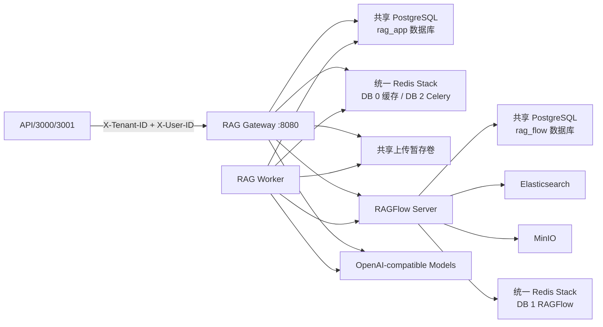
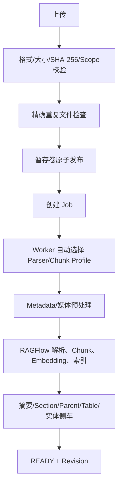
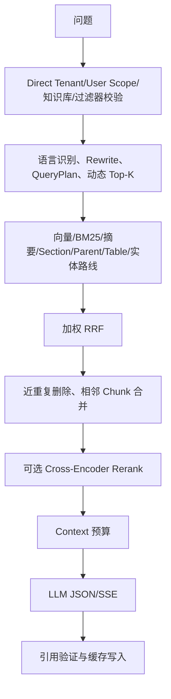

# LazyTT RAG 代码结构

更新时间：2026-08-19

本文描述当前代码，不描述未来 Identity 目标。当前运行时为 Direct Tenant/User 模式；没有
账号、密码、Session、JWT 签发或 JWT 验签。

## 1. 总体架构



核心边界：

- Gateway 提供稳定 API、Scope 隔离、检索编排、缓存、答案和引用；
- Worker 处理上传、媒体预处理、RAGFlow 解析轮询和侧车索引；
- RAGFlow 负责文件解析、原始 Chunk、向量/全文索引和底层召回；
- App PostgreSQL 保存业务事实、Profile、Job、版本、侧车索引、查询和引用；
- RAGFlow 源码不修改、不 Fork。

图中的两个 Redis Stack 节点是同一个物理容器的不同逻辑 DB，仅为展示调用职责而
分开绘制。DB 0、1、2 共享资源与故障域。

## 2. 根目录

```text
lazytt-rag-system/
├── AGENTS.md                 AI 协作规则
├── README.md                 项目入口
├── pyproject.toml            Python 依赖、工具和覆盖率配置
├── uv.lock                   锁定依赖
├── compose.local.yml        本地后端运行时
├── compose.dev.yml          ECS 后端运行时
├── src/rag_service/          后端源码
├── migrations/               rag_app/rag_flow 纯 SQL 迁移
├── tests/                    单元、集成和契约测试
├── tools/                    Bootstrap、Smoke、配置和安全工具
├── deploy/                   local/ecs 部署工具与共享 RAGFlow 模板
├── frontend/                 3000 全接口开发控制台
├── rag-development-spec/     OpenAPI、配置和设计规格
└── docs/                     用户、架构、验收和运维文档
```

本机私有文件如 `deploy/local/.env.ragflow`、`deploy/local/.env.full`、`.env.local`、数据库文件、
Node 依赖和 Smoke 输出均被 Git 忽略，不得提交。

## 3. 后端源码

### 3.1 `api/`

| 文件 | 职责 |
|---|---|
| `main.py` | ASGI 入口，创建应用 |
| `app.py` | 装配 Settings、Repository、Adapter、Direct Identity 依赖、异常处理和路由 |
| `offline_routes.py` | 知识库、文档、Job、Chunk、版本更新和回滚 API |
| `online_routes.py` | 检索、JSON/SSE 问答、请求、引用和反馈 API |
| `schemas.py` | Pydantic 请求/响应契约，禁止多余字段 |

业务接口从 Tenant/User 两个 Header 创建 `SecurityContext`。版本、能力和健康接口公开。

### 3.2 `security/`

| 文件 | 职责 |
|---|---|
| `direct_user.py` | 分别校验 1～128 字符 Tenant/User，拒绝空值/控制字符 |
| `context.py` | 将 Tenant、RAG Scope 用 SHA-256 派生固定 `security_scope_id` |

当前没有 `jwt_verifier.py`。未来接入 Identity 时应替换上下文来源，而不是删除 Scope 化
Repository 条件。

### 3.3 `domain/`

| 文件 | 职责 |
|---|---|
| `models.py` | 知识库、文档、Job、版本和在线结果等领域对象 |
| `state.py` | 文档/Job 状态机及合法迁移 |
| `ports.py` | Repository、RAGFlow、LLM、Embedding、Rerank、缓存和媒体端口 |
| `errors.py` | 稳定业务错误及 HTTP 映射基础 |
| `cache.py` | 缓存 Key、版本和命中边界 |

Domain 不依赖 FastAPI、SQLAlchemy 或具体模型供应商。

### 3.4 `application/`

| 文件 | 职责 |
|---|---|
| `offline.py` | 知识库/文档 CRUD、精确文件去重、Job 和安全版本更新编排 |
| `ingestion_worker.py` | Worker 上传、解析、进度同步、失败补偿及新版本原子切换 |
| `indexing.py` | Metadata、摘要、Section、动态 Parent、表格 Parent、实体关系侧车索引 |
| `online.py` | QueryPlan、多路线检索、RRF、去重、合并、Rerank、回答、引用和缓存 |
| `profiles.py` | 不可变 Profile 解析和校验 |
| `idempotency.py` | 写请求幂等执行器 |

### 3.5 `infrastructure/`

| 目录/文件 | 职责 |
|---|---|
| `postgres/models.py` | SQLAlchemy 表映射 |
| `postgres/repositories.py` | Scope 强制的业务 Repository |
| `postgres/query_store.py` | 查询、引用和反馈持久化 |
| `postgres/session.py` | Engine/Session 创建 |
| `ragflow/adapter.py` | RAGFlow v0.26.4 官方 HTTP API 适配 |
| `models/openai_compatible.py` | Chat/Embedding/Vision 通用 Adapter |
| `models/openai_compatible_rerank.py` | `/rerank` 协议 Adapter |
| `cache/redis_cache.py` | 精确缓存、1024/实际维度语义缓存和边界复验 |
| `media/openai_compatible.py` | ASR/视觉媒体预处理调用 |
| `staging/filesystem.py` | 上传临时文件原子交接 |
| `health.py` | Ready 依赖探测 |

### 3.6 `bootstrap/` 与 `workers/`

- `bootstrap/profiles.py`：幂等导入不可变 Profile；
- `bootstrap/cache_index.py`：创建/验证语义缓存索引；
- `bootstrap/runtime.py`：启动前模型、RAGFlow、API Key 和配置检查；
- `workers/celery_app.py`：Celery/Beat 配置；
- `workers/runner.py`：执行异步任务和恢复扫描；
- `cli.py`：命令行 Bootstrap 入口。

## 4. 数据库迁移

| Migration | 作用 |
|---|---|
| `0001` | 核心知识库、文档、Job、Profile、查询、引用、缓存相关表 |
| `0002` | 删除后允许复用文档 External ID |
| `0003` | 层级/摘要侧车索引 |
| `0004` | 轻量实体关系索引 |
| `0005` | 允许 Section 节点 |
| `0006` | 文档版本更新、退役、活动切换和回滚 |

数据库不保存账号、密码或 Session。旧 JWT Scope 数据不会自动迁移到 Direct User
Scope；现有卷虽被保留，但默认不可达。

## 5. 配置

`settings.py` 从 `configs/application.yaml` 和环境变量生成不可变强类型 Settings。
主要段：App、Identity、Database、Redis、RAGFlow、Upload、Jobs、LLM、Embedding、
Vision、Media、Rerank、Cache、Retrieval、Answers、Observability。

OpenAI-compatible 能力只需 Base URL、API Key 和模型名；敏感值不进入 YAML 和 Git。

## 6. 部署结构

### 6.1 独立存储栈

`deploy/local/docker-compose.storage.yml` 包含：

- 共享 PostgreSQL：物理实例内含 `rag_app` 与 `rag_flow` 两个逻辑数据库和独立账号；
- 统一 Redis Stack：DB 0 缓存、DB 1 RAGFlow、DB 2 Celery；
- Elasticsearch；
- MinIO。

它拥有 4 个显式命名卷，不发布宿主机端口。两个 PostgreSQL 业务账号均为非管理员，
且不能连接对方数据库；管理员账号只用于新数据卷首次初始化和恢复验证。

### 6.2 运行时栈

`compose.local.yml` 包含：

- RAGFlow Server 和 Task Executor；
- DBA 预安装后的只读 Schema Check、Bootstrap；
- Gateway、Worker、Scheduler；
- 独立 smoke profile Fixture。

两个 Compose 分别使用 `lazytt-rag-storage` 和 `lazytt-rag-runtime` Project，
Docker Desktop 会显示为两个独立项目。它们连接同一个由启动脚本幂等创建的外部共享
网络；`RAG_STORAGE_MODE=external` 时运行时改用环境变量中的外部地址，本地存储栈
不会启动。

### 6.3 脚本

| 脚本 | 作用 |
|---|---|
| `start-full.sh` | local 模式先存储后运行时；external 模式只运行时 |
| `stop-full.sh` | 只停止运行时 |
| `start-storage.sh` | 单独启动本地存储 |
| `stop-storage.sh` | 单独停止本地存储，不删除卷 |
| `preflight-full.sh` | 校验两个 Compose、平台、端口、配置和卷 |
| `bootstrap-ragflow-cloud-models.sh` | 探测并注册 RAGFlow 模型 |

## 7. 两套前端

### 7.1 3000 开发控制台

后端仓库 `frontend/`。它覆盖全部公开 API，允许编辑 Tenant/User 并检查完整响应。
切换任一 ID 会清空最近资源 UUID。

### 7.2 3001 普通用户端

独立 `lazytt-frontend-console` 仓库。它通过环境变量固定 `DIRECT_USER_ID`，BFF 注入
Header；提供文件、版本更新、流式问答、Markdown、缓存/Rerank提示和引用侧栏。
对话存在前端 D1/SQLite，不在 Gateway 用户表中。

## 8. 文件进入系统



最终原文 Chunk 和向量在 RAGFlow/Elasticsearch；侧车导航结构在 App PostgreSQL。

## 9. 问题进入系统



Document IDs 和 Metadata Filter 是强约束；不满足时返回空候选，不扩大检索范围。

## 10. 修改定位

| 需求 | 首先查看 |
|---|---|
| Tenant/User/Scope | `security/`、`api/app.py`、Repository 测试 |
| 新接口 | `api/*routes.py`、`schemas.py`、OpenAPI |
| 上传/版本 | `application/offline.py`、`ingestion_worker.py` |
| 检索/问答 | `application/online.py` |
| 数据表 | `postgres/models.py`、migrations 版本 SQL |
| RAGFlow 协议 | `infrastructure/ragflow/adapter.py` |
| 模型供应商 | 通常只改私有环境；协议差异才改通用 Adapter |
| 本地/外部数据库 | `.env.ragflow` 和 Compose，不改业务代码 |
| 3000 | `frontend/` |
| 3001 | 独立前端仓库 |

## 11. 验证命令

```bash
.venv/bin/ruff check src migrations tests tools rag-development-spec/tools
.venv/bin/python -m mypy src
.venv/bin/python -m pytest -q
.venv/bin/python rag-development-spec/tools/validate_spec.py
.venv/bin/python tools/check_tracked_secrets.py

cd frontend
npm test
npm run build
```

禁止修改 `ragflow-main`，禁止把私有环境、密钥或数据卷提交 Git，禁止常规操作使用
`docker compose down -v`。
