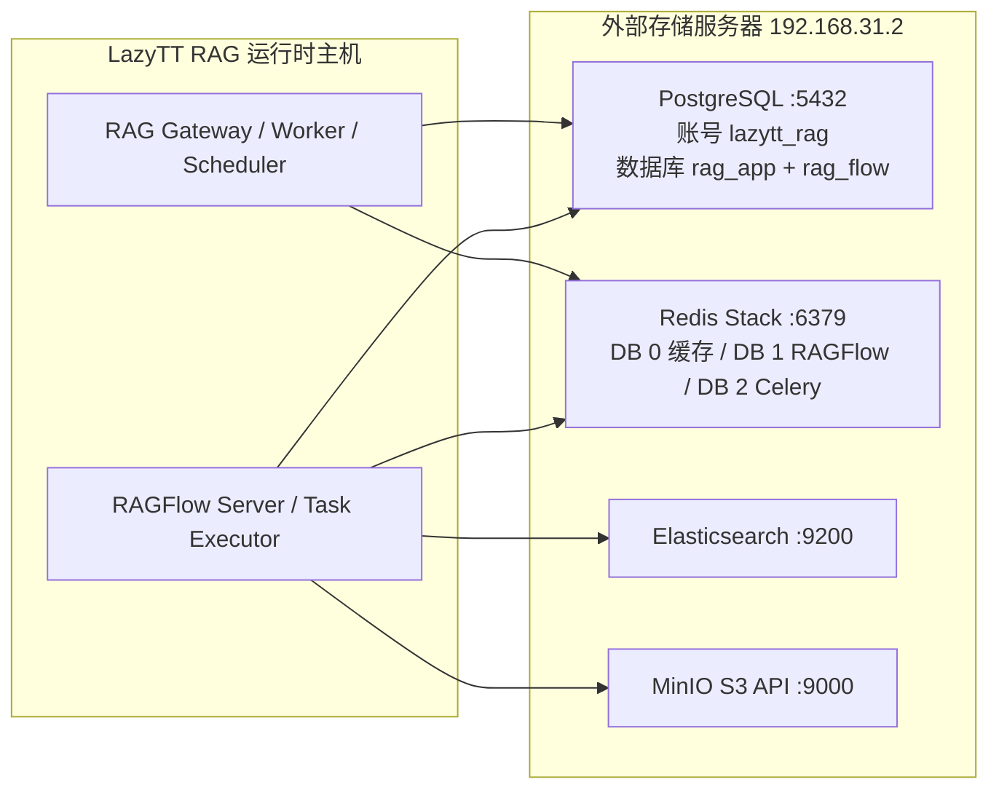

# LazyTT RAG 全部存储迁移到外部服务器操作手册

> 历史参考：本文保留改造前的流程与审计说明。2026-09-07 起，部署与 SQL 执行以[当前 ECS 操作入口](../deploy/ecs/README.md)为准；本文旧 `migrations/releases`、Alembic 或一体化安装命令不再执行。旧文件可在 Git 检查点 `335d418` 查阅。

## 1. 文档目标

本文说明如何把 LazyTT RAG 使用的全部有状态存储部署到新的局域网服务器，并让
RAGFlow 与自研 RAG Gateway 改用这些外部服务。

本文中的“迁移”采用当前已经确认的定义：

- 在新服务器创建空的数据库、账号、对象存储和缓存服务；
- 创建当前版本所需的表、索引与运行结构；
- 修改 LazyTT RAG 的连接配置并完成联调；
- **不复制旧业务数据**。

因此，本文不会执行以下操作：

- 不执行 `pg_dump` / `pg_restore`；
- 不导入旧 Elasticsearch 索引；
- 不复制旧 MinIO 对象；
- 不导入旧 Redis Stack 的 RDB 或 AOF；
- 不复制 Docker Volume；
- 不执行 `docker compose down -v`。

执行完成后，新环境是一个全新的空 RAG 系统。旧本地 Docker Volume 只要没有被
删除，仍可用于回退，但不会自动出现在新环境中。

## 2. 迁移范围和最终拓扑

系统当前使用四个物理存储服务。PostgreSQL 和 Redis Stack 都是一个物理服务，但由
应用和 RAGFlow 连接不同的逻辑数据库。业务运行时与本地存储还分别属于
`lazytt-rag-runtime`、`lazytt-rag-storage` 两个 Compose Project，通过项目外部创建的
共享 Docker Network 通信：

| 存储 | 使用方 | 主要用途 | 外部部署要求 |
|---|---|---|---|
| PostgreSQL `rag_app` | 自研 Gateway、Worker、Scheduler | 知识库映射、文档、版本、Job、Profile、请求、引用、侧车索引 | 与 `rag_flow` 共用一个 PostgreSQL 实例 |
| PostgreSQL `rag_flow` | RAGFlow Server、Task Executor | RAGFlow 账号、Dataset、文档任务、模型配置等控制面数据 | 与 `rag_app` 分库，不分实例 |
| Redis Stack DB 0 | Gateway | 精确缓存、语义缓存、FLOAT32 向量索引 | 必须支持 RediSearch/向量索引 |
| Redis Stack DB 1 | RAGFlow | RAGFlow 内部队列、任务状态和协调数据 | 与 DB 0/2 使用同一个物理实例 |
| Redis Stack DB 2 | Celery Worker、Scheduler、Gateway | 摄取/维护队列、未确认消息和短期运行协调 | 与 DB 0/1 使用同一个物理实例；Result Backend 关闭 |
| Elasticsearch | RAGFlow | Chunk 正文、向量、全文索引及检索 | 建议与当前固定版本 `8.11.3` 对齐 |
| MinIO | RAGFlow | 上传原文件和解析过程产生的对象 | 提供 S3-compatible API |

PostgreSQL 的物理合并与账号合并不是同一个概念：

- 当前本地默认配置使用 `rag_app`、`rag_flow` 两个运行账号，连接同一 PostgreSQL
  实例中的两个数据库；
- 本文给出的外部服务器方案允许 DBA 使用一个非管理员业务账号 `lazytt_rag` 访问
  两个数据库；
- 无论使用一个还是两个运行账号，`rag_app` 和 `rag_flow` 都必须保持为两个数据库，
  不能把表混入同一数据库。

> Redis Stack 的 DB 0、1、2 只隔离 Key 名，不隔离内存、性能、权限或故障。外部
> 部署仍必须为本项目提供独立 Redis Stack 实例，不能把逻辑 DB 当成跨业务安全隔离。

建议的局域网示例拓扑如下。端口仅为示例，实际以数据库管理员分配值为准：



## 3. 执行前必须准备的信息

先由数据库/基础设施管理员确认下表，不要边部署边猜地址：

| 项目 | 示例 | 实际值 |
|---|---|---|
| 外部存储服务器 | `192.168.31.2` | 待填写 |
| PostgreSQL 端口 | `5432` | 待填写 |
| PostgreSQL 业务账号 | `lazytt_rag` | 待填写 |
| PostgreSQL 业务密码 | `<REDACTED>` | 待填写到私有环境文件 |
| Redis Stack 端口 | `6379` | 待填写 |
| Redis Stack 密码 | `<REDACTED>` | 待填写到私有环境文件 |
| Elasticsearch 地址/端口 | `http://192.168.31.2:9200` | 待填写 |
| Elasticsearch 用户 | `elastic` | 待填写 |
| Elasticsearch 密码 | `<REDACTED>` | 待填写到私有环境文件 |
| MinIO S3 API 端口 | `9000` | 待填写 |
| MinIO Access Key | `lazytt_rag` | 待填写 |
| MinIO Secret Key | `<REDACTED>` | 待填写到私有环境文件 |

同时确认：

1. RAG 运行主机可以访问这些地址和端口；
2. 防火墙只允许受信局域网主机访问，不向公网开放；
3. PostgreSQL 建议与当前本地基线 PostgreSQL 18 兼容；
4. Elasticsearch 建议使用当前固定版本 `8.11.3`，跨大版本不能只改地址；
5. Redis Stack 必须包含 RediSearch 模块并支持 `FT.CREATE`、`FT.INFO`；
6. 外部服务器时间和 RAG 主机时间均已同步；
7. 生产环境应另行规划 TLS、证书、备份和监控。本文先完成局域网空环境联调。

## 4. 安全断点与配置备份

### 4.1 停止运行时

在 RAG 项目根目录执行：

```bash
cd /Users/wx/Lazyai_Project/Lazyai_RAG_Project/lazytt-rag-system
./deploy/local/stop-full.sh
```

该命令只停止运行时，不删除本地存储和数据卷。

### 4.2 备份本机私有配置

只备份配置，不备份旧业务数据：

```bash
cp deploy/local/.env.ragflow deploy/local/.env.ragflow.before-external
chmod 600 deploy/local/.env.ragflow.before-external
```

`.env.*` 已被 Git 忽略，但该文件仍包含密钥，不能发到聊天、邮件或 Git。

### 4.3 不需要停止外部服务器上的其他业务

本项目必须使用自己的逻辑数据库、账号或端口，不能清理外部服务器上其他项目的
数据。后续所有初始化命令只能以 `rag_app`、`rag_flow` 和本项目分配的 Redis、
Elasticsearch、MinIO 命名空间为目标。

## 5. 初始化 PostgreSQL

### 5.1 最终权限模型

外部 PostgreSQL 采用：

```text
一个 PostgreSQL 实例
└── 一个运行期业务账号 lazytt_rag
    ├── 数据库 rag_app
    └── 数据库 rag_flow
```

数据库管理员账号只在本节创建账号和数据库时使用。Gateway 与 RAGFlow 运行时都不
保存管理员账号，也不使用管理员账号连接。

### 5.2 由数据库管理员创建账号和两个数据库

以下 SQL 只在全新目标环境执行一次。请在安全终端中替换占位符，不要把真实密码写入
仓库：

```sql
CREATE ROLE lazytt_rag LOGIN PASSWORD '<REDACTED>';

CREATE DATABASE rag_app
  WITH OWNER = lazytt_rag
       ENCODING = 'UTF8'
       TEMPLATE = template0;

CREATE DATABASE rag_flow
  WITH OWNER = lazytt_rag
       ENCODING = 'UTF8'
       TEMPLATE = template0;

REVOKE CONNECT ON DATABASE rag_app FROM PUBLIC;
REVOKE CONNECT ON DATABASE rag_flow FROM PUBLIC;
GRANT CONNECT, TEMPORARY ON DATABASE rag_app TO lazytt_rag;
GRANT CONNECT, TEMPORARY ON DATABASE rag_flow TO lazytt_rag;
```

如果 `lazytt_rag` 或数据库已经存在，不能直接重复执行 `CREATE`。应先确认它们确实
属于本项目，再由管理员修正 owner/权限；不要为了省事删除同名对象。

### 5.3 验证同一业务账号可以访问两个数据库

```bash
PGPASSWORD='<REDACTED>' psql \
  -h 192.168.31.2 -p 5432 -U lazytt_rag -d rag_app \
  -Atqc 'SELECT current_user, current_database();'

PGPASSWORD='<REDACTED>' psql \
  -h 192.168.31.2 -p 5432 -U lazytt_rag -d rag_flow \
  -Atqc 'SELECT current_user, current_database();'
```

两条命令应分别返回：

```text
lazytt_rag|rag_app
lazytt_rag|rag_flow
```

### 5.4 表由谁创建

- `rag_app`：由项目 Alembic 迁移 `0001` 到 `0006` 创建；
- `rag_flow`：由固定版本 RAGFlow `v0.26.4` 的官方初始化逻辑创建；
- **不要**对 `rag_flow` 执行项目 Alembic；
- **不要**把 `schema.sql` 当成日常升级工具直接导入；Alembic 才是 `rag_app` 的版本
  真相来源。

详细表结构与六个版本的演进过程见：

- [`POSTGRESQL_SCHEMA_EVOLUTION.md`](./POSTGRESQL_SCHEMA_EVOLUTION.md)
- [`POSTGRESQL_SCHEMA_AND_DATA_MIGRATION.md`](./POSTGRESQL_SCHEMA_AND_DATA_MIGRATION.md)

## 6. 初始化统一 Redis Stack

外部服务器只部署一个本项目专用 Redis Stack。它同时提供普通 Redis 命令和
RediSearch/Vector Search：

```text
地址：192.168.31.2
端口：6379（示例）
认证：独立强密码
持久化：AOF everysec
淘汰策略：noeviction
模块：RediSearch 必须可用
逻辑 DB：0=缓存、1=RAGFlow、2=Celery
```

先验证服务、模块和三个逻辑 DB：

```bash
redis-cli -h 192.168.31.2 -p 6379 -a '<REDACTED>' --no-auth-warning PING
redis-cli -h 192.168.31.2 -p 6379 -a '<REDACTED>' --no-auth-warning MODULE LIST
redis-cli -h 192.168.31.2 -p 6379 -a '<REDACTED>' --no-auth-warning -n 1 PING
redis-cli -h 192.168.31.2 -p 6379 -a '<REDACTED>' --no-auth-warning -n 2 PING
```

`PING` 都应返回 `PONG`，模块清单应包含 Search/RediSearch。空服务一开始没有语义
缓存索引是正常的；`rag-app-bootstrap` 会在 DB 0 创建并校验当前版本索引，不需要
手工执行 `FT.CREATE`。RAGFlow 和 Celery 会分别在 DB 1、DB 2 创建运行 Key。

启动完成后，可在 DB 0 验证语义缓存索引：

```bash
redis-cli -h 192.168.31.2 -p 6379 -a '<REDACTED>' \
  --no-auth-warning -n 0 FT.INFO rag_semantic_cache_v2
```

这是空初始化，不导入旧 AOF/RDB。三个 DB 共享内存和故障域，容量、告警和拆分条件见
[`REDIS_UNIFICATION_AND_NEXT_STEPS.md`](./REDIS_UNIFICATION_AND_NEXT_STEPS.md)。

### 6.1 当前三个逻辑 DB 的准确职责

| DB | 使用方 | 当前职责 | 不负责什么 |
|---:|---|---|---|
| 0 | Gateway | 精确缓存、语义缓存、RediSearch 向量索引 | 不保存摄取 Job 的事实状态 |
| 1 | RAGFlow | RAGFlow 队列、任务状态和内部协调 | 不保存 Gateway 语义缓存 |
| 2 | Celery | `rag-ingestion`、`rag-maintenance` 两条 Broker 队列及未确认消息 | 不作为 Celery Result Backend |

当前 Celery 已关闭 Result Backend，业务 Job 的状态、重试次数、租约和错误信息以
PostgreSQL `rag_app.ingestion_job` 为事实来源。DB 2 只负责消息投递；不能用 Redis
中是否存在结果 Key 判断任务是否完成。

当前 Broker 保护参数包括：

- `visibility_timeout=14400` 秒；
- Worker `prefetch=1`，避免单 Worker 预取大量解析任务；
- 摄取扫描每 5 秒执行一次，调度消息 15 秒后过期；
- 清理任务每 900 秒执行一次，调度消息 840 秒后过期；
- Broker Key 使用 `rag:celery:` 前缀；
- 连接、读写超时和运行时重连均已开启。

这些策略减少重复积压和断连后的长时间悬挂，但不能提供物理资源隔离。外部 Redis
Stack 仍应为本项目独占，并使用 `noeviction`，避免静默淘汰队列或 RAGFlow 状态。

### 6.2 启动后的运行报告

在项目根目录执行：

```bash
./deploy/local/redis-runtime-report.sh
```

脚本只输出非敏感运行指标，包括 DB 大小、两条 Celery 队列长度、语义索引状态和
Redis 内存概要，不会打印密码。

## 7. 初始化 Elasticsearch

### 7.1 服务要求

建议使用单独集群或专门节点，版本与当前项目固定的 `8.11.3` 对齐：

```text
Scheme：http（局域网联调）或 https（生产）
地址：192.168.31.2
端口：9200
用户：elastic（当前 Compose 默认）
认证：独立强密码
```

不要把现有其他业务索引删除后“腾给”RAGFlow。当前空初始化只需要一个健康、可写的
目标集群，RAGFlow 会创建自己的索引。

### 7.2 验证集群

```bash
curl -fsS -u 'elastic:<REDACTED>' \
  'http://192.168.31.2:9200/_cluster/health?pretty'
```

预期 HTTP 200，`status` 为 `green` 或可解释的单节点 `yellow`，且不能为 `red`。

可再验证写权限。下面的测试索引只能使用明确的临时名称，测试后删除：

```bash
curl -fsS -u 'elastic:<REDACTED>' -X PUT \
  'http://192.168.31.2:9200/lazytt-rag-connectivity-check'
curl -fsS -u 'elastic:<REDACTED>' -X DELETE \
  'http://192.168.31.2:9200/lazytt-rag-connectivity-check'
```

## 8. 初始化 MinIO

### 8.1 服务要求

RAGFlow 使用 MinIO 的 S3 API 保存原文件和解析对象：

```text
地址：192.168.31.2
S3 API 端口：9000
Console 端口：可选，运行时不依赖
Access Key：项目专用账号
Secret Key：独立强密码
```

当前 RAGFlow 模板允许 Bucket 留空，由 RAGFlow 负责创建/选择运行所需对象空间。共享
MinIO 时，运维侧应为本项目分配独立账号、策略和 Bucket 命名空间，不能授予清理其他
项目 Bucket 的权限。

### 8.2 验证

```bash
curl -fsS http://192.168.31.2:9000/minio/health/live
```

如果安装了 MinIO Client，可进一步验证鉴权：

```bash
mc alias set lazytt-rag http://192.168.31.2:9000 \
  '<ACCESS_KEY>' '<SECRET_KEY>'
mc admin info lazytt-rag
```

本文不复制旧 MinIO 对象；新系统上传第一个测试文档后才会出现新的业务对象。

## 9. 修改 LazyTT RAG 私有连接配置

### 9.1 只修改源配置文件

编辑：

```text
deploy/local/.env.ragflow
```

不要手工修改 `deploy/local/.env.full`。它是 `start-full.sh` 每次根据
`deploy/local/.env.ragflow` 重新生成的运行环境。

### 9.2 外部存储配置示例

下例采用一个 PostgreSQL 业务账号 `lazytt_rag`、两个 PostgreSQL 逻辑数据库，以及
一个 Redis Stack 的三个逻辑 DB。所有密码都是占位符：

```dotenv
# 切换到外部存储；启动脚本将不再启动本机 storage Compose。
RAG_STORAGE_MODE=external

# 自研应用 PostgreSQL。密码必须做 URL 编码后写入 DSN。
APP_DATABASE_DSN=postgresql+psycopg://lazytt_rag:<URL_ENCODED_PASSWORD>@192.168.31.2:5432/rag_app

# 统一 Redis Stack。运行环境会派生 DB 0 缓存、DB 1 RAGFlow、DB 2 Celery。
REDIS_STACK_HOST=192.168.31.2
REDIS_STACK_PORT=6379
REDIS_STACK_PASSWORD=<REDACTED>
REDIS_STACK_MAXMEMORY=1gb

# RAGFlow PostgreSQL：与上面同一账号，但连接另一个数据库。
RAGFLOW_POSTGRES_HOST=192.168.31.2
RAGFLOW_POSTGRES_PORT=5432
RAGFLOW_POSTGRES_DATABASE=rag_flow
RAGFLOW_POSTGRES_USER=lazytt_rag
RAGFLOW_POSTGRES_PASSWORD=<REDACTED>

# RAGFlow Elasticsearch。
RAGFLOW_ES_SCHEME=http
RAGFLOW_ES_HOST=192.168.31.2
RAGFLOW_ES_PORT=9200
ELASTIC_PASSWORD=<REDACTED>

# RAGFlow MinIO。
RAGFLOW_MINIO_HOST=192.168.31.2
RAGFLOW_MINIO_PORT=9000
MINIO_USER=<ACCESS_KEY>
MINIO_PASSWORD=<SECRET_KEY>

```

`APP_DATABASE_DSN` 中的密码属于 URL 部分。若密码含 `@`、`:`、`/`、`#`、`%` 等
字符，必须先做 percent-encoding；`REDIS_STACK_PASSWORD` 等独立密码字段填写原始
密码，环境生成器会在派生 Redis URL 时完成编码。

URL 编码后的密码仍然是秘密。应使用受信的本地密码管理工具完成编码，并直接写入
权限为 `0600` 的私有配置；不要把编码结果打印到共享终端或聊天记录。

### 9.3 清理旧 RAGFlow API Key 引用

新 `rag_flow` 数据库没有旧账号和旧 API Key。把私有配置中的以下字段留空：

```dotenv
RAGFLOW_API_KEY=
```

保留已设置的 `RAGFLOW_ADMIN_EMAIL` 和本机私有管理员密码。`start-full.sh` 会通过
RAGFlow 官方账号 API 在新数据库中注册/登录，并把新 API Key 写回私有配置。不要
直接操作 `rag_flow` 数据表伪造 Token。

## 10. 先做网络连通性检查

在 RAG 运行主机执行：

```bash
nc -vz 192.168.31.2 5432
nc -vz 192.168.31.2 6379
nc -vz 192.168.31.2 9200
nc -vz 192.168.31.2 9000
```

端口连通只证明 TCP 可达，不证明账号、权限、协议和模块正确。还必须执行第 5 至 8
节的协议级验证。

如果宿主机可访问而容器不可访问，应检查：

- Docker Desktop 到局域网的路由；
- 数据库服务器是否只允许了宿主机某个源地址；
- DNS/IP 是否能从容器网络解析和访问；
- 防火墙是否错误地只允许本机回环地址。

## 11. 启动顺序和 DBA 预安装

确认 PostgreSQL、Redis Stack、Elasticsearch、MinIO 四个物理存储服务全部健康，且
DBA 已执行 `migrations/releases/V1.0.0__fresh_install.sql` 后，在项目
根目录执行：

```bash
./deploy/local/start-full.sh
```

外部模式下预期看到：

```text
external storage mode selected; local storage containers were not started
```

启动链路为：

1. 读取 `deploy/local/.env.ragflow`；
2. 生成 Git 忽略的 `deploy/local/.env.full`；
3. 对 `lazytt-rag-runtime` 做静态检查；external 模式不渲染、不校验本地 storage
   Compose，也不要求本地存储镜像变量；
4. 因 `RAG_STORAGE_MODE=external` 跳过本地存储容器；
5. `rag-app-schema-check` 以只读事务验证 `rag_app` 与 `rag_flow` 完整结构；
6. Schema 校验成功后，启动固定版本 RAGFlow Server 与 Task Executor；RAGFlow
   只会对 DBA 已安装的结构执行官方幂等兼容性检查；
7. 等待 RAGFlow 健康检查通过；
8. 创建/验证新 RAGFlow 管理账号和 API Key；
9. 注册并验证模型 Provider；
10. `rag-app-bootstrap` 创建 Profile 和语义缓存索引；
11. 启动 Gateway、Worker、Scheduler。

单一业务账号 `lazytt_rag` 持有 `rag_app`、`rag_flow` 两个数据库及目标 Schema/对象，
并在两个目标 Schema 中保留 CREATE；这满足 RAGFlow 兼容性 ALTER 与任务入队防御性
建表。缺表、版本不一致、对象所有权或 CREATE 权限不符合时启动必须失败，不要授予
超级用户来绕过门禁。

## 12. 验证 PostgreSQL 初始化结果

### 12.1 验证 `rag_app`

```bash
PGPASSWORD='<REDACTED>' psql \
  -h 192.168.31.2 -p 5432 -U lazytt_rag -d rag_app \
  -c 'SELECT version_num FROM rag_app.alembic_version;'
```

当前代码的期望版本为：

```text
0006_document_version_updates
```

查看表：

```bash
PGPASSWORD='<REDACTED>' psql \
  -h 192.168.31.2 -p 5432 -U lazytt_rag -d rag_app \
  -c '\dt'
```

### 12.2 验证 `rag_flow`

```bash
PGPASSWORD='<REDACTED>' psql \
  -h 192.168.31.2 -p 5432 -U lazytt_rag -d rag_flow \
  -c '\dt'
```

应看到 DBA 安装脚本预先创建的 42 张 RAGFlow v0.26.4 业务表，而不是空数据库。
RAGFlow 首次启动只初始化必要的业务数据并执行官方幂等兼容性检查，不负责替代 DBA
建表；不要用 `rag_app` 的表清单判断 `rag_flow`。

### 12.3 验证只读 Schema 门禁

```bash
docker compose --env-file deploy/local/.env.full \
  -f compose.local.yml ps -a rag-app-schema-check rag-app-bootstrap
```

两个一次性容器都应以成功状态结束。若失败，查看：

```bash
docker compose --env-file deploy/local/.env.full \
  -f compose.local.yml logs --no-log-prefix \
  rag-app-schema-check rag-app-bootstrap
```

日志中不得复制、粘贴或对外发送完整 DSN、密码或 API Key。

## 13. 验证所有存储确实走外部服务器

### 13.1 本地 storage Compose 不应启动

```bash
docker compose --env-file deploy/local/.env.full \
  -f deploy/local/docker-compose.storage.yml ps
```

外部模式不应因本次启动新增本地数据库容器。已有旧容器可能仍存在；判断实际连接要以
`deploy/local/.env.full` 中的目标地址和运行时健康检查为准，不能只看 Docker Desktop。

### 13.2 查看非敏感目标地址

不要输出含密码的 DSN。只查看不敏感主机字段：

```bash
awk -F= '/^RAG_STORAGE_MODE=|^RAGFLOW_POSTGRES_HOST=|^RAGFLOW_ES_HOST=|^RAGFLOW_MINIO_HOST=|^REDIS_STACK_HOST=/ {print}' deploy/local/.env.full
```

`APP_DATABASE_DSN`、`APP_REDIS_URL`、`CACHE_REDIS_URL` 含密码，不要用 `cat` 或
`grep` 把它们打印到共享终端；`APP_REDIS_URL` 和 `CACHE_REDIS_URL` 由启动脚本生成，
不需要手填。

### 13.3 Gateway 健康检查

```bash
curl -fsS http://127.0.0.1:8080/health/live
curl -fsS http://127.0.0.1:8080/health/ready
```

`live` 应成功；`ready` 应确认数据库、Redis、RAGFlow、模型和缓存索引已就绪。如果
缓存服务降级，系统可能还能存活，但不能把迁移验收判为全部通过。

## 14. 最小端到端验收

所有测试只使用非业务 Fixture：

1. 使用新的测试 `X-Tenant-ID` 和 `X-User-ID` 创建知识库；
2. 上传 `tests/fixtures/ragflow-smoke.txt`；
3. 等待上传和解析 Job 成功；
4. 验证文档 `READY`、Chunk 数量大于 0；
5. 执行混合检索，确认返回候选；
6. 执行普通回答和 SSE 流式回答；
7. 重复同一问题，验证精确缓存；
8. 使用近义问题验证语义缓存或记录阈值未命中；
9. 删除测试文档和知识库；
10. 确认新 Elasticsearch、MinIO、PostgreSQL、Redis Stack 出现且只出现本项目的
    新数据。

可结合项目现有脚本：

```bash
./deploy/local/run-gateway-model-smoke.sh
./deploy/local/run-ragflow-smoke.sh --parse-timeout 600
```

执行删除前要确认目标是本次非业务 Fixture；不要清理其他项目的数据。

## 15. 常见故障与处理

### 15.1 `connection refused` / timeout

含义：地址、端口、防火墙或服务监听范围错误。

处理：

1. 用 `nc -vz` 验证端口；
2. 在存储服务器本机验证服务；
3. 检查服务是否只监听 `127.0.0.1`；
4. 检查防火墙和 Docker Desktop 路由；
5. 不要通过关闭全部防火墙长期绕过问题。

### 15.2 PostgreSQL `password authentication failed`

含义：业务密码、DSN URL 编码、`pg_hba.conf` 或账号权限错误。

处理：用同一 `lazytt_rag` 分别直接登录 `rag_app` 和 `rag_flow`；两者都成功后再启动
系统。

### 15.3 `rag-app-schema-check` 失败

常见原因：DBA 尚未安装完整结构、`rag_app.alembic_version` 不是当前 Head、连接到了
错误数据库，或 `rag_app`、`rag_flow` 任一目标 Schema 缺少 CREATE 权限或对象所有权。
它是只读检查器，不会自动修复；旧双角色安装应由 DBA 在维护窗口审计并执行
`docs/database-deployment-package/lazytt_rag_single_role_migration.sql`，不能授予超级用户
或让自研应用自动跑 Alembic。全新空实例则应执行
`migrations/releases/V1.0.0__fresh_install.sql`。

### 15.4 RAGFlow 启动但账号/API Key 失败

新 `rag_flow` 不认识旧 Key。确认 `RAGFLOW_API_KEY=` 已留空、注册入口仅在受控本地
管理界面启用，并让 `start-full.sh` 通过官方 API 创建新 Key。

### 15.5 Redis Stack `unknown command FT.CREATE/FT.INFO`

连接到了普通 Redis，而不是 Redis Stack/RediSearch。更换目标服务，不要关闭语义缓存
索引预检来掩盖错误。

### 15.6 Elasticsearch 401/403

确认 `ELASTIC_PASSWORD` 对应的账号确实是当前配置使用的 `elastic`，且具备创建和读写
RAGFlow 索引的权限。当前环境如果改用非 `elastic` 用户，还需同步确认配置模板支持，
不能只改密码。

### 15.7 MinIO 健康但上传失败

健康接口不校验项目凭据。使用 `mc` 验证 Access Key/Secret Key 的登录、Bucket 创建和
对象读写权限。

## 16. 回退到本地存储

如果外部存储联调失败且需要恢复原本地环境：

```bash
./deploy/local/stop-full.sh
cp deploy/local/.env.ragflow.before-external deploy/local/.env.ragflow
chmod 600 deploy/local/.env.ragflow
./deploy/local/start-full.sh
```

回退成立的前提是：

- 没有执行 `docker compose down -v`；
- 没有删除本地命名卷；
- 备份的 `.env.ragflow.before-external` 与本地卷中的账号、密码、API Key 匹配。

外部环境中新增的数据不会自动回到本地；本地旧数据也不会自动进入外部环境。

## 17. 完成判定清单

只有下面全部通过，才能宣告外部存储迁移完成：

- [ ] 外部 PostgreSQL 有 `rag_app` 和 `rag_flow` 两个数据库；
- [ ] 运行时只使用业务账号 `lazytt_rag`，不保存管理员账号；
- [ ] `rag_app.alembic_version` 为 `0006_document_version_updates`；
- [ ] `rag_flow` 已由 RAGFlow v0.26.4 正常初始化；
- [ ] 统一 Redis Stack 的 DB 0、1、2 `PING` 成功；
- [ ] Redis Stack 具备 RediSearch，DB 0 语义缓存索引已创建；
- [ ] DB 2 只承担 Celery Broker，Celery Result Backend 保持关闭；
- [ ] `rag-ingestion`、`rag-maintenance` 两条队列及 `rag:celery:` 前缀符合运行配置；
- [ ] `rag_app.ingestion_job` 可作为异步 Job 状态的事实来源；
- [ ] Elasticsearch 健康、鉴权和写权限正常；
- [ ] MinIO 健康、鉴权和对象读写权限正常；
- [ ] `RAG_STORAGE_MODE=external`；
- [ ] `start-full.sh` 明确跳过本地 storage Compose；
- [ ] `/health/live` 和 `/health/ready` 通过；
- [ ] Dataset/文档/解析/检索/回答/删除 Smoke 通过；
- [ ] 容器重启后仍可访问全部外部存储；
- [ ] 没有真实密码、API Key、Token 或完整 DSN 进入 Git 和日志；
- [ ] 没有删除本地 Volume，回退路径仍然可用。

## 18. 与“保留旧数据迁移”的边界

本文只适用于空环境初始化。未来如果要保留旧数据，不能直接复用本文步骤并补几个
复制命令，因为 PostgreSQL、Elasticsearch、MinIO、Redis Stack 之间存在跨存储引用
和切换时点一致性要求。那将是另一套需要停写窗口、版本检查、全量导出、联合恢复、
一致性校验和回滚演练的数据迁移方案。

## 19. 不在本次外部存储范围内的本地 Volume

运行时 Compose 还保留两个本地命名卷：

- `upload_staging_data`：Worker 处理上传文件时的短期暂存区；
- `ragflow_logs`：RAGFlow 运行日志。

它们不属于 PostgreSQL、Redis Stack、Elasticsearch 或 MinIO，也没有在本次空环境
迁移中改成外部数据库。重建 runtime 容器会复用这些卷；正常任务完成后暂存文件会按
清理策略处理。若后续要实现多主机 Worker 或集中日志，需要分别设计共享文件存储和
日志采集方案，不能把这两个卷误当成数据库连接地址处理。

外部模式下，`deploy/local/.env.ragflow` 可以删除 `POSTGRES_IMAGE`、
`REDIS_STACK_IMAGE`、`ELASTICSEARCH_IMAGE`、`MINIO_IMAGE`。环境生成器不会把它们
写入 `.env.full`，静态前检也不会渲染本地 storage Compose。回退到 local 模式时，
重新使用原本地私有配置即可恢复这些固定镜像。

如果真实外部服务器尚未准备好，可以先使用
[`LOCAL_EXTERNAL_STORAGE_REHEARSAL.md`](LOCAL_EXTERNAL_STORAGE_REHEARSAL.md) 中的
独立空环境模拟 PostgreSQL、Redis Stack、Elasticsearch 和 MinIO。模拟环境的镜像只
属于模拟服务器 Compose，不属于 RAG 运行时配置。
