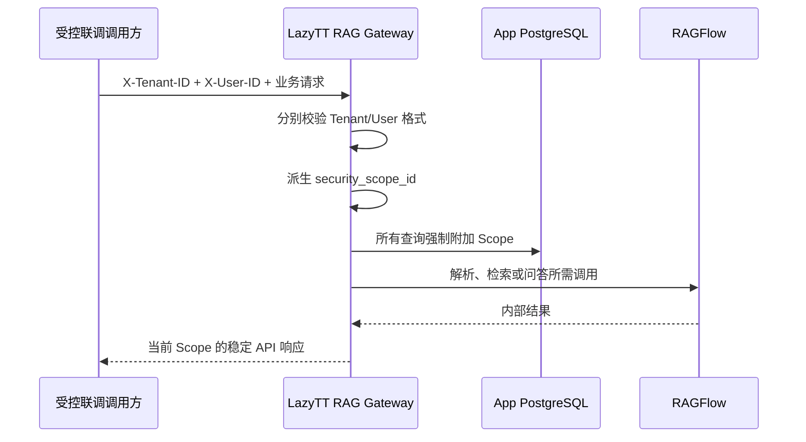
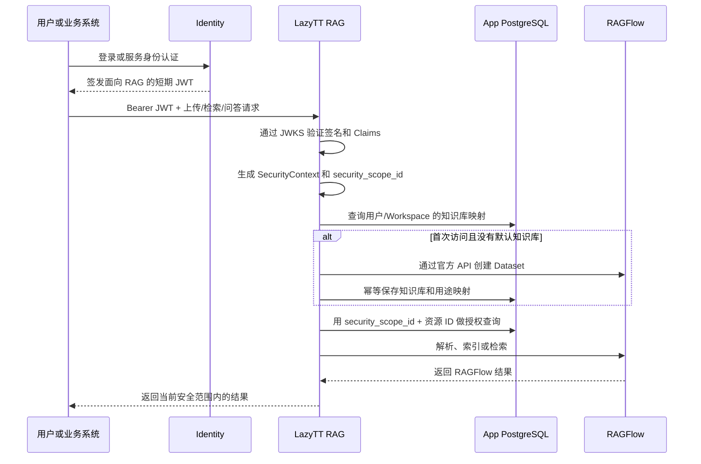
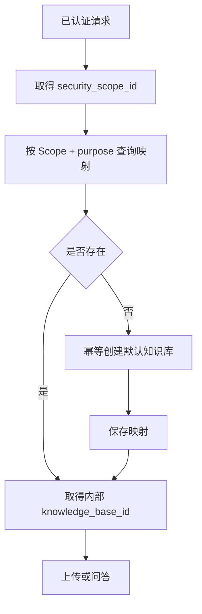
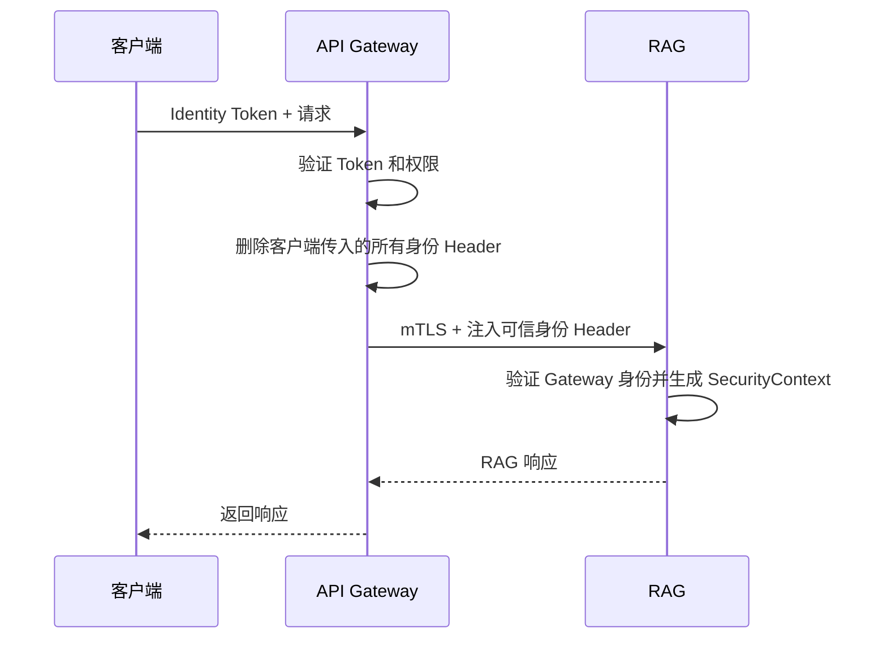
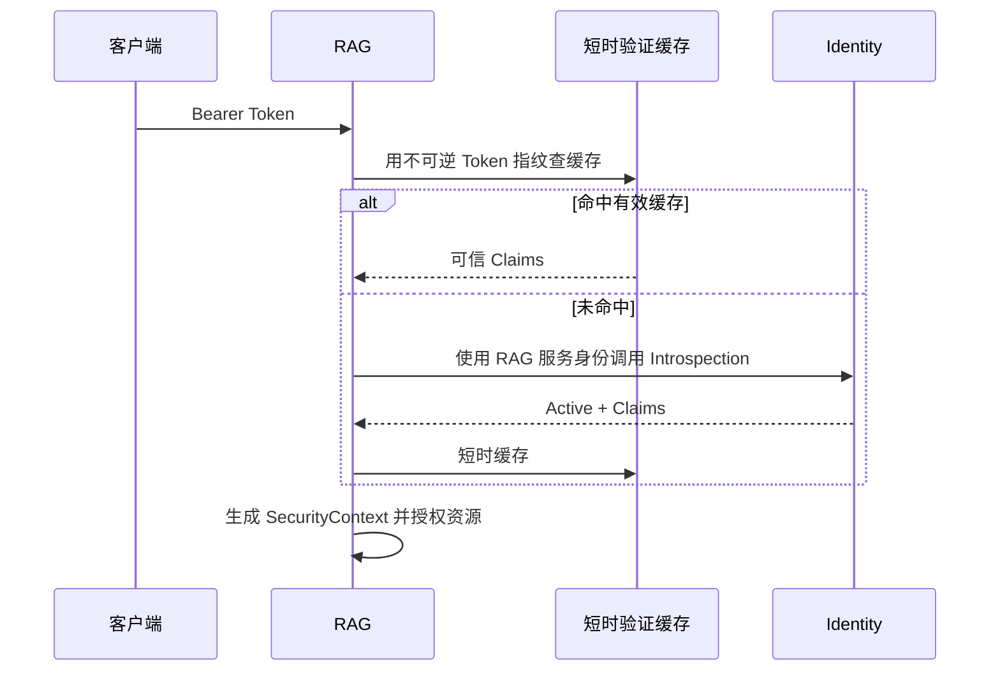

# Identity 接入与局域网数据服务切换策略

更新时间：2026-08-19

本文记录 Identity 的四种候选方案、当前临时落地方案，以及存储拆分/外部数据库切换：

1. 公司 Identity 统一管理用户身份，LazyTT RAG 不再负责注册、登录和密码；
2. 废弃当前本地数据，把 PostgreSQL、Redis 和 Elasticsearch 连接切换到局域网
   共享服务器上的 RAG 独立资源。

> [!IMPORTANT]
> 当前已经实施 **方案四 Direct Tenant/User**，并已把存储服务拆成独立 Compose。
> 业务请求使用 `X-Tenant-ID + X-User-ID`，没有注册、登录、密码、Session 或 JWT。该模式只用于受控联调，
> 不是最终生产认证。局域网外部数据库模式已具备配置切换能力，但本次没有迁移数据，
> 也没有连接或清理公司的共享服务器。

---

## 1. 四种 Identity 接入策略对比

### 1.1 详细对比表

| 对比项 | 方案一：JWT + JWKS | 方案二：API Gateway + 可信请求头 | 方案三：Token Introspection | 方案四：直接传 Tenant/User |
| --- | --- | --- | --- | --- |
| 身份认证方 | Identity 签发，RAG 验签 | API Gateway 验证 Identity Token | Identity 验证接口 | 没有可靠认证方 |
| 调用方传给 RAG | Bearer JWT | 由网关注入的内部身份 Header | Bearer Token | Tenant/User Header |
| RAG 获得公钥/身份的方式 | HTTPS JWKS，按 `kid` 缓存 | 信任经过 mTLS 的网关 | 每次或短缓存调用 Identity | 直接相信调用方 |
| 是否验证签名 | 是 | 网关验证；RAG验证网关服务身份 | 由 Identity 接口验证 | 否 |
| 身份冒充风险 | 低 | 网络边界配置正确时低 | 低 | 高 |
| Token 撤销速度 | 通常到 Access Token 过期 | 取决于网关策略 | 最快，可近实时 | 不支持 |
| Identity 请求时不可用 | 已签发 Token 和已缓存 JWKS 可继续使用 | 登录可能受影响，RAG 依赖网关 | 无有效缓存时 RAG 认证不可用 | 不受影响，但本身不安全 |
| 每次请求额外网络调用 | 通常没有 | 多经过一层网关 | 有，或命中短时缓存 | 没有 |
| 延迟 | 低 | 低到中 | 中 | 最低 |
| RAG 代码改动 | 低到中 | 中 | 中到高 | 低 |
| 网络/部署改动 | 低 | 高，需要 mTLS/Service Mesh | 中，需要访问 Identity | 低 |
| Key 轮换 | Identity 发布新 JWKS Key | 网关负责 | Identity 内部负责 | 无 |
| 多租户支持 | 好 | 好 | 好 | 极易配置错误 |
| 资源级授权 | RAG 继续执行 | RAG 继续执行 | RAG 继续执行 | 仍需 RAG 执行 |
| 知识库 ID | 系统内部仍需要 | 系统内部仍需要 | 系统内部仍需要 | 系统内部仍需要 |
| 适合生产 | **是，推荐** | 已有成熟统一网关时适合 | 有强撤销要求时适合 | **否** |
| 与当前代码匹配度 | **最高** | 中 | 中 | 只适合测试 |

### 1.2 当前决策

当前阶段选择 **方案四：直接传 Tenant/User**，目标是先把公司 Identity 之外的业务链路
打通。实现边界如下：

- `X-Tenant-ID` 和 `X-User-ID` 都必填、长度 1～128、拒绝控制字符；
- 请求 Tenant 与 `user:<User ID>` 共同派生 `security_scope_id`；
- Repository、Job、缓存、幂等和引用仍按 Scope 强制隔离；
- 删除本地账号、密码、Session、JWT 签发和 JWT 验签；
- 3000 可切换 Tenant/User，3001 通过环境变量固定两者；
- Header 可被冒用，因此只能在受控网络使用。

最终生产仍推荐 **方案一：Identity 签发短期 JWT，RAG 通过 JWKS 验签**。

理由：

- 未来 RAG 可支持 Bearer JWT、Audience、JWKS、公钥缓存和算法白名单；
- 验签完成后可以直接复用现有 `SecurityContext` 和 `security_scope_id`；
- 不需要每次请求同步调用 Identity；
- Identity 暂时不可用时，已登录用户仍可在 Token 有效期内访问；
- Identity 掌握私钥，RAG 只持有公钥，责任边界清晰。

方案二、三保留为未来可选架构，不建议同时实现三套生产认证逻辑。

### 1.3 当前已实现调用链



当前没有 JWT/JWKS/Introspection 网络调用。未来接入 Identity 时，可信认证只替换
`SecurityContext` 的来源，底层 Scope 化 Repository 和缓存边界继续复用。

---

## 2. 当前项目具体怎么做

### 2.1 目标调用链



### 2.2 Identity 必须提供的契约

| 项目 | 要求 |
| --- | --- |
| Audience | 为 RAG 单独分配，例如 `lazytt-rag-service` |
| 签名算法 | RS256 或 ES256 |
| JWT Header | 必须含 `kid`，用于选择 JWKS 公钥 |
| JWKS URL | RAG 容器可以访问的 HTTPS 地址 |
| Access Token | 生产建议 5～15 分钟 |
| Key 轮换 | 新旧公钥并存到旧 Token 全部过期 |
| 用户禁用 | 停止签发新 Token；强撤销要求另行设计 |

JWT 建议包含：

```json
{
  "iss": "https://identity.example",
  "aud": "lazytt-rag-service",
  "sub": "user-123",
  "tenant_id": "company-a",
  "rag_scope_id": "user:user-123",
  "iat": 1787000000,
  "exp": 1787000900,
  "jti": "unique-token-id"
}
```

客户端不能自行决定 `tenant_id` 或 `rag_scope_id`。这两个值必须由 Identity 根据
用户和授权关系写入 Token。

### 2.3 个人空间、共享空间和服务身份

个人知识空间：

```text
sub = user-123
tenant_id = company-a
rag_scope_id = user:user-123
```

团队共享空间：

```text
sub = user-123
tenant_id = company-a
rag_scope_id = workspace:team-456
```

后台服务：

```text
sub = service:document-sync
tenant_id = company-a
rag_scope_id = service:document-sync:approved-purpose
```

同一个 `rag_scope_id` 代表有意共享同一批 RAG 资源。个人用户必须使用不同的
`rag_scope_id`，否则会被视为共享空间。

### 2.4 知识库 ID 的处理方式

当前开发 API 继续显式使用知识库 ID：

```text
POST /v1/knowledge-bases
POST /v1/knowledge-bases/{knowledge_base_id}/documents
POST /v1/retrieval
POST /v1/answers
```

普通用户端不需要展示知识库 ID。增加默认知识库映射后，处理过程为：



建议映射字段：

| 字段 | 说明 |
| --- | --- |
| `security_scope_id` | 数据安全范围 |
| `owner_subject_id` | Identity User ID，用于审计 |
| `purpose` | `pdf`、`office`、`image`、`media` 或 `default` |
| `knowledge_base_id` | RAG 内部知识库 UUID |
| `created_at` | 创建时间 |
| `updated_at` | 更新时间 |

唯一约束建议为：

```text
(security_scope_id, purpose) UNIQUE
```

这样并发的两个首次请求也只能创建一条有效映射。

### 2.5 后端修改范围

| 模块 | 修改内容 |
| --- | --- |
| `security/jwt_verifier.py` | 继续使用 JWKS；补充 Identity 契约兼容测试 |
| `security/context.py` | 保持 Scope 派生；确认 Identity Claims 映射 |
| `settings.py` | 配置 Identity Audience 和 JWKS URL |
| API 认证依赖 | Token 来源改为 Identity，不再依赖本地用户签发 |
| Offline/Application | 新增默认知识库幂等 Provisioning |
| PostgreSQL | 新增 Scope/User/用途到知识库的映射 |
| Repository | 所有资源查询继续带 `security_scope_id` |
| Worker | 继续从 Job 继承可信 Scope，不需要保存用户 JWT |
| Redis Cache | 缓存边界继续包含 Scope 和知识库 Revision |
| Health/Bootstrap | 检查 JWKS 可访问性和 Identity 配置 |
| 日志 | 记录脱敏身份指纹，不记录完整 JWT |

不能删除 RAG 的认证验证和资源授权代码。Identity 接管的是注册、登录、密码和 Token
签发；RAG 仍然必须验证可信身份并保护自己的资源。

### 2.6 前端修改范围

- 普通用户端改为 Identity 登录；
- 删除“本地账号系统是生产认证”的入口；
- Token 刷新由 Identity SDK、统一 BFF 或公司登录组件完成；
- 浏览器不保存 RAG 私钥、模型 Key 或 Refresh Token；
- 普通用户端自动使用内部默认知识库；
- 开发控制台继续允许测试人员查看知识库 UUID 和显式选择知识库；
- 退出登录时清理本地会话并通知 Identity。

### 2.7 实施顺序

| 阶段 | 工作 | 验收 |
| --- | --- | --- |
| 1 | 冻结 Identity Claims、Audience、JWKS | 双方确认契约 |
| 2 | 用测试 Identity JWT 联调 RAG 验签 | 正确 Token 成功，伪造/过期失败 |
| 3 | 实现默认知识库映射 | 并发首次访问不重复创建 |
| 4 | 前端切换 Identity 登录 | 不再依赖本地注册 |
| 5 | DBA 安装空库 Schema 后切换数据服务 | 只读 Schema Check、Bootstrap 成功 |
| 6 | 做跨用户、跨租户隔离测试 | UUID 泄露仍不能越权 |
| 7 | 做上传、检索、问答真实联调 | 完整链路通过 |

---

## 3. 方案一：Identity JWT + JWKS

### 3.1 工作方式

Identity 用私钥签发 JWT，RAG 根据 Token Header 中的 `kid` 从 JWKS 选择公钥，然后
验证算法、签名、Audience、有效期和必需 Claims。

验签完成前，JWT 内容全部是不可信输入。只有成功生成 `SecurityContext` 后，业务层
才能使用其中的 User、Tenant 和 Scope。

### 3.2 配置方式

```text
AUTH_AUDIENCE=lazytt-rag-service
AUTH_JWKS_URL=https://identity.example/.well-known/jwks.json
AUTH_PUBLIC_KEY_PATH=
```

`AUTH_JWKS_URL` 和 `AUTH_PUBLIC_KEY_PATH` 只能二选一。生产使用 Identity JWKS；
本地 PEM 只保留给离线开发。

### 3.3 Key 轮换

1. Identity 生成新 Key 和新 `kid`；
2. JWKS 同时发布新旧公钥；
3. 新 Token 使用新 Key；
4. RAG 遇到新 `kid` 时刷新 JWKS；
5. 等旧 Token 全部过期后再移除旧公钥。

不能先删除旧 Key 再发布新 Key，否则仍在有效期内的旧 Token 会突然全部失败。

### 3.4 资源授权

JWT 有效不代表可访问任意资源。RAG 仍执行：

```text
Token 有效
AND
请求具备对应操作权限
AND
资源 security_scope_id 与请求一致
AND
资源状态允许当前操作
```

知道其他用户的 `knowledge_base_id` 或 `document_id` 仍然无法跨 Scope 访问。

### 3.5 失败处理

| 场景 | 行为 |
| --- | --- |
| 没有 Bearer Token | 401 |
| 签名错误、算法不允许 | 401 |
| Audience 不匹配 | 401 |
| Token 过期 | 401，由客户端刷新 |
| 缺少 Tenant/Scope | 401 |
| JWKS 暂时不可用但 Key 已缓存 | 使用缓存 Key 验证 |
| JWKS 不可用且没有对应 Key | 拒绝认证，不能跳过验签 |
| 资源不属于 Scope | 返回统一资源不可用结果 |

### 3.6 测试

- 正确 Identity JWT 可以调用；
- 错误签名、Audience 和过期时间全部失败；
- JWKS 新旧 Key 轮换期间行为正确；
- 用户 A 无法列出、上传、检索、更新或删除用户 B 的资源；
- 同一 Workspace 的授权用户按预期共享；
- Worker 重试保留原 Scope；
- 精确缓存和语义缓存不能跨 Scope 命中。

### 3.7 优缺点

优点：

- 与当前系统最匹配；
- 每次请求不依赖 Identity 网络调用；
- RAG 只持有公钥；
- 性能稳定，适合容器横向扩展。

缺点：

- Access Token 在过期前通常不能立即撤销；
- Identity 和 RAG 必须共同维护 Claim 契约；
- Key 轮换必须遵守新旧 Key 重叠窗口。

结论：**当前项目首选方案。**

---

## 4. 方案二：API Gateway + 可信请求头

### 4.1 工作方式



内部 Header 可以包含 Subject、Tenant、RAG Scope、Token ID 和过期时间。具体名称由
公司网关规范决定。

### 4.2 必须满足的安全条件

- 外部客户端不能直接访问 RAG；
- Gateway 必须删除客户端自带的同名 Header；
- Gateway 到 RAG 使用 mTLS 或等价 Workload Identity；
- RAG 只信任指定 Gateway 服务身份；
- 不能只依赖来源 IP；
- 网关故障时不能开放 RAG 直连作为降级。

### 4.3 后端和部署修改

- 新增 `TrustedHeaderIdentityAdapter`；
- 明确配置认证模式，不能自动猜测 JWT 或 Header；
- 校验 Header 类型、长度、过期时间；
- 收紧 Gateway 监听地址和网络策略；
- 配置 mTLS 证书和轮换；
- 日志保留 Gateway Request ID，但不记录原始 Token。

### 4.4 知识库处理

Gateway 只解决“身份是否可信”。知识库映射、Scope 验证和资源状态检查仍由 RAG
完成，不能由 Gateway Header 直接绕过 Repository。

### 4.5 失败处理与测试

| 场景 | 行为 |
| --- | --- |
| 客户端直连 RAG | 网络层或 RAG 拒绝 |
| 客户端伪造身份 Header | Gateway 删除并覆盖 |
| mTLS 身份错误 | TLS 层拒绝 |
| Header 缺失/格式错误 | 401 |
| Gateway 不可用 | 整体入口不可用，不降级为直连 |

测试重点是直连阻断、Header 伪造、证书轮换和跨 Scope 隔离。

### 4.6 优缺点

优点：

- 公司统一处理多种 Identity 协议；
- RAG 不直接接触外部 Token；
- 限流、审计和服务路由集中。

缺点：

- mTLS、网关和网络策略复杂；
- Gateway 成为关键依赖；
- RAG 端口一旦可绕过，身份 Header 就能被伪造。

结论：已有成熟统一网关时可选，不是当前最小改动方案。

---

## 5. 方案三：Token Introspection

### 5.1 工作方式

RAG 收到 Bearer Token 后调用 Identity 验证接口，由 Identity 返回 Token 是否 Active
以及可信 Claims。

```json
{
  "active": true,
  "sub": "user-123",
  "tenant_id": "company-a",
  "rag_scope_id": "user:user-123",
  "aud": "lazytt-rag-service",
  "exp": 1787000900,
  "jti": "unique-token-id"
}
```

### 5.2 调用链



RAG 调用 Identity 时使用独立服务身份，例如 mTLS、Client Credentials 或 Workload
Identity，不能把用户 Token 当作服务端凭据。

### 5.3 缓存与撤销

推荐起点：

| 类型 | TTL |
| --- | ---: |
| Active Token | 15～30 秒 |
| Inactive Token | 3～5 秒 |
| 最大 TTL | 不超过 Token 剩余有效期 |
| 调用超时 | 1～2 秒 |
| 重试 | 仅可重试错误最多一次 |

缓存越长，Identity 压力越小，但用户禁用和 Token 撤销生效越慢。

### 5.4 后端修改

- 新增 Introspection Client 和 Adapter；
- 新增服务凭据管理；
- 新增短时验证缓存；
- 新增超时、有限重试、熔断和并发限制；
- 新增 Identity 可用性健康状态；
- 不在日志或缓存 Key 中保存完整 Token。

### 5.5 失败处理

| 场景 | 行为 |
| --- | --- |
| `active=false` | 401 |
| 缺少必需 Claims | 401 |
| Identity 超时且存在有效缓存 | 按批准策略短暂使用缓存 |
| Identity 超时且无缓存 | 503 |
| 服务凭据失效 | Ready 失败并告警 |

不能在 Identity 故障时改为相信客户端传入的 User ID。

### 5.6 优缺点

优点：

- 适合不透明 Token；
- 用户禁用和撤销可以快速生效；
- 权限可以由 Identity 实时返回。

缺点：

- 每次请求增加依赖和延迟；
- Identity 故障直接影响 RAG；
- 需要缓存、熔断、容量和服务凭据管理。

结论：存在强实时撤销要求时使用，否则方案一更简单。

---

## 6. 方案四：直接传 Tenant/User

### 6.1 工作方式

```text
X-Tenant-ID: tenant-123
X-User-ID: user-123
```

RAG 根据 Tenant/User 组合派生测试 Scope，然后查找或创建默认知识库。两个值只是
调用方自报身份，没有签名或 Identity 背书。

### 6.2 允许范围

只有以下条件同时满足时才允许：

- 环境明确为 `local` 或 `test`；
- 只监听 `127.0.0.1` 或隔离测试网络；
- 只使用合成数据；
- 页面和健康状态标记“禁止生产使用”；
- 生产环境启用该模式时必须启动失败。

“服务 Token + User ID”可以用于受控内部批处理：服务先证明自己，再代表指定用户
操作。但这意味着该服务被授权模拟用户，不能开放给浏览器或普通客户端。

### 6.3 主要风险

- 任意修改 Header 就能冒充其他用户；
- 无法可靠撤销、禁用和审计；
- 局域网端口误开放后可能直接越权；
- 容易在迁移后留下生产后门。

### 6.4 测试

- Production 环境启用必须启动失败；
- 非本机来源必须拒绝；
- Tenant/User 任一空值、超长值和非法字符必须拒绝；
- 只能操作测试数据；
- 切换到生产认证后，该入口完全不可用。

结论：只用于开发便利，不能替代 Identity。

---

## 7. 局域网数据服务空库切换

本节的 Compose/配置拆分已经实现：`docker-compose.storage.yml` 独立管理 4 个有状态
服务，`docker-compose.full.yml` 只管理运行时；`RAG_STORAGE_MODE=local|external`
决定是否启动本机存储。尚未执行的只是连接公司数据库服务器和清理旧数据。

### 7.1 范围与前提

本次不迁移旧数据，而是：

```text
旧 PostgreSQL 数据：不要
旧 Redis/Valkey 数据：不要
旧 Elasticsearch 索引：不要
旧 MinIO 测试对象：不要
数据导出、复制、恢复：不执行
目标：连接共享服务器上的全新 RAG 独立资源
```

文档用 `<LAN_DB_HOST>` 表示共享服务器；当前讨论地址为局域网
`192.168.31.2`。生产配置建议改用内部 DNS，避免服务器换 IP 时修改多个文件。

服务器会被其他项目共享，因此必须同时实现：

1. **项目级隔离**：RAG 与其他业务使用不同数据库、账号、索引权限、Key 命名空间；
2. **RAG 用户级隔离**：RAG 内部继续使用 `security_scope_id` 隔离用户和 Workspace。

### 7.2 当前存储与目标资源

| 当前服务 | 用途 | 目标隔离资源 |
| --- | --- | --- |
| App PostgreSQL | 知识库、文档、版本、Job、查询和侧车索引元数据 | 独立数据库 `lazytt_rag_app` 和独立账号 |
| RAGFlow PostgreSQL | RAGFlow 账号、Dataset、文档和任务元数据 | 独立数据库 `lazytt_ragflow` 和独立账号 |
| Redis Stack DB 0 | 精确缓存、语义向量缓存 | 支持 RediSearch，使用 RAG 专用物理实例 |
| Redis Stack DB 1 | RAGFlow 队列与运行状态 | 应用不得扫描或修改 |
| Redis Stack DB 2 | Celery Broker、Worker/Scheduler 控制 | 与 DB 0/1 共享资源和故障域 |
| Elasticsearch | Chunk 正文、向量和全文索引 | RAG 专用账号、角色和索引范围 |
| MinIO | 上传原文件和 RAGFlow 对象 | RAG 专用 Bucket 和账号 |

只创建 PostgreSQL 数据库不能覆盖全部 RAG 数据，其他存储也要分配独立命名空间。

### 7.3 PostgreSQL 规划

推荐在同一个 PostgreSQL Cluster 中创建两个数据库和两个最小权限账号：

```text
lazytt_rag_app       ← lazytt_rag_app_user
lazytt_ragflow       ← lazytt_ragflow_user
```

由 DBA 使用管理账号执行类似操作，示例密码必须替换为 Secret Manager 中的真实值：

```sql
CREATE ROLE lazytt_rag_app_user LOGIN PASSWORD '<REDACTED>';
CREATE DATABASE lazytt_rag_app OWNER lazytt_rag_app_user;

CREATE ROLE lazytt_ragflow_user LOGIN PASSWORD '<REDACTED>';
CREATE DATABASE lazytt_ragflow OWNER lazytt_ragflow_user;
```

要求：

- 两个账号不能访问其他项目数据库；
- 其他项目账号不能访问这两个数据库；
- App 账号不能访问 RAGFlow 数据库，反之亦然；
- 数据库字符集使用 UTF-8；
- 连接数、Statement Timeout 和备份策略由 DBA 配置；
- App 数据库由版本 SQL 创建 `rag_app` Schema 和表；
- RAGFlow 数据库由官方 RAGFlow 启动流程初始化，不能手工伪造表。

### 7.4 Redis 规划

当前实现使用一个项目专用 Redis Stack 物理实例：

```text
DB 0 → 精确缓存和语义缓存
DB 1 → RAGFlow 队列和状态
DB 2 → Celery 与 Job 控制
```

语义缓存必须支持 Redis Stack/RediSearch 向量索引。普通 Redis 即使能够 `PING`，
也可能在创建向量索引时失败。

逻辑 DB 不是强安全隔离。必须由 DBA 评审网络 ACL、Key Pattern、实例内存、
`noeviction`、AOF 和高可用。需要独立权限、容量、淘汰策略或故障边界时，应重新拆分
物理实例，优先拆 Celery。

### 7.5 Elasticsearch 规划

当前本地基线为 Elasticsearch 8.11.3，RAGFlow 版本为 v0.26.4。远程服务器应优先
提供相同版本。

共享集群需要：

- RAGFlow 专用用户；
- 专用角色；
- 只允许访问实际的 RAGFlow 索引范围；
- 禁止读取其他项目索引；
- 限制危险的集群管理权限；
- 配置容量、水位、分片和快照策略。

如果远程版本不同：

| 情况 | 处理 |
| --- | --- |
| 同为已验证的 8.11.3 | 直接进入 Smoke |
| 8.x 其他版本 | 先在空索引环境验证 Mapping、向量检索和认证 |
| 跨大版本 | 不直接切换，先做兼容性 PoC |
| 验证失败 | 使用独立 8.11.3 实例，不修改 RAGFlow 源码规避 |

不能只因为集群健康为 Green 就判定兼容；必须验证上传、解析、Embedding、向量检索、
BM25、删除、重启和索引恢复。

### 7.6 MinIO 规划

即使 MinIO 暂时仍在本机，也应创建全新的 RAG 专用 Bucket 和账号。若以后迁移到
共享服务器，同样只需更换 Endpoint，并保持 Bucket 权限隔离。

```text
Bucket：lazytt-rag
账号：lazytt-rag-minio-user
权限：仅允许访问该 Bucket
```

旧数据全部不要，因此不复制旧对象。新数据库不能继续引用旧 Bucket 中的对象。

### 7.7 当前配置为什么不能只改一个地址

Gateway 已经使用可配置连接串。`APP_REDIS_URL` 与 `CACHE_REDIS_URL` 虽然是两个
变量，但当前分别固定指向同一个 Redis Stack 的 DB 2 和 DB 0：

```text
APP_DATABASE_DSN
APP_REDIS_URL
CACHE_REDIS_URL
```

RAGFlow 与三个应用进程则通过统一的 Redis Stack 地址参数连接：

```text
REDIS_STACK_HOST=redis-stack
REDIS_STACK_PORT=6379
REDIS_STACK_PASSWORD=<REDACTED>
```

本地与外部存储模式已由独立 Storage Compose 和运行时 Compose 分开管理。切换外部
存储时需要同时填写 PostgreSQL、Elasticsearch、MinIO 和 Redis Stack 地址；不能只
修改其中一个地址。

### 7.8 推荐配置改造

新增明确的外部数据模式：

```text
DATA_BACKEND_MODE=external
```

并把 RAGFlow 地址参数化：

```text
RAGFLOW_POSTGRES_HOST=<LAN_DB_HOST>
RAGFLOW_POSTGRES_PORT=5432
RAGFLOW_ES_HOST=<LAN_DB_HOST>
RAGFLOW_ES_PORT=9200
RAGFLOW_MINIO_HOST=<LAN_DB_HOST>
RAGFLOW_MINIO_PORT=9000
REDIS_STACK_HOST=<LAN_DB_HOST>
REDIS_STACK_PORT=6379
REDIS_STACK_PASSWORD=<REDACTED>
```

真实密码只进入 Git 忽略环境或 Secret Manager。示意连接串：

```text
APP_DATABASE_DSN=postgresql+psycopg://lazytt_rag_app_user:<REDACTED>@<LAN_DB_HOST>:5432/lazytt_rag_app
APP_REDIS_URL=redis://:<REDACTED>@<LAN_DB_HOST>:6379/2
CACHE_REDIS_URL=redis://:<REDACTED>@<LAN_DB_HOST>:6379/0
```

RAGFlow 使用同一 Redis Stack 的 DB 1。三个逻辑 DB 的编号是协议边界，外部实例也
必须保持 DB 0/1/2 的映射，不能把三类数据写入同一个 DB。

### 7.9 Compose 改造

推荐把数据服务分为两个模式：

```text
local-data
  → 启动共享 postgres（rag_app + rag_flow）
  → 启动一个 redis-stack（DB 0/1/2）、elasticsearch、minio

external-data
  → 不启动上述本地数据服务
  → 启动前检查远程端口、账号和所需模块
  → 只启动 RAGFlow、只读 Schema Check、Bootstrap、Gateway、Worker、Scheduler
```

需要处理：

- 本地数据服务放入明确 Profile；
- 外部模式不再依赖本地 service healthcheck；
- 用外部连接预检替代 `depends_on`；
- RAGFlow Server 和 Task Executor 使用相同远程配置；
- App Schema Check、Gateway、Worker、Scheduler 使用同一套 App DSN/Redis URL；
- 启动输出必须显示使用外部模式，但不能打印密码或完整连接串；
- `./deploy/local/start-full.sh` 根据模式选择正确 Compose 服务集合。

### 7.10 空库切换步骤

#### 阶段 A：服务器准备

1. DBA 创建两个空 PostgreSQL 数据库和独立账号；
2. 创建一个 RAG 专用 Redis Stack 实例，并允许使用 DB 0、DB 1 和 DB 2；
3. 创建 Elasticsearch RAG 专用账号和空索引权限；
4. 创建新的 MinIO Bucket 和账号；
5. 防火墙只允许 RAG 主机访问所需端口；
6. 确认 DNS/IP、TLS、证书和密码交付方式。

#### 阶段 B：代码和配置准备

1. 参数化 RAGFlow 的 PostgreSQL、ES、Redis、MinIO Host/Port；
2. 增加 `external-data` Compose 模式；
3. 调整本地 `depends_on`；
4. 增加远程服务启动预检；
5. 使用 Git 忽略环境填写真实凭据；
6. 示例文件只保留 `<REDACTED>`。

#### 阶段 C：连接验证

从宿主机和实际容器网络分别检查：

- PostgreSQL 可以认证并创建 App Schema；
- Redis Stack 的 DB 0 可读写且支持 `FT.CREATE` 等所需模块；
- Redis Stack 的 DB 1 可供 RAGFlow 读写；
- Redis Stack 的 DB 2 可供 Celery Broker 读写；Celery 结果不写 Redis，任务事实以
  App PostgreSQL 为准；
- Elasticsearch 版本、认证和集群健康正常；
- MinIO Bucket 可读写。

宿主机能连接不代表 Docker 容器一定能连接，必须两处都测试。

#### 阶段 D：空环境初始化

```text
App PostgreSQL：由 DBA 执行评审后的全新安装/迁移 SQL
RAGFlow PostgreSQL：由 DBA 安装固定 v0.26.4 Schema
RAGFlow Elasticsearch：由解析/索引流程创建空索引
Redis Stack DB 0：Bootstrap 创建当前模型维度的向量索引
Profile：导入不可变 Profile
模型：运行真实 Chat、Embedding、Vision、Rerank 探测
```

不得直接写 RAGFlow 数据库伪造初始化状态。

#### 阶段 E：完整启动

按顺序启动：

```text
远程数据服务已就绪
→ ragflow-server
→ ragflow-task-executor
→ rag-app-schema-check（只读）
→ rag-app-bootstrap
→ rag-gateway
→ rag-worker
→ rag-scheduler
```

#### 阶段 F：验收

只使用非业务 Fixture：

1. 当前阶段验证缺少/非法 Tenant/User Header 被拒绝，并分别做跨租户、跨用户隔离反向测试；
2. 自动创建用户默认知识库；
3. 上传 PDF、Office、图片和按需音视频；
4. 等待解析、Embedding 和侧车索引完成；
5. 执行向量、BM25、RRF 和 Rerank；
6. 执行普通问答和 SSE；
7. 验证引用；
8. 验证精确缓存和语义缓存；
9. 验证跨用户、跨租户隔离；
10. 验证文档更新、回滚和删除；
11. 重启全部应用容器；
12. 确认重启后模型、知识库和索引正常；
13. 确认本地数据库容器没有被使用；
14. 确认数据实际写入 RAG 专用远程资源。

### 7.11 失败恢复

切换失败时：

- 停止新写入；
- 保存脱敏日志和 Request ID；
- 恢复本地模式配置；
- 重新启用本地依赖；
- 不把新旧 Elasticsearch 索引混用；
- 不直接修改 RAGFlow 数据库；
- 不通过忽略 User ID/Scope 校验或健康检查强行启动。

旧数据虽然不需要迁移，但建议在新环境验收完成前保留旧 Volume，作为快速恢复旧
开发环境的手段。新环境验收通过后，用户可以另行授权删除。

### 7.12 最终清理

新环境完整验收后，旧本地数据可以全部清理：

- App PostgreSQL Volume；
- 统一 Redis Stack Volume；
- RAGFlow PostgreSQL Volume；
- Elasticsearch Volume；
- MinIO 旧测试对象和 Volume。

实际删除不属于本文档修改，执行前仍需再次确认精确目标。禁止使用模糊路径、未展开
变量或未经检查的 `docker compose down -v`。

---

## 8. 容易混淆的概念

### 8.1 Authentication 与 Authorization

- Authentication：确认调用者是谁；
- Authorization：确认调用者能操作什么。

生产中 Identity 主要负责 Authentication；RAG 必须继续负责知识库、文档和操作权限。
当前 Direct Tenant/User 阶段没有 Authentication，只有输入校验和 Scope 数据分区。

### 8.2 User ID

用户的稳定标识；未来可对应 JWT 的 `sub`。User ID 不是凭据，不能单独证明请求确实
由该用户发出。

### 8.3 JWT

Identity 签名的身份凭据。JWT 证明用户、租户、Scope 和有效期，不保存知识库内容，
也不替代知识库 ID。

### 8.4 `tenant_id`

用户所属企业、组织或租户。它提供第一层业务隔离。

### 8.5 `rag_scope_id`

Identity 授权给本次请求的数据空间。可以代表个人、Workspace 或服务用途。

### 8.6 `security_scope_id`

RAG 根据 Tenant 和 RAG Scope 计算的固定摘要。当前两项来自 `X-Tenant-ID` 和
`user:<X-User-ID>`；生产应改为可信 Identity 数据：

```text
SHA256(tenant_id + 分隔符 + rag_scope_id)
```

它是数据库、缓存、Job 和侧车索引的实际隔离键。

### 8.7 `knowledge_base_id`

某个具体知识库的 UUID。它负责资源定位，`security_scope_id` 负责判断这个资源是否
属于当前请求。两者缺一不可。

### 8.8 用户为什么可以不感知知识库 ID

普通用户端可以通过默认知识库映射自动取得内部 UUID，因此用户只看到“我的文件”和
“智能问答”。这只是隐藏实现细节，系统内部仍然使用 UUID。

### 8.9 一个用户如何拥有多个知识库

映射表通过不同 `purpose` 保存多个知识库，例如 PDF、Office、图片和音视频；高级
API 也可以让用户显式创建更多知识库。

### 8.10 多人如何共享 Workspace

Identity 给获授权用户签发相同 `tenant_id + rag_scope_id`，RAG 将他们映射到同一
安全空间。个人 `sub` 仍用于审计是谁执行了操作。

### 8.11 知道别人的 UUID 为什么不能访问

Repository 查询同时要求 UUID 和当前 `security_scope_id`。Scope 不一致时不会返回
资源，因此 UUID 不是授权凭据。

### 8.12 项目级隔离与用户级隔离

- 项目级隔离：数据库账号、数据库名、Redis ACL、ES 索引权限和 MinIO Bucket；
- 用户级隔离：RAG 内部的 `security_scope_id`。

项目级隔离防止其他业务系统访问 RAG 数据；用户级隔离防止 RAG 用户互相越权。

### 8.13 Identity 删除用户后怎样处理 RAG 数据

推荐先停止用户获取新 Token并阻止访问，再根据公司保留策略异步删除其知识库、文档、
对象、索引和缓存。Identity 删除账号不应直接在同一个 HTTP 请求里级联删除全部数据，
否则难以审计和恢复。

---

## 9. 最终建议

```text
当前联调调用方负责：提供稳定 X-Tenant-ID + X-User-ID（不具备认证能力）
未来 Identity 负责：用户、登录、密码、Token、组织和身份生命周期
RAG 负责：Scope、资源授权、知识库、文档、检索、问答和缓存
数据服务器负责：为 RAG 提供与其他项目隔离的数据库和索引资源
```

实施选择：

1. 当前采用 **方案四 Direct Tenant/User**，仅用于受控开发联调；
2. 未来生产认证优先采用 **方案一 JWT + JWKS**；
3. 普通用户端采用默认知识库映射，开发 API 保留显式知识库 ID；
4. 存储 Compose 已拆分，本地/外部存储可只改配置切换；
5. 公司共享服务器必须为 RAG 分配独立逻辑资源；
6. 旧数据不迁移，外部模式使用全新空资源；
7. 完整验收通过后，再单独批准清理本地旧数据。
