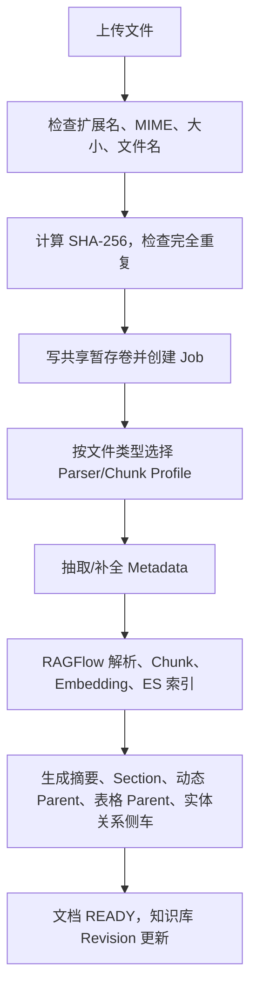

# LazyTT RAG 新人学习指南

更新时间：2026-08-19

这份文档用尽量少的 Python 前置知识解释当前系统。部署操作请看
[USER_MANUAL.md](USER_MANUAL.md)，逐目录职责请看
[CODEBASE_STRUCTURE.md](CODEBASE_STRUCTURE.md)。

## 1. 先理解 RAG

普通大模型只知道训练时学到的内容。RAG 的做法是：先从你的文件中找到相关原文，再
把原文和问题一起交给大模型。回答必须带引用，用户可以回看证据。

```text
文件 → 解析 → 切块 → 向量/全文索引
问题 → 检索 → 排序 → 上下文 → LLM → 引用校验 → 回答
```

这个项目不只调用 RAGFlow。RAGFlow 负责文档解析、原始 Chunk、Embedding 索引和底层
召回；自研 Gateway 负责稳定 API、数据隔离、任务、检索编排、缓存、答案和引用。

## 2. 运行组件

| 组件 | 小白理解 |
|---|---|
| Gateway | 对外总入口，端口 8080 |
| Worker | 后台处理上传、解析和索引 |
| Scheduler | 定时恢复超时任务、清理暂存文件 |
| RAGFlow | 文件解析、切块、索引和底层检索引擎 |
| App PostgreSQL | 保存知识库映射、文档状态、Job、版本、侧车和引用 |
| Redis Stack DB 0 | 精确/语义缓存和 HNSW 向量索引 |
| Redis Stack DB 1 | RAGFlow 内部队列、锁和短状态 |
| Redis Stack DB 2 | Celery 摄取/维护任务队列和 Broker 投递状态；任务事实保存在 PostgreSQL |
| Elasticsearch | RAGFlow 的向量和全文索引 |
| MinIO | RAGFlow 原始文件对象 |

这里的三个 DB 来自同一个 Redis Stack 物理服务。Redis Stack 包含普通 Redis 能力并
额外提供 RediSearch，所以 Celery 和 RAGFlow 可以继续使用普通 Redis 命令，语义缓存
则使用向量索引。逻辑 DB 不是三个独立实例：它们共享内存、AOF、连接和故障域。

存储单元已放在独立 `docker-compose.storage.yml`，运行时在
`docker-compose.full.yml`。这让数据库可以单独部署、启停，或只改环境变量切换到
局域网服务器。它们分别显示为 Docker 项目 `lazytt-rag-storage` 和
`lazytt-rag-runtime`，通过一个项目外部的共享 Docker 网络通信。

## 3. 当前身份和隔离

当前阶段没有注册、登录、密码、Session 或 JWT。业务请求传入：

```http
X-Tenant-ID: stable-tenant-id
X-User-ID: stable-user-id
```

Gateway 校验两个 ID 后，将 Tenant 和 `user:<id>` 拼接并计算 SHA-256
摘要，得到 `security_scope_id`。所有数据库查询、缓存、Job、知识库和引用都带这个
Scope，所以不同 Tenant/User 组合默认互相看不到数据。

但调用方能填写任意 Tenant/User，所以这只是“数据分区”，不是“身份认证”。只能在
受控开发网络使用。未来公司 Identity 应提供可信身份，底层 Scope 设计继续复用。

## 4. 一个文件如何入库



### 自动 Parser/Chunk 路由

- PDF：通常 DeepDoc，正文 Profile；
- DOCX/TXT/Markdown/HTML：Office Parser，正文 Profile；
- XLSX/CSV：Office Parser，表格小块 Profile；
- PPTX/图片：视觉文件族 Profile；
- 音频/视频：先用 FFmpeg、ASR 和独立媒体 Vision 转成带时间戳 Markdown，再交给
  RAGFlow；普通图片仍使用文档 OCR Vision。

知识库创建时保存的是优先默认 Profile；上传未显式指定时，后端先保留兼容默认 Parser，
再按文件族选择 Parser/Chunk。Profile 是带版本的不可变配置，修改策略要新增版本，不能
悄悄改旧版本含义。

### 切块和侧车索引

RAGFlow 生成原始 Chunk。Gateway 还生成导航用结构：

- Summary：整份文档摘要；
- Section：章节摘要/边界；
- Parent：按标题和长度动态聚合相邻原始 Chunk；
- Table Parent：保存表头上下文的多行组；
- Entity/Relation：轻量实体和显式关系，不等于完整知识图谱。

这些侧车只帮助“找到证据”。最终返回和引用必须回读 RAGFlow 真实 Chunk，不能把自动
摘要伪装成原文。

## 5. 一个问题如何回答

1. 校验 Direct Tenant/User Scope、知识库、Document IDs 和 Metadata Filter；
2. 清理 Unicode、控制字符和多余空白；
3. 识别中英文和知识库语言；
4. 必要时让 LLM 生成双语 QueryPlan；
5. 根据 fact/list/comparison/summary/multi-hop 选择动态 Top-K；
6. 并行执行原问题/翻译问题向量、BM25 和侧车路线；
7. 用加权 RRF 合并“排名”，不是直接把相似度按百分比相加；
8. 删除语义近重复候选，合并相邻 Chunk 上下文；
9. 可选调用真实 Cross-Encoder Rerank；
10. 按 Token 预算选择上下文；
11. LLM 生成 JSON 或 SSE；
12. 验证 `[C1]` 等引用确实来自当前证据；
13. 写入精确/语义缓存。

### 强过滤与排序的区别

Document IDs 和 Metadata Filter 是硬条件：不满足就不能返回。向量、BM25、RRF 和
Rerank 是满足硬条件后的排序信号。

### RRF 分数为什么很小

RRF 使用路线内名次，常见贡献类似 `weight / (k + rank)`。它不是 0～1 相似度，也不是
百分制。路线权重不要求和为 1，因为它们是每条命中路线的相对贡献；最后按总和排序。

## 6. 缓存

- exact：请求关键字段完全相同；
- semantic：语义向量足够接近；
- none：直接检索和生成。

缓存 Key/过滤边界包含 Scope、知识库 Revision、Retrieval/Profile、Prompt、Model、
语言和有限历史摘要。缓存命中后仍重新验证引用与知识库范围。文档新增、删除、更新或
回滚会改变 Revision，使旧缓存自动失效。

## 7. 文档安全更新

“更新文件”不是直接覆盖旧文件：

```text
上传新版本 → 独立解析新版本 → 成功后原子切换
→ 新 RAGFlow 文档启用 → 旧 RAGFlow 文档禁用
→ 旧版本记录 RETIRED → Revision +1
```

如果新版本失败，旧版本继续工作。回滚会把目标旧版本重新激活。对外逻辑
`document_id` 不变，RAGFlow 内部物理文档会随版本变化。

这不是 Chunk 级真正增量 Embedding：目前仍解析新文件，只在应用层安全切换版本。

## 8. 代码阅读顺序

建议按这条线读：

1. `src/rag_service/domain/models.py`：系统有哪些对象；
2. `domain/state.py`：状态怎样变化；
3. `domain/ports.py`：业务需要哪些能力；
4. `application/offline.py`：文件/知识库编排；
5. `application/ingestion_worker.py`：后台解析；
6. `application/indexing.py`：侧车索引；
7. `application/online.py`：检索和回答；
8. `infrastructure/ragflow/adapter.py`：怎样调用 RAGFlow；
9. `infrastructure/postgres/`：怎样存业务状态；
10. `api/*routes.py`：怎样暴露为 HTTP。

不要一开始就逐行读 3000/3001 前端或 Compose；先建立后端主流程，再看界面和部署。

## 9. Bootstrap、Worker 和 Scheduler

- `bootstrap/`：启动前验证模型、Profile、RAGFlow、API Key 和缓存索引；
- `workers/`：Celery Worker 与 Beat；
- `cli.py`：命令行 Bootstrap 入口。

Bootstrap 是“开门前检查”；Worker 是“真正干耗时工作的人”；Scheduler 是“定时巡视
和恢复的人”。

## 10. 两套前端

- 3000 开发控制台：后端仓库 `frontend/`，能测试全部接口并编辑 Tenant/User；
- 3001 普通用户端：独立 `lazytt-frontend-console`，用环境变量固定 Tenant/User，重点展示
  文件、流式问答、Markdown、引用、缓存和 Rerank 状态。

3001 对话历史存在前端自己的 D1/SQLite。换一台电脑、启动另一套前端实例时不会自动
同步，即使 Direct Tenant/User 相同；RAG 文件和知识库仍在同一后端 Scope 中。

## 11. 本地和外部存储

默认 `RAG_STORAGE_MODE=local`，启动脚本先拉起存储 Compose。改为 `external` 并填写
连接信息后，运行时直接连接局域网数据库服务器，不启动本地存储。

共享服务器要给 RAG 分配独立 PostgreSQL Database/账号、Redis DB 或实例、
Elasticsearch 命名空间和 MinIO Bucket。这里是项目级隔离；User Scope 是项目内部
隔离，两者不能互相替代。

## 12. 常用命令

```bash
./deploy/local/start-full.sh
./deploy/local/stop-full.sh
./deploy/local/start-storage.sh
./deploy/local/stop-storage.sh
```

```bash
.venv/bin/python -m pytest -q
.venv/bin/ruff check src migrations tests tools
.venv/bin/python -m mypy src
```

## 13. 已有与未完成

已经具备：多格式解析、自动 Profile 路由、混合检索、双语 Rewrite、动态 Top-K、RRF、
可选 Rerank、摘要/层级/表格/实体侧车、缓存、SSE、引用、文件版本更新、Scope 隔离、
独立存储 Compose 和本地/外部配置切换。

仍需生产化：公司 Identity、可信认证与授权、TLS/网关、配额/限流、集中审计、监控告警、
容量压测、高可用、联合备份恢复、数据合规和完整 GraphRAG。

## 14. 安全习惯

- 不提交私有 `.env`、密码、API Key；
- 不对公网开放 Direct Identity、RAGFlow UI 或数据库；
- 不执行 `docker compose down -v`；
- 不修改 RAGFlow 源码；
- 测试只用非业务 Fixture；
- 每次改动都运行对应测试并保存本地 Git Commit。

新人最有效的练习是：启动系统，使用一组 Direct Tenant/User 上传非业务小文档，观察 Job
到 READY，用中英文各问一次，查看 QueryPlan、RRF、Rerank、引用和缓存，再上传一个
新版本并回滚。完整走一遍后，再回到代码追调用链。
