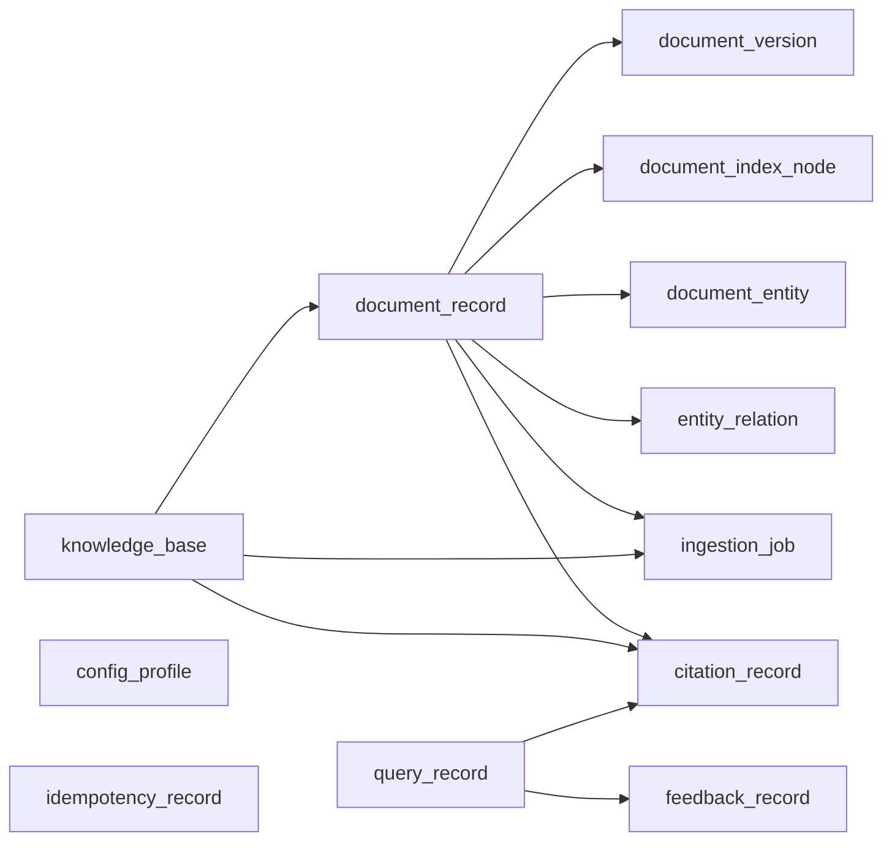

# LazyTT RAG System 全部数据存储结构与字段字典

本文只讲解 LazyTT RAG System 当前实际使用的数据存储结构：PostgreSQL 中有哪些逻辑
数据库、Schema、表和字段，Elasticsearch 中有哪些业务索引和 Mapping 字段，统一
Redis Stack 的三个逻辑 DB 中有哪些键空间和结构字段，以及 MinIO 中如何组织桶、对象路径和
对象元数据。

本文不是数据库迁移操作手册，不包含备份、恢复、切换、回滚或服务器迁移步骤，也不
包含任何真实密码、连接串、Token 或业务数据。

## 1. 文档范围

- 逐字段记录自研 `rag_app` Schema 的 13 张物理表，共 206 个字段，其中包含 12 张业务
  表和 1 张 Alembic 版本表；
- 逐字段记录 RAGFlow v0.26.4 当前 `rag_flow.public` Schema 的 42 张表，共 581 个字段；
- 逐字段记录当前 Elasticsearch 4 个业务索引的完整 Mapping；
- 记录统一 Redis Stack DB 0、DB 1、DB 2 的键名模式、数据类型、内部字段、
  TTL 和用途；
- 记录 MinIO 桶命名、对象路径组成和对象元数据字段；
- 记录主要约束、索引、表关系以及字段在系统中的用途；
- 字段定义以 `src/rag_service/infrastructure/postgres/models.py` 的当前 ORM 为准；
- 数据字典对应的当前 Schema 基准为 `0006_document_version_updates`；
- RAGFlow 表结构以当前运行中的 `infiniflow/ragflow:v0.26.4` 数据库为准；这些表是上游
  实现细节，不是 LazyTT 对外 API 契约，升级 RAGFlow 后必须重新核对；
- Elasticsearch、MinIO 和 Redis Stack 没有 PostgreSQL 意义上的关系表，本文
  分别使用“索引字段”“键空间字段”和“对象元数据字段”描述，避免把不同存储模型混淆。

## 2. PostgreSQL 责任边界

当前一个 PostgreSQL 实例承载两个逻辑数据库和两个最小权限账号：

```text
PostgreSQL 实例
├── rag_app 数据库
│   ├── 账号：rag_app
│   ├── Schema：rag_app
│   ├── 自研 Gateway 的 12 张业务表
│   └── Schema 版本：rag_app.alembic_version
└── rag_flow 数据库
    ├── 账号：rag_flow
    └── RAGFlow v0.26.4 官方内部表
```

- 本文逐字段描述 `rag_app` 和当前 `rag_flow` 两个逻辑数据库。
- `rag_flow` 表由固定版本的 RAGFlow 官方镜像管理；本文只是数据字典，不表示项目会直接
  修改这些表，也不允许通过修改数据库伪造 Dataset、文档、账号或模型配置。
- `rag_flow` 内部表结构应以 `infiniflow/ragflow:v0.26.4` 实际运行数据库为准；升级
  RAGFlow 版本后，上游内部表可能发生变化。
- PostgreSQL 只保存关系数据和业务状态。RAGFlow 原始文件还依赖 MinIO，Chunk 与
  检索索引还依赖 Elasticsearch。

## 3. 全部存储单元总览

| 存储单元 | 当前实现 | 结构规模 | 主要职责 |
|---|---|---:|---|
| `rag_app` PostgreSQL | PostgreSQL 18.4 / Schema `rag_app` | 13 张表，206 个字段 | Gateway 业务状态、隔离、Job、侧车索引、问答审计 |
| `rag_flow` PostgreSQL | PostgreSQL 18.4 / Schema `public` | 42 张表，581 个字段 | RAGFlow Dataset、文档、任务、模型、账号及内部配置 |
| Elasticsearch | 8.11.3 | 当前 4 个业务索引 | RAGFlow Chunk 倒排索引、向量索引和文档元数据索引 |
| Redis Stack DB 0 | Redis Stack 7.4 | 精确缓存、语义缓存、2 个 RediSearch 索引 | 问答缓存、1024 维向量 HNSW 检索和缓存边界 |
| Redis Stack DB 1 | Redis Stack 7.4 | RAGFlow 内部队列与临时键 | Task Executor 队列、取消标记、心跳和上游临时状态 |
| Redis Stack DB 2 | Redis Stack 7.4 | `rag:celery:` 键空间 | Worker/Beat 摄取与维护队列、未确认消息和控制通道；不保存任务结果 |
| MinIO | RELEASE.2026-03-25 | Dataset/租户桶与对象 | RAGFlow 上传文件、解析中间对象和对象元数据 |

### 3.1 自研数据库业务表总览

`rag_app` Schema 当前共有 12 张业务表。`alembic_version` 是 Schema 版本标记表，不是
业务数据表，因此不计入下面的 12 张表和 205 个业务字段。

| 表名 | 字段数 | 主要职责 |
|---|---:|---|
| `config_profile` | 10 | 保存版本化 Parser、Chunk、Embedding、Retrieval 等配置 |
| `knowledge_base` | 18 | 保存知识库、Scope、Profile 绑定和 RAGFlow Dataset 映射 |
| `document_record` | 28 | 保存稳定逻辑文档及当前活动版本视图 |
| `document_version` | 25 | 保存每次文档更新产生的版本记录 |
| `document_index_node` | 14 | 保存 Parent、Section 和 Summary 侧车索引节点 |
| `document_entity` | 14 | 保存从文档中抽取的实体索引 |
| `entity_relation` | 15 | 保存文档内的轻量实体关系 |
| `ingestion_job` | 20 | 保存上传、解析、重解析、更新等异步任务 |
| `idempotency_record` | 11 | 保存写接口幂等请求和已生成响应 |
| `query_record` | 24 | 保存检索与问答请求的审计信息 |
| `citation_record` | 18 | 保存回答引用、位置、分数和验证状态 |
| `feedback_record` | 8 | 保存用户对回答的结构化反馈 |
| **合计** | **205** | — |

## 4. 最终表关系



关系说明：

- `security_scope_id` 是所有隔离数据的 64 位十六进制 Scope Hash；Repository 查询必须
  同时携带它，不能只按 UUID 查询。
- 知识库是文档、摄取任务和引用的上级边界。
- `document_record` 是稳定逻辑文档；`document_version` 保存每次上传的新物理版本。
- 层级节点、实体和关系都是可重建的 Gateway 侧车索引，原始 Chunk 仍在 RAGFlow。
- `query_record` 保存问答请求，引用和反馈通过请求 ID 关联。
- `config_profile` 和 `idempotency_record` 不依赖具体知识库，但仍受版本或 Scope 约束。

## 5. PostgreSQL 类型约定

| 类型 | 含义 |
|---|---|
| `UUID` | 128 位资源标识；API 通常以字符串形式返回 |
| `CHAR(64)` | 固定 64 字符 SHA-256 十六进制值，如 Scope Hash、内容 Hash |
| `VARCHAR(n)` | 最大长度为 `n` 的短文本 |
| `TEXT` | 不设固定短长度的文本 |
| `JSONB` | PostgreSQL 二进制 JSON，可建立 GIN 索引和按字段过滤 |
| `BYTEA` | 二进制数据；当前用于侧车 Embedding 的 FLOAT32 字节序列 |
| `NUMERIC(p,s)` | 精确定点小数；`p` 是总位数，`s` 是小数位数 |
| `TIMESTAMPTZ` | 带时区时间戳，数据库和 API 统一按可还原时区的时间处理 |
| `BIGINT` | 64 位整数，适合修订号、字节数和 Token 数 |
| `INTEGER` | 32 位整数 |
| `SMALLINT` | 16 位整数，适合 HTTP 状态码和简单评分 |

字段表中的“必填”表示数据库列 `NOT NULL`；“默认值”是数据库默认值，不代表 API
调用方一定可以省略同名参数。

## 6. `config_profile`：版本化配置

保存 Parser、Chunk、Embedding、Retrieval、Rerank、Prompt、Model 和 Cache Profile。
Profile 一旦发布不能原地改变语义，行为变化应新增版本。

| 字段 | 类型 | 必填 | 默认值 | 含义 |
|---|---|:---:|---|---|
| `id` | `UUID` | 是 | — | Profile 主键 |
| `profile_type` | `VARCHAR(32)` | 是 | — | Profile 类型枚举 |
| `name` | `VARCHAR(64)` | 是 | — | Profile 名称，不含版本号 |
| `version` | `INTEGER` | 是 | — | 正整数版本号 |
| `description` | `VARCHAR(512)` | 否 | `NULL` | 人类可读说明 |
| `config_json` | `JSONB` | 是 | — | 实际配置内容 |
| `checksum_sha256` | `CHAR(64)` | 是 | — | 配置规范化后的校验值，用于发现同版本漂移 |
| `enabled` | `BOOLEAN` | 是 | `true` | 是否允许新请求引用 |
| `created_at` | `TIMESTAMPTZ` | 是 | `CURRENT_TIMESTAMP` | 创建时间 |
| `updated_at` | `TIMESTAMPTZ` | 是 | `CURRENT_TIMESTAMP` | 最近更新时间，由触发器维护 |

关键约束：`profile_type + name + version` 唯一，`version > 0`。

## 7. `knowledge_base`：知识库主表

保存知识库的 Scope、Profile 绑定、RAGFlow Dataset 映射和知识库 Revision。

| 字段 | 类型 | 必填 | 默认值 | 含义 |
|---|---|:---:|---|---|
| `id` | `UUID` | 是 | — | 自研系统知识库 ID |
| `security_scope_id` | `CHAR(64)` | 是 | — | 由身份边界派生的隔离 Hash |
| `external_id` | `VARCHAR(128)` | 否 | `NULL` | 调用方提供的业务幂等标识 |
| `name` | `VARCHAR(128)` | 是 | — | 知识库名称 |
| `description` | `VARCHAR(2048)` | 否 | `NULL` | 知识库说明 |
| `ragflow_dataset_id` | `VARCHAR(64)` | 否 | `NULL` | 对应的 RAGFlow Dataset ID |
| `parser_profile_ref` | `VARCHAR(128)` | 是 | — | Parser Profile 完整引用，如 `office-default@1` |
| `chunk_profile_ref` | `VARCHAR(128)` | 是 | — | Chunk Profile 完整引用 |
| `embedding_profile_ref` | `VARCHAR(128)` | 是 | — | Embedding Profile 完整引用 |
| `retrieval_profile_ref` | `VARCHAR(128)` | 是 | — | Retrieval Profile 完整引用 |
| `status` | `VARCHAR(32)` | 是 | — | 创建、可用、删除或失败状态 |
| `revision` | `BIGINT` | 是 | `0` | 内容修订号；变化后参与缓存隔离 |
| `row_version` | `BIGINT` | 是 | `0` | 数据库乐观锁版本 |
| `last_error_code` | `VARCHAR(64)` | 否 | `NULL` | 最近一次稳定错误码 |
| `last_error_message` | `VARCHAR(512)` | 否 | `NULL` | 最近一次脱敏错误摘要 |
| `deleted_at` | `TIMESTAMPTZ` | 否 | `NULL` | 软删除时间 |
| `created_at` | `TIMESTAMPTZ` | 是 | `CURRENT_TIMESTAMP` | 创建时间 |
| `updated_at` | `TIMESTAMPTZ` | 是 | `CURRENT_TIMESTAMP` | 最近更新时间 |

关键约束：同一 Scope 内 `external_id` 唯一；`ragflow_dataset_id` 全局唯一；
`revision`、`row_version` 不得为负数。

## 8. `document_record`：逻辑文档主表

它是文档 API 和在线检索使用的稳定入口。文档更新期间，旧活动版本继续可用；新版本
成功后才在事务中切换活动版本。

| 字段 | 类型 | 必填 | 默认值 | 含义 |
|---|---|:---:|---|---|
| `id` | `UUID` | 是 | — | 逻辑文档 ID |
| `security_scope_id` | `CHAR(64)` | 是 | — | 文档隔离 Hash |
| `knowledge_base_id` | `UUID` | 是 | — | 所属知识库 ID |
| `external_id` | `VARCHAR(128)` | 否 | `NULL` | 调用方文档标识；软删除后可以复用 |
| `ragflow_document_id` | `VARCHAR(64)` | 否 | `NULL` | 当前活动版本对应的 RAGFlow 文档 ID |
| `active_version_id` | `UUID` | 否 | `NULL` | 当前活动 `document_version.id` |
| `active_version_number` | `INTEGER` | 是 | `1` | 当前活动版本号 |
| `document_revision` | `BIGINT` | 是 | `1` | 逻辑文档修订号，用于并发和缓存边界 |
| `filename` | `VARCHAR(255)` | 是 | — | 用户可见原文件名 |
| `safe_filename` | `VARCHAR(255)` | 是 | — | 清理后的安全文件名 |
| `mime_type` | `VARCHAR(128)` | 是 | — | 服务端识别的 MIME 类型 |
| `file_size_bytes` | `BIGINT` | 是 | — | 文件字节数 |
| `content_sha256` | `CHAR(64)` | 是 | — | 文件内容 Hash，用于完整性和精确去重 |
| `metadata_json` | `JSONB` | 否 | `NULL` | 用户元数据与自动抽取的结构化元数据 |
| `parser_profile_ref` | `VARCHAR(128)` | 是 | — | 实际 Parser Profile 引用 |
| `chunk_profile_ref` | `VARCHAR(128)` | 是 | — | 实际 Chunk Profile 引用 |
| `status` | `VARCHAR(32)` | 是 | — | 上传、解析、索引、可用、失败或删除状态 |
| `progress` | `NUMERIC(5,4)` | 是 | `0` | `0～1` 的统一处理进度 |
| `chunk_count` | `INTEGER` | 是 | `0` | 当前活动版本 Chunk 数 |
| `token_count` | `BIGINT` | 是 | `0` | 当前活动版本 Token 数 |
| `row_version` | `BIGINT` | 是 | `0` | 乐观锁版本 |
| `last_error_code` | `VARCHAR(64)` | 否 | `NULL` | 最近错误码 |
| `last_error_message` | `VARCHAR(1024)` | 否 | `NULL` | 最近脱敏错误摘要 |
| `engine_progress_message` | `VARCHAR(2048)` | 否 | `NULL` | RAGFlow 当前解析阶段摘要 |
| `indexed_at` | `TIMESTAMPTZ` | 否 | `NULL` | 当前版本完成索引的时间 |
| `deleted_at` | `TIMESTAMPTZ` | 否 | `NULL` | 软删除时间 |
| `created_at` | `TIMESTAMPTZ` | 是 | `CURRENT_TIMESTAMP` | 创建时间 |
| `updated_at` | `TIMESTAMPTZ` | 是 | `CURRENT_TIMESTAMP` | 最近更新时间 |

关键约束和索引：

- 同一 Scope、知识库中，未删除文档的非空 `external_id` 唯一；
- `ragflow_document_id` 全局唯一；
- `metadata_json` 使用 GIN 索引；
- Scope、知识库、状态、Hash 和文件名均有查询索引；
- 文件大小、进度、Chunk、Token 和版本号不能为负数或非法范围。

## 9. `document_version`：文档版本历史

每次更新创建一条不可变候选版本。只有解析和索引成功的版本才能变成 `ACTIVE`，旧活动
版本随后变成 `RETIRED`。

| 字段 | 类型 | 必填 | 默认值 | 含义 |
|---|---|:---:|---|---|
| `id` | `UUID` | 是 | — | 文档版本 ID |
| `security_scope_id` | `CHAR(64)` | 是 | — | 版本隔离 Hash |
| `knowledge_base_id` | `UUID` | 是 | — | 所属知识库 ID |
| `document_id` | `UUID` | 是 | — | 所属逻辑文档 ID |
| `version_number` | `INTEGER` | 是 | — | 从 1 开始递增的版本号 |
| `ragflow_document_id` | `VARCHAR(64)` | 否 | `NULL` | 此版本对应的 RAGFlow 物理文档 ID |
| `filename` | `VARCHAR(255)` | 是 | — | 此版本原文件名 |
| `safe_filename` | `VARCHAR(255)` | 是 | — | 此版本安全文件名 |
| `mime_type` | `VARCHAR(128)` | 是 | — | MIME 类型 |
| `file_size_bytes` | `BIGINT` | 是 | — | 文件字节数 |
| `content_sha256` | `CHAR(64)` | 是 | — | 此版本内容 Hash |
| `metadata_json` | `JSONB` | 是 | `{}` | 此版本元数据快照 |
| `parser_profile_ref` | `VARCHAR(128)` | 是 | — | 此版本 Parser Profile |
| `chunk_profile_ref` | `VARCHAR(128)` | 是 | — | 此版本 Chunk Profile |
| `status` | `VARCHAR(32)` | 是 | — | `PENDING`、处理中、`ACTIVE`、`RETIRED` 或 `FAILED` |
| `requested_mode` | `VARCHAR(32)` | 是 | — | 调用方请求的 `AUTO` 或 `SAFE_REPLACE` |
| `effective_mode` | `VARCHAR(32)` | 是 | — | 服务最终采用的更新模式 |
| `chunk_count` | `INTEGER` | 是 | `0` | 此版本 Chunk 数 |
| `token_count` | `BIGINT` | 是 | `0` | 此版本 Token 数 |
| `last_error_code` | `VARCHAR(64)` | 否 | `NULL` | 版本处理错误码 |
| `last_error_message` | `VARCHAR(1024)` | 否 | `NULL` | 版本处理错误摘要 |
| `activated_at` | `TIMESTAMPTZ` | 否 | `NULL` | 成为活动版本的时间 |
| `retired_at` | `TIMESTAMPTZ` | 否 | `NULL` | 被新版本替代的时间 |
| `created_at` | `TIMESTAMPTZ` | 是 | `CURRENT_TIMESTAMP` | 创建时间 |
| `updated_at` | `TIMESTAMPTZ` | 是 | `CURRENT_TIMESTAMP` | 最近更新时间 |

关键约束：同一逻辑文档的 `version_number` 唯一；同一逻辑文档最多一条 `ACTIVE`；
删除逻辑文档会级联删除本地版本记录，但不会绕过应用状态机直接操作 RAGFlow。

## 10. `document_index_node`：层级与摘要侧车索引

保存 Parent、Section、Summary 节点及其 Embedding。命中后必须通过源 Chunk ID 回读
RAGFlow 原文，不能直接把摘要当成引用正文。

| 字段 | 类型 | 必填 | 默认值 | 含义 |
|---|---|:---:|---|---|
| `id` | `UUID` | 是 | — | 节点 ID |
| `security_scope_id` | `CHAR(64)` | 是 | — | 节点隔离 Hash |
| `knowledge_base_id` | `UUID` | 是 | — | 所属知识库 |
| `document_id` | `UUID` | 是 | — | 所属逻辑文档 |
| `node_type` | `VARCHAR(16)` | 是 | — | `PARENT`、`SECTION` 或 `SUMMARY` |
| `ordinal` | `INTEGER` | 是 | — | 同类型节点在文档中的顺序，从 0 开始 |
| `content` | `TEXT` | 是 | — | 节点的聚合内容或摘要文本 |
| `source_chunk_ids_json` | `JSONB` | 是 | — | 节点对应的真实 RAGFlow Chunk ID 数组 |
| `embedding_bytes` | `BYTEA` | 否 | `NULL` | 固定顺序 FLOAT32 向量字节 |
| `embedding_dimension` | `INTEGER` | 是 | `0` | 向量维度；未生成时为 0 |
| `metadata_json` | `JSONB` | 是 | `{}` | 标题、页码和层级等辅助元数据 |
| `index_version` | `INTEGER` | 是 | `1` | 侧车索引算法版本 |
| `created_at` | `TIMESTAMPTZ` | 是 | `CURRENT_TIMESTAMP` | 创建时间 |
| `updated_at` | `TIMESTAMPTZ` | 是 | `CURRENT_TIMESTAMP` | 最近更新时间 |

关键约束：文档、节点类型、序号和索引版本联合唯一；源 Chunk 数组有 GIN 索引。

## 11. `document_entity`：文档实体侧车索引

保存确定性抽取的实体、别名和证据 Chunk，不保存 RAGFlow 原文副本。

| 字段 | 类型 | 必填 | 默认值 | 含义 |
|---|---|:---:|---|---|
| `id` | `UUID` | 是 | — | 实体记录 ID |
| `security_scope_id` | `CHAR(64)` | 是 | — | 实体隔离 Hash |
| `knowledge_base_id` | `UUID` | 是 | — | 所属知识库 |
| `document_id` | `UUID` | 是 | — | 所属逻辑文档 |
| `canonical_name` | `VARCHAR(128)` | 是 | — | 用于展示的规范名称 |
| `normalized_name` | `VARCHAR(128)` | 是 | — | 用于匹配和去重的标准化名称 |
| `entity_type` | `VARCHAR(32)` | 是 | — | 组织、技术、日期、版本等实体类型 |
| `aliases_json` | `JSONB` | 是 | — | 实体别名数组 |
| `source_chunk_ids_json` | `JSONB` | 是 | — | 出现实体验证据的 RAGFlow Chunk ID |
| `mention_count` | `INTEGER` | 是 | `1` | 文档中出现次数，必须大于 0 |
| `metadata_json` | `JSONB` | 是 | `{}` | 抽取器和位置等辅助元数据 |
| `index_version` | `INTEGER` | 是 | `1` | 实体索引算法版本 |
| `created_at` | `TIMESTAMPTZ` | 是 | `CURRENT_TIMESTAMP` | 创建时间 |
| `updated_at` | `TIMESTAMPTZ` | 是 | `CURRENT_TIMESTAMP` | 最近更新时间 |

关键约束：同一文档、标准化名称和索引版本联合唯一；实体名称和证据 Chunk 有索引。

## 12. `entity_relation`：轻量实体关系

保存文档中明确出现的主体—谓词—客体关系。它是轻量导航索引，不是完整知识图谱。

| 字段 | 类型 | 必填 | 默认值 | 含义 |
|---|---|:---:|---|---|
| `id` | `UUID` | 是 | — | 关系记录 ID |
| `security_scope_id` | `CHAR(64)` | 是 | — | 关系隔离 Hash |
| `knowledge_base_id` | `UUID` | 是 | — | 所属知识库 |
| `document_id` | `UUID` | 是 | — | 所属逻辑文档 |
| `subject_name` | `VARCHAR(128)` | 是 | — | 主体展示名称 |
| `subject_normalized` | `VARCHAR(128)` | 是 | — | 主体标准化名称 |
| `predicate` | `VARCHAR(64)` | 是 | — | 关系谓词 |
| `object_name` | `VARCHAR(128)` | 是 | — | 客体展示名称 |
| `object_normalized` | `VARCHAR(128)` | 是 | — | 客体标准化名称 |
| `source_chunk_ids_json` | `JSONB` | 是 | — | 支撑该关系的真实 Chunk ID |
| `confidence` | `NUMERIC(5,4)` | 是 | `1` | `0～1` 抽取置信度，不是检索相似度 |
| `metadata_json` | `JSONB` | 是 | `{}` | 抽取位置和规则等辅助信息 |
| `index_version` | `INTEGER` | 是 | `1` | 关系索引算法版本 |
| `created_at` | `TIMESTAMPTZ` | 是 | `CURRENT_TIMESTAMP` | 创建时间 |
| `updated_at` | `TIMESTAMPTZ` | 是 | `CURRENT_TIMESTAMP` | 最近更新时间 |

关键约束：同一文档中标准化三元组和索引版本联合唯一。

## 13. `ingestion_job`：异步摄取任务

保存上传、解析、重解析、文档更新、删除和清理任务，并支持 Worker 认领、租约、有限
重试和取消。

| 字段 | 类型 | 必填 | 默认值 | 含义 |
|---|---|:---:|---|---|
| `id` | `UUID` | 是 | — | Job ID |
| `security_scope_id` | `CHAR(64)` | 是 | — | Job 隔离 Hash |
| `job_type` | `VARCHAR(32)` | 是 | — | Job 类型枚举 |
| `status` | `VARCHAR(32)` | 是 | — | 等待、运行、重试、成功、失败或取消状态 |
| `knowledge_base_id` | `UUID` | 否 | `NULL` | 相关知识库；全局清理任务可以为空 |
| `document_id` | `UUID` | 否 | `NULL` | 相关逻辑文档；知识库级任务可以为空 |
| `progress` | `NUMERIC(5,4)` | 是 | `0` | `0～1` 的任务进度 |
| `attempt` | `INTEGER` | 是 | `0` | 已执行次数 |
| `max_attempts` | `INTEGER` | 是 | `2` | 最大执行次数 |
| `payload_json` | `JSONB` | 否 | `NULL` | 类型特定输入；不得写入明文 Secret |
| `result_json` | `JSONB` | 否 | `NULL` | 类型特定结果摘要 |
| `error_code` | `VARCHAR(64)` | 否 | `NULL` | 稳定错误码 |
| `error_message` | `VARCHAR(1024)` | 否 | `NULL` | 脱敏错误摘要 |
| `next_retry_at` | `TIMESTAMPTZ` | 否 | `NULL` | 下次允许重试时间 |
| `locked_by` | `VARCHAR(128)` | 否 | `NULL` | 当前 Worker 标识 |
| `locked_until` | `TIMESTAMPTZ` | 否 | `NULL` | Worker 租约截止时间 |
| `started_at` | `TIMESTAMPTZ` | 否 | `NULL` | 首次开始时间 |
| `finished_at` | `TIMESTAMPTZ` | 否 | `NULL` | 最终结束时间 |
| `created_at` | `TIMESTAMPTZ` | 是 | `CURRENT_TIMESTAMP` | 创建时间 |
| `updated_at` | `TIMESTAMPTZ` | 是 | `CURRENT_TIMESTAMP` | 最近更新时间 |

关键索引按 Scope、状态、重试时间、租约、文档和知识库支持并发任务认领。

## 14. `idempotency_record`：写请求幂等记录

保存请求指纹和已完成响应快照，使相同 Scope 的重复写请求不会创建重复资源。

| 字段 | 类型 | 必填 | 默认值 | 含义 |
|---|---|:---:|---|---|
| `security_scope_id` | `CHAR(64)` | 是 | — | 复合主键；隔离 Hash |
| `idempotency_key` | `VARCHAR(128)` | 是 | — | 复合主键；调用方提供的幂等键 |
| `http_method` | `VARCHAR(8)` | 是 | — | 复合主键；HTTP 方法 |
| `request_path` | `VARCHAR(255)` | 是 | — | 复合主键；接口路径 |
| `request_sha256` | `CHAR(64)` | 是 | — | 请求规范化内容 Hash，防止同键不同请求 |
| `processing_status` | `VARCHAR(16)` | 是 | — | `PROCESSING`、`COMPLETED` 或 `FAILED` |
| `response_status` | `SMALLINT` | 否 | `NULL` | 已完成响应 HTTP 状态码 |
| `response_json` | `JSONB` | 否 | `NULL` | 可安全重放的响应快照 |
| `resource_id` | `UUID` | 否 | `NULL` | 创建或操作的资源 ID |
| `created_at` | `TIMESTAMPTZ` | 是 | `CURRENT_TIMESTAMP` | 创建时间 |
| `expires_at` | `TIMESTAMPTZ` | 是 | — | 幂等记录过期时间，必须晚于创建时间 |

## 15. `query_record`：检索与问答审计

保存脱敏问题、请求状态、缓存状态、回答和诊断统计，不应记录凭据或未经授权的完整
业务上下文。

| 字段 | 类型 | 必填 | 默认值 | 含义 |
|---|---|:---:|---|---|
| `request_id` | `UUID` | 是 | — | 请求主键，同时用于查询状态与取消 |
| `security_scope_id` | `CHAR(64)` | 是 | — | 请求隔离 Hash |
| `request_status` | `VARCHAR(32)` | 是 | — | 接受、运行、完成、失败或取消状态 |
| `outcome` | `VARCHAR(32)` | 否 | `NULL` | `success`、`no_evidence`、`refused` 或 `cancelled` |
| `query_sha256` | `CHAR(64)` | 是 | — | 原问题 Hash |
| `query_redacted` | `TEXT` | 否 | `NULL` | 脱敏后的原问题 |
| `effective_query_redacted` | `TEXT` | 否 | `NULL` | 脱敏后的 Rewrite/翻译问题 |
| `knowledge_base_ids_json` | `JSONB` | 是 | — | 本次查询的知识库 ID 数组 |
| `retrieval_profile_ref` | `VARCHAR(128)` | 是 | — | Retrieval Profile 引用 |
| `prompt_profile_ref` | `VARCHAR(128)` | 否 | `NULL` | 问答时使用的 Prompt Profile |
| `model_profile_ref` | `VARCHAR(128)` | 否 | `NULL` | 问答时使用的 Model Profile |
| `cache_status` | `VARCHAR(32)` | 是 | `BYPASS` | 绕过、未命中、精确命中、语义命中或写入失败 |
| `candidate_count` | `INTEGER` | 是 | `0` | 融合后候选数 |
| `context_count` | `INTEGER` | 是 | `0` | 送入 LLM 的上下文数 |
| `answer_text` | `TEXT` | 否 | `NULL` | 最终回答文本 |
| `timings_json` | `JSONB` | 否 | `NULL` | 缓存、检索、生成等阶段耗时 |
| `warnings_json` | `JSONB` | 否 | `NULL` | 降级和非致命警告数组 |
| `prompt_tokens` | `INTEGER` | 否 | `NULL` | 输入 Token 数 |
| `completion_tokens` | `INTEGER` | 否 | `NULL` | 输出 Token 数 |
| `total_tokens` | `INTEGER` | 否 | `NULL` | 总 Token 数 |
| `error_code` | `VARCHAR(64)` | 否 | `NULL` | 请求失败错误码 |
| `created_at` | `TIMESTAMPTZ` | 是 | `CURRENT_TIMESTAMP` | 请求创建时间 |
| `completed_at` | `TIMESTAMPTZ` | 否 | `NULL` | 请求结束时间 |
| `expires_at` | `TIMESTAMPTZ` | 否 | `NULL` | 审计记录清理时间 |

知识库 ID 数组使用 GIN 索引；查询状态、结果和时间均按 Scope 建索引。

## 16. `citation_record`：回答引用

保存一次问答实际使用的来源、顺序、页码、坐标、摘录和检索/重排分数。

| 字段 | 类型 | 必填 | 默认值 | 含义 |
|---|---|:---:|---|---|
| `id` | `UUID` | 是 | — | 引用记录 ID |
| `security_scope_id` | `CHAR(64)` | 是 | — | 引用隔离 Hash |
| `request_id` | `UUID` | 是 | — | 所属 `query_record.request_id` |
| `ordinal` | `INTEGER` | 是 | — | 引用顺序，从 0 开始 |
| `label` | `VARCHAR(16)` | 是 | — | 回答中显示的 `C1`、`C2` 等标签 |
| `knowledge_base_id` | `UUID` | 是 | — | 来源知识库 |
| `document_id` | `UUID` | 是 | — | 来源逻辑文档 |
| `engine_chunk_id` | `VARCHAR(128)` | 是 | — | RAGFlow/搜索引擎 Chunk ID |
| `document_name` | `VARCHAR(255)` | 是 | — | 来源文件名快照 |
| `heading_path_json` | `JSONB` | 否 | `NULL` | 标题层级路径 |
| `page_start` | `INTEGER` | 否 | `NULL` | 起始页；不能为负数 |
| `page_end` | `INTEGER` | 否 | `NULL` | 结束页；不能为负数 |
| `positions_json` | `JSONB` | 否 | `NULL` | 页面坐标或结构位置数组 |
| `quote_text` | `TEXT` | 是 | — | 经边界验证的引用摘录 |
| `retrieval_score` | `NUMERIC(10,8)` | 否 | `NULL` | 检索融合分数 |
| `rerank_score` | `NUMERIC(10,8)` | 否 | `NULL` | 外部 Cross-Encoder 重排分数 |
| `verification_status` | `VARCHAR(32)` | 是 | — | `VALID`、`INVALID` 或 `UNVERIFIED` |
| `created_at` | `TIMESTAMPTZ` | 是 | `CURRENT_TIMESTAMP` | 创建时间 |

## 17. `feedback_record`：用户反馈

保存对某次回答的结构化反馈，可用于离线评估，不直接改变在线索引。

| 字段 | 类型 | 必填 | 默认值 | 含义 |
|---|---|:---:|---|---|
| `id` | `UUID` | 是 | — | 反馈 ID |
| `security_scope_id` | `CHAR(64)` | 是 | — | 反馈隔离 Hash |
| `request_id` | `UUID` | 是 | — | 所属问答请求 ID |
| `rating` | `SMALLINT` | 否 | `NULL` | 只允许 `1` 或 `-1` |
| `feedback_type` | `VARCHAR(32)` | 是 | — | 有用、无用、答案错误、引用错误等类型 |
| `comment_text` | `TEXT` | 否 | `NULL` | 用户补充说明 |
| `corrected_answer` | `TEXT` | 否 | `NULL` | 用户提供的参考纠正答案 |
| `created_at` | `TIMESTAMPTZ` | 是 | `CURRENT_TIMESTAMP` | 创建时间 |

删除对应 `query_record` 时，引用和反馈记录按外键级联删除。

## 18. `alembic_version`：自研 Schema 版本标记

该表是 `rag_app` Schema 的第 13 张物理表，只保存当前 Alembic Revision。

| 字段 | 类型 | 必填 | 默认值 | 键/约束 | 含义 |
|---|---|:---:|---|---|---|
| `version_num` | `VARCHAR(32)` | 是 | — | 主键 | 当前已应用的 Alembic Revision；它是版本标识，不是迁移操作记录。 |

## 19. RAGFlow `rag_flow.public` 全部表与字段

本节来自当前运行中的 `infiniflow/ragflow:v0.26.4` 实际 Schema，共 **42 张表、581 个字段**。
字段名、类型、空值、默认值和数据库键是实测结果；敏感字段只展示定义，不展示值。

### 19.1 `api_4_conversation`

保存面向公开 API 的会话、消息上下文和响应配置。

| 字段 | 类型 | 必填 | 默认值 | 键/约束 | 含义 |
|---|---|:---:|---|---|---|
| `id` | `VARCHAR(32)` | 是 | — | 主键 | 记录主键或资源唯一标识。 |
| `create_time` | `BIGINT` | 否 | — | — | 创建时间的 Epoch/数字表示。 |
| `create_date` | `TIMESTAMP` | 否 | — | — | 创建时间的字符串表示。 |
| `update_time` | `BIGINT` | 否 | — | — | 最后更新时间的 Epoch/数字表示。 |
| `update_date` | `TIMESTAMP` | 否 | — | — | 最后更新时间的字符串表示。 |
| `name` | `VARCHAR(255)` | 否 | — | — | 显示名称。 |
| `dialog_id` | `VARCHAR(32)` | 是 | — | — | 关联 Dialog/Assistant 标识。 |
| `user_id` | `VARCHAR(255)` | 是 | — | — | 关联的 RAGFlow 用户标识。 |
| `exp_user_id` | `VARCHAR(255)` | 否 | — | — | 关联的exp 用户标识。 |
| `message` | `TEXT` | 否 | — | — | 消息正文或结构化消息内容。 |
| `reference` | `TEXT` | 否 | — | — | RAGFlow 上游“reference”字段；具体枚举和值域由对应上游模块解释。 |
| `tokens` | `INTEGER` | 是 | — | — | RAGFlow 上游“tokens”字段；具体枚举和值域由对应上游模块解释。 |
| `source` | `VARCHAR(16)` | 否 | — | — | 数据来源。 |
| `dsl` | `TEXT` | 否 | — | — | Agent/Canvas 或 Pipeline 的 DSL 内容。 |
| `duration` | `REAL` | 是 | — | — | RAGFlow 上游“duration”字段；具体枚举和值域由对应上游模块解释。 |
| `round` | `INTEGER` | 是 | — | — | RAGFlow 上游“round”字段；具体枚举和值域由对应上游模块解释。 |
| `thumb_up` | `INTEGER` | 是 | — | — | RAGFlow 上游“thumb up”字段；具体枚举和值域由对应上游模块解释。 |
| `errors` | `TEXT` | 否 | — | — | 结构化错误集合。 |
| `version_title` | `VARCHAR(255)` | 否 | — | — | RAGFlow 上游“版本 标题”字段；具体枚举和值域由对应上游模块解释。 |

### 19.2 `api_token`

保存 RAGFlow 用户创建的 API Token 及其状态。

| 字段 | 类型 | 必填 | 默认值 | 键/约束 | 含义 |
|---|---|:---:|---|---|---|
| `create_time` | `BIGINT` | 否 | — | — | 创建时间的 Epoch/数字表示。 |
| `create_date` | `TIMESTAMP` | 否 | — | — | 创建时间的字符串表示。 |
| `update_time` | `BIGINT` | 否 | — | — | 最后更新时间的 Epoch/数字表示。 |
| `update_date` | `TIMESTAMP` | 否 | — | — | 最后更新时间的字符串表示。 |
| `tenant_id` | `VARCHAR(32)` | 是 | — | 主键 | 所属 RAGFlow 租户标识。 |
| `token` | `VARCHAR(255)` | 是 | — | 主键 | API Token；敏感字段，不得输出实际值。 |
| `dialog_id` | `VARCHAR(32)` | 否 | — | — | 关联 Dialog/Assistant 标识。 |
| `source` | `VARCHAR(16)` | 否 | — | — | 数据来源。 |
| `beta` | `VARCHAR(255)` | 否 | — | — | RAGFlow 上游“beta”字段；具体枚举和值域由对应上游模块解释。 |

### 19.3 `canvas_template`

保存 Agent/Canvas 可复用模板。

| 字段 | 类型 | 必填 | 默认值 | 键/约束 | 含义 |
|---|---|:---:|---|---|---|
| `id` | `VARCHAR(32)` | 是 | — | 主键 | 记录主键或资源唯一标识。 |
| `create_time` | `BIGINT` | 否 | — | — | 创建时间的 Epoch/数字表示。 |
| `create_date` | `TIMESTAMP` | 否 | — | — | 创建时间的字符串表示。 |
| `update_time` | `BIGINT` | 否 | — | — | 最后更新时间的 Epoch/数字表示。 |
| `update_date` | `TIMESTAMP` | 否 | — | — | 最后更新时间的字符串表示。 |
| `avatar` | `TEXT` | 否 | — | — | 用户头像地址或对象引用。 |
| `title` | `TEXT` | 否 | — | — | 标题。 |
| `description` | `TEXT` | 否 | — | — | 说明文本。 |
| `canvas_type` | `VARCHAR(32)` | 否 | — | — | Canvas 类型。 |
| `canvas_types` | `TEXT` | 否 | — | — | RAGFlow 上游“Canvas types”字段；具体枚举和值域由对应上游模块解释。 |
| `canvas_category` | `VARCHAR(32)` | 是 | — | — | RAGFlow 上游“Canvas category”字段；具体枚举和值域由对应上游模块解释。 |
| `dsl` | `TEXT` | 否 | — | — | Agent/Canvas 或 Pipeline 的 DSL 内容。 |

### 19.4 `chat_channel`

保存聊天渠道及其接入配置。

| 字段 | 类型 | 必填 | 默认值 | 键/约束 | 含义 |
|---|---|:---:|---|---|---|
| `id` | `VARCHAR(32)` | 是 | — | 主键 | 记录主键或资源唯一标识。 |
| `create_time` | `BIGINT` | 否 | — | — | 创建时间的 Epoch/数字表示。 |
| `create_date` | `TIMESTAMP` | 否 | — | — | 创建时间的字符串表示。 |
| `update_time` | `BIGINT` | 否 | — | — | 最后更新时间的 Epoch/数字表示。 |
| `update_date` | `TIMESTAMP` | 否 | — | — | 最后更新时间的字符串表示。 |
| `tenant_id` | `VARCHAR(32)` | 是 | — | — | 所属 RAGFlow 租户标识。 |
| `name` | `VARCHAR(128)` | 是 | — | — | 显示名称。 |
| `channel` | `VARCHAR(128)` | 是 | — | — | RAGFlow 上游“渠道”字段；具体枚举和值域由对应上游模块解释。 |
| `config` | `TEXT` | 是 | — | — | 结构化配置内容。 |
| `chat_id` | `VARCHAR(32)` | 否 | — | — | 关联的chat标识。 |
| `status` | `INTEGER` | 是 | — | — | 当前业务状态。 |
| `dialog_id` | `VARCHAR(32)` | 否 | — | — | 关联 Dialog/Assistant 标识。 |

### 19.5 `compilation_template`

保存编排或编译模板定义。

| 字段 | 类型 | 必填 | 默认值 | 键/约束 | 含义 |
|---|---|:---:|---|---|---|
| `id` | `VARCHAR(32)` | 是 | — | 主键 | 记录主键或资源唯一标识。 |
| `create_time` | `BIGINT` | 否 | — | — | 创建时间的 Epoch/数字表示。 |
| `create_date` | `TIMESTAMP` | 否 | — | — | 创建时间的字符串表示。 |
| `update_time` | `BIGINT` | 否 | — | — | 最后更新时间的 Epoch/数字表示。 |
| `update_date` | `TIMESTAMP` | 否 | — | — | 最后更新时间的字符串表示。 |
| `tenant_id` | `VARCHAR(32)` | 否 | — | — | 所属 RAGFlow 租户标识。 |
| `group_id` | `VARCHAR(32)` | 否 | — | — | 关联的分组标识。 |
| `name` | `VARCHAR(128)` | 是 | — | — | 显示名称。 |
| `description` | `TEXT` | 否 | — | — | 说明文本。 |
| `kind` | `VARCHAR(64)` | 是 | — | — | RAGFlow 上游“kind”字段；具体枚举和值域由对应上游模块解释。 |
| `config` | `TEXT` | 是 | — | — | 结构化配置内容。 |
| `is_builtin` | `BOOLEAN` | 是 | — | — | 是否满足“builtin”条件的布尔标记。 |
| `status` | `VARCHAR(1)` | 否 | — | — | 当前业务状态。 |

### 19.6 `compilation_template_group`

保存编排模板分组。

| 字段 | 类型 | 必填 | 默认值 | 键/约束 | 含义 |
|---|---|:---:|---|---|---|
| `id` | `VARCHAR(32)` | 是 | — | 主键 | 记录主键或资源唯一标识。 |
| `create_time` | `BIGINT` | 否 | — | — | 创建时间的 Epoch/数字表示。 |
| `create_date` | `TIMESTAMP` | 否 | — | — | 创建时间的字符串表示。 |
| `update_time` | `BIGINT` | 否 | — | — | 最后更新时间的 Epoch/数字表示。 |
| `update_date` | `TIMESTAMP` | 否 | — | — | 最后更新时间的字符串表示。 |
| `tenant_id` | `VARCHAR(32)` | 是 | — | — | 所属 RAGFlow 租户标识。 |
| `name` | `VARCHAR(128)` | 是 | — | — | 显示名称。 |
| `description` | `TEXT` | 否 | — | — | 说明文本。 |
| `scope` | `VARCHAR(16)` | 是 | — | — | RAGFlow 上游“scope”字段；具体枚举和值域由对应上游模块解释。 |
| `status` | `VARCHAR(1)` | 否 | — | — | 当前业务状态。 |

### 19.7 `connector`

保存外部数据源连接器及同步配置。

| 字段 | 类型 | 必填 | 默认值 | 键/约束 | 含义 |
|---|---|:---:|---|---|---|
| `id` | `VARCHAR(32)` | 是 | — | 主键 | 记录主键或资源唯一标识。 |
| `create_time` | `BIGINT` | 否 | — | — | 创建时间的 Epoch/数字表示。 |
| `create_date` | `TIMESTAMP` | 否 | — | — | 创建时间的字符串表示。 |
| `update_time` | `BIGINT` | 否 | — | — | 最后更新时间的 Epoch/数字表示。 |
| `update_date` | `TIMESTAMP` | 否 | — | — | 最后更新时间的字符串表示。 |
| `tenant_id` | `VARCHAR(32)` | 是 | — | — | 所属 RAGFlow 租户标识。 |
| `name` | `VARCHAR(128)` | 是 | — | — | 显示名称。 |
| `source` | `VARCHAR(128)` | 是 | — | — | 数据来源。 |
| `input_type` | `VARCHAR(128)` | 是 | — | — | input类型。 |
| `config` | `TEXT` | 是 | — | — | 结构化配置内容。 |
| `refresh_freq` | `INTEGER` | 是 | — | — | RAGFlow 上游“refresh freq”字段；具体枚举和值域由对应上游模块解释。 |
| `prune_freq` | `INTEGER` | 是 | — | — | RAGFlow 上游“prune freq”字段；具体枚举和值域由对应上游模块解释。 |
| `timeout_secs` | `INTEGER` | 是 | — | — | RAGFlow 上游“timeout secs”字段；具体枚举和值域由对应上游模块解释。 |
| `indexing_start` | `TIMESTAMP` | 否 | — | — | RAGFlow 上游“indexing start”字段；具体枚举和值域由对应上游模块解释。 |
| `status` | `VARCHAR(16)` | 否 | — | — | 当前业务状态。 |

### 19.8 `connector2kb`

保存连接器与知识库之间的关联。

| 字段 | 类型 | 必填 | 默认值 | 键/约束 | 含义 |
|---|---|:---:|---|---|---|
| `id` | `VARCHAR(32)` | 是 | — | 主键 | 记录主键或资源唯一标识。 |
| `create_time` | `BIGINT` | 否 | — | — | 创建时间的 Epoch/数字表示。 |
| `create_date` | `TIMESTAMP` | 否 | — | — | 创建时间的字符串表示。 |
| `update_time` | `BIGINT` | 否 | — | — | 最后更新时间的 Epoch/数字表示。 |
| `update_date` | `TIMESTAMP` | 否 | — | — | 最后更新时间的字符串表示。 |
| `connector_id` | `VARCHAR(32)` | 是 | — | — | 外部连接器标识。 |
| `kb_id` | `VARCHAR(32)` | 是 | — | — | 关联的知识库/Dataset 标识。 |
| `auto_parse` | `VARCHAR(1)` | 是 | — | — | 上传后是否自动创建解析任务。 |

### 19.9 `conversation`

保存 Dialog 下的会话内容与状态。

| 字段 | 类型 | 必填 | 默认值 | 键/约束 | 含义 |
|---|---|:---:|---|---|---|
| `id` | `VARCHAR(32)` | 是 | — | 主键 | 记录主键或资源唯一标识。 |
| `create_time` | `BIGINT` | 否 | — | — | 创建时间的 Epoch/数字表示。 |
| `create_date` | `TIMESTAMP` | 否 | — | — | 创建时间的字符串表示。 |
| `update_time` | `BIGINT` | 否 | — | — | 最后更新时间的 Epoch/数字表示。 |
| `update_date` | `TIMESTAMP` | 否 | — | — | 最后更新时间的字符串表示。 |
| `dialog_id` | `VARCHAR(32)` | 是 | — | — | 关联 Dialog/Assistant 标识。 |
| `name` | `VARCHAR(255)` | 否 | — | — | 显示名称。 |
| `message` | `TEXT` | 否 | — | — | 消息正文或结构化消息内容。 |
| `reference` | `TEXT` | 否 | — | — | RAGFlow 上游“reference”字段；具体枚举和值域由对应上游模块解释。 |
| `user_id` | `VARCHAR(255)` | 否 | — | — | 关联的 RAGFlow 用户标识。 |

### 19.10 `dialog`

保存 RAGFlow Chat Assistant/Dialog 配置。

| 字段 | 类型 | 必填 | 默认值 | 键/约束 | 含义 |
|---|---|:---:|---|---|---|
| `id` | `VARCHAR(32)` | 是 | — | 主键 | 记录主键或资源唯一标识。 |
| `create_time` | `BIGINT` | 否 | — | — | 创建时间的 Epoch/数字表示。 |
| `create_date` | `TIMESTAMP` | 否 | — | — | 创建时间的字符串表示。 |
| `update_time` | `BIGINT` | 否 | — | — | 最后更新时间的 Epoch/数字表示。 |
| `update_date` | `TIMESTAMP` | 否 | — | — | 最后更新时间的字符串表示。 |
| `tenant_id` | `VARCHAR(32)` | 是 | — | — | 所属 RAGFlow 租户标识。 |
| `name` | `VARCHAR(255)` | 否 | — | — | 显示名称。 |
| `description` | `TEXT` | 否 | — | — | 说明文本。 |
| `icon` | `TEXT` | 否 | — | — | RAGFlow 上游“icon”字段；具体枚举和值域由对应上游模块解释。 |
| `language` | `VARCHAR(32)` | 否 | — | — | 语言代码。 |
| `llm_id` | `VARCHAR(128)` | 是 | — | — | LLM 模型标识。 |
| `tenant_llm_id` | `INTEGER` | 否 | — | — | 关联的租户 LLM标识。 |
| `llm_setting` | `TEXT` | 是 | — | — | 模型调用参数和连接配置。 |
| `prompt_type` | `VARCHAR(16)` | 是 | — | — | Prompt类型。 |
| `prompt_config` | `TEXT` | 是 | — | — | Prompt 模板和生成配置。 |
| `meta_data_filter` | `TEXT` | 否 | — | — | 检索元数据过滤条件。 |
| `similarity_threshold` | `REAL` | 是 | — | — | 相似度过滤阈值。 |
| `vector_similarity_weight` | `REAL` | 是 | — | — | 向量相似度在 RAGFlow 内部混合计算中的权重。 |
| `top_n` | `INTEGER` | 是 | — | — | 最终返回或保留数量。 |
| `top_k` | `INTEGER` | 是 | — | — | 初始召回数量。 |
| `do_refer` | `VARCHAR(1)` | 是 | — | — | RAGFlow 上游“do refer”字段；具体枚举和值域由对应上游模块解释。 |
| `rerank_id` | `VARCHAR(128)` | 是 | — | — | 重排模型标识。 |
| `tenant_rerank_id` | `INTEGER` | 否 | — | — | 关联的租户 Rerank标识。 |
| `kb_ids` | `TEXT` | 是 | — | — | 关联的知识库/Dataset 标识集合。 |
| `status` | `VARCHAR(1)` | 否 | — | — | 当前业务状态。 |

### 19.11 `document`

保存 RAGFlow 文档主记录、解析配置、进度和 Chunk 统计。

| 字段 | 类型 | 必填 | 默认值 | 键/约束 | 含义 |
|---|---|:---:|---|---|---|
| `id` | `VARCHAR(32)` | 是 | — | 主键 | 记录主键或资源唯一标识。 |
| `create_time` | `BIGINT` | 否 | — | — | 创建时间的 Epoch/数字表示。 |
| `create_date` | `TIMESTAMP` | 否 | — | — | 创建时间的字符串表示。 |
| `update_time` | `BIGINT` | 否 | — | — | 最后更新时间的 Epoch/数字表示。 |
| `update_date` | `TIMESTAMP` | 否 | — | — | 最后更新时间的字符串表示。 |
| `thumbnail` | `TEXT` | 否 | — | — | RAGFlow 上游“thumbnail”字段；具体枚举和值域由对应上游模块解释。 |
| `kb_id` | `VARCHAR(256)` | 是 | — | — | 关联的知识库/Dataset 标识。 |
| `parser_id` | `VARCHAR(32)` | 是 | — | — | 解析器类型或 Parser 标识。 |
| `pipeline_id` | `VARCHAR(32)` | 否 | — | — | 关联的Pipeline标识。 |
| `parser_config` | `TEXT` | 是 | — | — | 解析、切块及相关 Pipeline 配置。 |
| `source_type` | `VARCHAR(128)` | 是 | — | — | 来源类型。 |
| `type` | `VARCHAR(32)` | 是 | — | — | RAGFlow 上游“类型”字段；具体枚举和值域由对应上游模块解释。 |
| `created_by` | `VARCHAR(32)` | 是 | — | — | RAGFlow 上游“created by”字段；具体枚举和值域由对应上游模块解释。 |
| `name` | `VARCHAR(255)` | 否 | — | — | 显示名称。 |
| `location` | `VARCHAR(255)` | 否 | — | — | 文件或资源位置。 |
| `size` | `BIGINT` | 是 | — | — | 对象、文件或内容大小。 |
| `token_num` | `INTEGER` | 是 | — | — | 文档或内容 Token 统计。 |
| `chunk_num` | `INTEGER` | 是 | — | — | 文档 Chunk 数量。 |
| `progress` | `REAL` | 是 | — | — | 任务完成进度。 |
| `progress_msg` | `TEXT` | 否 | — | — | 任务进度说明或错误提示。 |
| `process_begin_at` | `TIMESTAMP` | 否 | — | — | process begin时间。 |
| `process_duration` | `REAL` | 是 | — | — | RAGFlow 上游“process duration”字段；具体枚举和值域由对应上游模块解释。 |
| `suffix` | `VARCHAR(32)` | 是 | — | — | RAGFlow 上游“suffix”字段；具体枚举和值域由对应上游模块解释。 |
| `content_hash` | `VARCHAR(32)` | 否 | — | — | 内容 Hash，用于变更检测或去重。 |
| `run` | `VARCHAR(1)` | 否 | — | — | RAGFlow 上游“run”字段；具体枚举和值域由对应上游模块解释。 |
| `status` | `VARCHAR(1)` | 否 | — | — | 当前业务状态。 |

### 19.12 `evaluation_cases`

保存评测数据集中的单条测试用例。

| 字段 | 类型 | 必填 | 默认值 | 键/约束 | 含义 |
|---|---|:---:|---|---|---|
| `id` | `VARCHAR(32)` | 是 | — | 主键 | 记录主键或资源唯一标识。 |
| `create_date` | `TIMESTAMP` | 否 | — | — | 创建时间的字符串表示。 |
| `update_time` | `BIGINT` | 否 | — | — | 最后更新时间的 Epoch/数字表示。 |
| `update_date` | `TIMESTAMP` | 否 | — | — | 最后更新时间的字符串表示。 |
| `dataset_id` | `VARCHAR(32)` | 是 | — | — | 评测数据集标识。 |
| `question` | `TEXT` | 是 | — | — | 评测或问答问题。 |
| `reference_answer` | `TEXT` | 否 | — | — | 评测参考答案。 |
| `relevant_doc_ids` | `TEXT` | 否 | — | — | relevant 文档标识集合。 |
| `relevant_chunk_ids` | `TEXT` | 否 | — | — | relevant Chunk标识集合。 |
| `metadata` | `TEXT` | 否 | — | — | 结构化元数据。 |
| `create_time` | `BIGINT` | 是 | — | — | 创建时间的 Epoch/数字表示。 |

### 19.13 `evaluation_datasets`

保存评测数据集定义。

| 字段 | 类型 | 必填 | 默认值 | 键/约束 | 含义 |
|---|---|:---:|---|---|---|
| `id` | `VARCHAR(32)` | 是 | — | 主键 | 记录主键或资源唯一标识。 |
| `create_date` | `TIMESTAMP` | 否 | — | — | 创建时间的字符串表示。 |
| `update_date` | `TIMESTAMP` | 否 | — | — | 最后更新时间的字符串表示。 |
| `tenant_id` | `VARCHAR(32)` | 是 | — | — | 所属 RAGFlow 租户标识。 |
| `name` | `VARCHAR(255)` | 是 | — | — | 显示名称。 |
| `description` | `TEXT` | 否 | — | — | 说明文本。 |
| `kb_ids` | `TEXT` | 是 | — | — | 关联的知识库/Dataset 标识集合。 |
| `created_by` | `VARCHAR(32)` | 是 | — | — | RAGFlow 上游“created by”字段；具体枚举和值域由对应上游模块解释。 |
| `create_time` | `BIGINT` | 是 | — | — | 创建时间的 Epoch/数字表示。 |
| `update_time` | `BIGINT` | 是 | — | — | 最后更新时间的 Epoch/数字表示。 |
| `status` | `INTEGER` | 是 | — | — | 当前业务状态。 |

### 19.14 `evaluation_results`

保存单条评测结果和指标。

| 字段 | 类型 | 必填 | 默认值 | 键/约束 | 含义 |
|---|---|:---:|---|---|---|
| `id` | `VARCHAR(32)` | 是 | — | 主键 | 记录主键或资源唯一标识。 |
| `create_date` | `TIMESTAMP` | 否 | — | — | 创建时间的字符串表示。 |
| `update_time` | `BIGINT` | 否 | — | — | 最后更新时间的 Epoch/数字表示。 |
| `update_date` | `TIMESTAMP` | 否 | — | — | 最后更新时间的字符串表示。 |
| `run_id` | `VARCHAR(32)` | 是 | — | — | 评测运行标识。 |
| `case_id` | `VARCHAR(32)` | 是 | — | — | 评测用例标识。 |
| `generated_answer` | `TEXT` | 是 | — | — | 系统生成的答案。 |
| `retrieved_chunks` | `TEXT` | 是 | — | — | 本次评测实际召回的 Chunk 结构。 |
| `metrics` | `TEXT` | 是 | — | — | 单条或阶段评测指标。 |
| `execution_time` | `REAL` | 是 | — | — | execution时间。 |
| `token_usage` | `TEXT` | 否 | — | — | 结构化 Token 用量统计。 |
| `create_time` | `BIGINT` | 是 | — | — | 创建时间的 Epoch/数字表示。 |

### 19.15 `evaluation_runs`

保存一次完整评测运行的状态与汇总。

| 字段 | 类型 | 必填 | 默认值 | 键/约束 | 含义 |
|---|---|:---:|---|---|---|
| `id` | `VARCHAR(32)` | 是 | — | 主键 | 记录主键或资源唯一标识。 |
| `create_date` | `TIMESTAMP` | 否 | — | — | 创建时间的字符串表示。 |
| `update_time` | `BIGINT` | 否 | — | — | 最后更新时间的 Epoch/数字表示。 |
| `update_date` | `TIMESTAMP` | 否 | — | — | 最后更新时间的字符串表示。 |
| `dataset_id` | `VARCHAR(32)` | 是 | — | — | 评测数据集标识。 |
| `dialog_id` | `VARCHAR(32)` | 是 | — | — | 关联 Dialog/Assistant 标识。 |
| `name` | `VARCHAR(255)` | 是 | — | — | 显示名称。 |
| `config_snapshot` | `TEXT` | 是 | — | — | RAGFlow 上游“配置 snapshot”字段；具体枚举和值域由对应上游模块解释。 |
| `metrics_summary` | `TEXT` | 否 | — | — | 评测指标汇总。 |
| `status` | `VARCHAR(32)` | 是 | — | — | 当前业务状态。 |
| `created_by` | `VARCHAR(32)` | 是 | — | — | RAGFlow 上游“created by”字段；具体枚举和值域由对应上游模块解释。 |
| `create_time` | `BIGINT` | 是 | — | — | 创建时间的 Epoch/数字表示。 |
| `complete_time` | `BIGINT` | 否 | — | — | 任务完成时间。 |

### 19.16 `file`

保存 RAGFlow 文件管理树中的文件或文件夹记录。

| 字段 | 类型 | 必填 | 默认值 | 键/约束 | 含义 |
|---|---|:---:|---|---|---|
| `id` | `VARCHAR(32)` | 是 | — | 主键 | 记录主键或资源唯一标识。 |
| `create_time` | `BIGINT` | 否 | — | — | 创建时间的 Epoch/数字表示。 |
| `create_date` | `TIMESTAMP` | 否 | — | — | 创建时间的字符串表示。 |
| `update_time` | `BIGINT` | 否 | — | — | 最后更新时间的 Epoch/数字表示。 |
| `update_date` | `TIMESTAMP` | 否 | — | — | 最后更新时间的字符串表示。 |
| `parent_id` | `VARCHAR(32)` | 是 | — | — | 父级记录标识。 |
| `tenant_id` | `VARCHAR(32)` | 是 | — | — | 所属 RAGFlow 租户标识。 |
| `created_by` | `VARCHAR(32)` | 是 | — | — | RAGFlow 上游“created by”字段；具体枚举和值域由对应上游模块解释。 |
| `name` | `VARCHAR(255)` | 是 | — | — | 显示名称。 |
| `location` | `VARCHAR(255)` | 否 | — | — | 文件或资源位置。 |
| `size` | `BIGINT` | 是 | — | — | 对象、文件或内容大小。 |
| `type` | `VARCHAR(32)` | 是 | — | — | RAGFlow 上游“类型”字段；具体枚举和值域由对应上游模块解释。 |
| `source_type` | `VARCHAR(128)` | 是 | — | — | 来源类型。 |

### 19.17 `file2document`

保存文件管理记录与知识库文档的关联。

| 字段 | 类型 | 必填 | 默认值 | 键/约束 | 含义 |
|---|---|:---:|---|---|---|
| `id` | `VARCHAR(32)` | 是 | — | 主键 | 记录主键或资源唯一标识。 |
| `create_time` | `BIGINT` | 否 | — | — | 创建时间的 Epoch/数字表示。 |
| `create_date` | `TIMESTAMP` | 否 | — | — | 创建时间的字符串表示。 |
| `update_time` | `BIGINT` | 否 | — | — | 最后更新时间的 Epoch/数字表示。 |
| `update_date` | `TIMESTAMP` | 否 | — | — | 最后更新时间的字符串表示。 |
| `file_id` | `VARCHAR(32)` | 否 | — | — | 关联的文件管理记录标识。 |
| `document_id` | `VARCHAR(32)` | 否 | — | — | 关联的文档标识。 |

### 19.18 `file_commit`

保存文件同步或提交批次。

| 字段 | 类型 | 必填 | 默认值 | 键/约束 | 含义 |
|---|---|:---:|---|---|---|
| `id` | `VARCHAR(32)` | 是 | — | 主键 | 记录主键或资源唯一标识。 |
| `create_time` | `BIGINT` | 否 | — | — | 创建时间的 Epoch/数字表示。 |
| `create_date` | `TIMESTAMP` | 否 | — | — | 创建时间的字符串表示。 |
| `update_time` | `BIGINT` | 否 | — | — | 最后更新时间的 Epoch/数字表示。 |
| `update_date` | `TIMESTAMP` | 否 | — | — | 最后更新时间的字符串表示。 |
| `folder_id` | `VARCHAR(32)` | 是 | — | — | 父文件夹标识。 |
| `parent_id` | `VARCHAR(32)` | 否 | — | — | 父级记录标识。 |
| `message` | `VARCHAR(512)` | 是 | — | — | 消息正文或结构化消息内容。 |
| `author_id` | `VARCHAR(32)` | 是 | — | — | 关联的作者标识。 |
| `file_count` | `INTEGER` | 是 | — | — | 文件数量。 |
| `tree_state` | `TEXT` | 否 | — | — | RAGFlow 上游“tree state”字段；具体枚举和值域由对应上游模块解释。 |
| `title` | `VARCHAR(255)` | 否 | — | — | 标题。 |
| `comments` | `TEXT` | 否 | — | — | RAGFlow 上游“comments”字段；具体枚举和值域由对应上游模块解释。 |

### 19.19 `file_commit_item`

保存文件提交批次中的单项差异。

| 字段 | 类型 | 必填 | 默认值 | 键/约束 | 含义 |
|---|---|:---:|---|---|---|
| `id` | `VARCHAR(32)` | 是 | — | 主键 | 记录主键或资源唯一标识。 |
| `create_time` | `BIGINT` | 否 | — | — | 创建时间的 Epoch/数字表示。 |
| `create_date` | `TIMESTAMP` | 否 | — | — | 创建时间的字符串表示。 |
| `update_time` | `BIGINT` | 否 | — | — | 最后更新时间的 Epoch/数字表示。 |
| `update_date` | `TIMESTAMP` | 否 | — | — | 最后更新时间的字符串表示。 |
| `commit_id` | `VARCHAR(32)` | 是 | — | — | 文件提交批次标识。 |
| `file_id` | `VARCHAR(32)` | 是 | — | — | 关联的文件管理记录标识。 |
| `operation` | `VARCHAR(16)` | 是 | — | — | 执行的操作名称。 |
| `old_hash` | `VARCHAR(64)` | 否 | — | — | RAGFlow 上游“old Hash”字段；具体枚举和值域由对应上游模块解释。 |
| `new_hash` | `VARCHAR(64)` | 否 | — | — | RAGFlow 上游“new Hash”字段；具体枚举和值域由对应上游模块解释。 |
| `old_location` | `VARCHAR(255)` | 否 | — | — | RAGFlow 上游“old 位置”字段；具体枚举和值域由对应上游模块解释。 |
| `new_location` | `VARCHAR(255)` | 否 | — | — | RAGFlow 上游“new 位置”字段；具体枚举和值域由对应上游模块解释。 |
| `old_name` | `VARCHAR(255)` | 否 | — | — | RAGFlow 上游“old 名称”字段；具体枚举和值域由对应上游模块解释。 |
| `new_name` | `VARCHAR(255)` | 否 | — | — | RAGFlow 上游“new 名称”字段；具体枚举和值域由对应上游模块解释。 |
| `diff` | `TEXT` | 否 | — | — | 变更差异内容。 |
| `content_after_storage` | `VARCHAR(16)` | 否 | — | — | RAGFlow 上游“内容 after storage”字段；具体枚举和值域由对应上游模块解释。 |
| `content_after_location` | `VARCHAR(512)` | 否 | — | — | RAGFlow 上游“内容 after 位置”字段；具体枚举和值域由对应上游模块解释。 |
| `slug_kwd` | `VARCHAR(512)` | 否 | — | — | RAGFlow 上游“slug kwd”字段；具体枚举和值域由对应上游模块解释。 |
| `page_type_kwd` | `VARCHAR(32)` | 否 | — | — | RAGFlow 上游“页 类型 kwd”字段；具体枚举和值域由对应上游模块解释。 |

### 19.20 `invitation_code`

保存租户邀请代码及使用状态。

| 字段 | 类型 | 必填 | 默认值 | 键/约束 | 含义 |
|---|---|:---:|---|---|---|
| `id` | `VARCHAR(32)` | 是 | — | 主键 | 记录主键或资源唯一标识。 |
| `create_time` | `BIGINT` | 否 | — | — | 创建时间的 Epoch/数字表示。 |
| `create_date` | `TIMESTAMP` | 否 | — | — | 创建时间的字符串表示。 |
| `update_time` | `BIGINT` | 否 | — | — | 最后更新时间的 Epoch/数字表示。 |
| `update_date` | `TIMESTAMP` | 否 | — | — | 最后更新时间的字符串表示。 |
| `code` | `VARCHAR(32)` | 是 | — | — | RAGFlow 上游“code”字段；具体枚举和值域由对应上游模块解释。 |
| `visit_time` | `TIMESTAMP` | 否 | — | — | 最后访问或使用时间。 |
| `user_id` | `VARCHAR(32)` | 否 | — | — | 关联的 RAGFlow 用户标识。 |
| `tenant_id` | `VARCHAR(32)` | 否 | — | — | 所属 RAGFlow 租户标识。 |
| `status` | `VARCHAR(1)` | 否 | — | — | 当前业务状态。 |

### 19.21 `knowledgebase`

保存 RAGFlow Dataset/知识库配置、模型和统计。

| 字段 | 类型 | 必填 | 默认值 | 键/约束 | 含义 |
|---|---|:---:|---|---|---|
| `id` | `VARCHAR(32)` | 是 | — | 主键 | 记录主键或资源唯一标识。 |
| `create_time` | `BIGINT` | 否 | — | — | 创建时间的 Epoch/数字表示。 |
| `create_date` | `TIMESTAMP` | 否 | — | — | 创建时间的字符串表示。 |
| `update_time` | `BIGINT` | 否 | — | — | 最后更新时间的 Epoch/数字表示。 |
| `update_date` | `TIMESTAMP` | 否 | — | — | 最后更新时间的字符串表示。 |
| `avatar` | `TEXT` | 否 | — | — | 用户头像地址或对象引用。 |
| `tenant_id` | `VARCHAR(32)` | 是 | — | — | 所属 RAGFlow 租户标识。 |
| `name` | `VARCHAR(128)` | 是 | — | — | 显示名称。 |
| `language` | `VARCHAR(32)` | 否 | — | — | 语言代码。 |
| `description` | `TEXT` | 否 | — | — | 说明文本。 |
| `embd_id` | `VARCHAR(128)` | 是 | — | — | Embedding 模型标识。 |
| `tenant_embd_id` | `INTEGER` | 否 | — | — | 关联的租户 Embedding标识。 |
| `permission` | `VARCHAR(16)` | 是 | — | — | RAGFlow 上游“permission”字段；具体枚举和值域由对应上游模块解释。 |
| `created_by` | `VARCHAR(32)` | 是 | — | — | RAGFlow 上游“created by”字段；具体枚举和值域由对应上游模块解释。 |
| `doc_num` | `INTEGER` | 是 | — | — | 知识库文档数量。 |
| `token_num` | `INTEGER` | 是 | — | — | 文档或内容 Token 统计。 |
| `chunk_num` | `INTEGER` | 是 | — | — | 文档 Chunk 数量。 |
| `similarity_threshold` | `REAL` | 是 | — | — | 相似度过滤阈值。 |
| `vector_similarity_weight` | `REAL` | 是 | — | — | 向量相似度在 RAGFlow 内部混合计算中的权重。 |
| `parser_id` | `VARCHAR(32)` | 是 | — | — | 解析器类型或 Parser 标识。 |
| `pipeline_id` | `VARCHAR(32)` | 否 | — | — | 关联的Pipeline标识。 |
| `parser_config` | `TEXT` | 是 | — | — | 解析、切块及相关 Pipeline 配置。 |
| `pagerank` | `INTEGER` | 是 | — | — | RAGFlow 上游“pagerank”字段；具体枚举和值域由对应上游模块解释。 |
| `graphrag_task_id` | `VARCHAR(32)` | 否 | — | — | 关联的graphrag 任务标识。 |
| `graphrag_task_finish_at` | `TIMESTAMP` | 否 | — | — | graphrag 任务 finish时间。 |
| `raptor_task_id` | `VARCHAR(32)` | 否 | — | — | 关联的raptor 任务标识。 |
| `raptor_task_finish_at` | `TIMESTAMP` | 否 | — | — | raptor 任务 finish时间。 |
| `mindmap_task_id` | `VARCHAR(32)` | 否 | — | — | 关联的mindmap 任务标识。 |
| `mindmap_task_finish_at` | `TIMESTAMP` | 否 | — | — | mindmap 任务 finish时间。 |
| `artifact_task_id` | `VARCHAR(32)` | 否 | — | — | 关联的Artifact 任务标识。 |
| `artifact_task_finish_at` | `TIMESTAMP` | 否 | — | — | Artifact 任务 finish时间。 |
| `skill_task_id` | `VARCHAR(32)` | 否 | — | — | 关联的skill 任务标识。 |
| `skill_task_finish_at` | `TIMESTAMP` | 否 | — | — | skill 任务 finish时间。 |
| `status` | `VARCHAR(1)` | 否 | — | — | 当前业务状态。 |

### 19.22 `llm`

保存上游可用模型目录。

| 字段 | 类型 | 必填 | 默认值 | 键/约束 | 含义 |
|---|---|:---:|---|---|---|
| `create_time` | `BIGINT` | 否 | — | — | 创建时间的 Epoch/数字表示。 |
| `create_date` | `TIMESTAMP` | 否 | — | — | 创建时间的字符串表示。 |
| `update_time` | `BIGINT` | 否 | — | — | 最后更新时间的 Epoch/数字表示。 |
| `update_date` | `TIMESTAMP` | 否 | — | — | 最后更新时间的字符串表示。 |
| `llm_name` | `VARCHAR(128)` | 是 | — | 主键 | 模型显示名称。 |
| `model_type` | `VARCHAR(128)` | 是 | — | — | 模型能力类型。 |
| `fid` | `VARCHAR(128)` | 是 | — | 主键 | RAGFlow 上游“fid”字段；具体枚举和值域由对应上游模块解释。 |
| `max_tokens` | `INTEGER` | 是 | — | — | 模型单次最大 Token 数或配置上限。 |
| `tags` | `VARCHAR(255)` | 是 | — | — | 标签集合。 |
| `is_tools` | `BOOLEAN` | 是 | — | — | 是否满足“tools”条件的布尔标记。 |
| `status` | `VARCHAR(1)` | 否 | — | — | 当前业务状态。 |

### 19.23 `llm_factories`

保存模型供应商目录和能力说明。

| 字段 | 类型 | 必填 | 默认值 | 键/约束 | 含义 |
|---|---|:---:|---|---|---|
| `name` | `VARCHAR(128)` | 是 | — | 主键 | 显示名称。 |
| `create_time` | `BIGINT` | 否 | — | — | 创建时间的 Epoch/数字表示。 |
| `create_date` | `TIMESTAMP` | 否 | — | — | 创建时间的字符串表示。 |
| `update_time` | `BIGINT` | 否 | — | — | 最后更新时间的 Epoch/数字表示。 |
| `update_date` | `TIMESTAMP` | 否 | — | — | 最后更新时间的字符串表示。 |
| `logo` | `TEXT` | 否 | — | — | RAGFlow 上游“logo”字段；具体枚举和值域由对应上游模块解释。 |
| `tags` | `VARCHAR(255)` | 是 | — | — | 标签集合。 |
| `rank` | `INTEGER` | 是 | — | — | RAGFlow 上游“rank”字段；具体枚举和值域由对应上游模块解释。 |
| `status` | `VARCHAR(1)` | 否 | — | — | 当前业务状态。 |

### 19.24 `mcp_server`

保存 RAGFlow Agent 可调用的 MCP Server 配置。

| 字段 | 类型 | 必填 | 默认值 | 键/约束 | 含义 |
|---|---|:---:|---|---|---|
| `id` | `VARCHAR(32)` | 是 | — | 主键 | 记录主键或资源唯一标识。 |
| `create_time` | `BIGINT` | 否 | — | — | 创建时间的 Epoch/数字表示。 |
| `create_date` | `TIMESTAMP` | 否 | — | — | 创建时间的字符串表示。 |
| `update_time` | `BIGINT` | 否 | — | — | 最后更新时间的 Epoch/数字表示。 |
| `update_date` | `TIMESTAMP` | 否 | — | — | 最后更新时间的字符串表示。 |
| `name` | `VARCHAR(255)` | 是 | — | — | 显示名称。 |
| `tenant_id` | `VARCHAR(32)` | 是 | — | — | 所属 RAGFlow 租户标识。 |
| `url` | `VARCHAR(2048)` | 是 | — | — | 资源或服务 URL。 |
| `server_type` | `VARCHAR(32)` | 是 | — | — | server类型。 |
| `description` | `TEXT` | 否 | — | — | 说明文本。 |
| `variables` | `TEXT` | 否 | — | — | 模板变量定义。 |
| `headers` | `TEXT` | 否 | — | — | 外部服务 HTTP Header 配置；可能包含敏感信息。 |

### 19.25 `memory`

保存 RAGFlow 自身 Memory 功能的配置与统计。

| 字段 | 类型 | 必填 | 默认值 | 键/约束 | 含义 |
|---|---|:---:|---|---|---|
| `id` | `VARCHAR(32)` | 是 | — | 主键 | 记录主键或资源唯一标识。 |
| `create_time` | `BIGINT` | 否 | — | — | 创建时间的 Epoch/数字表示。 |
| `create_date` | `TIMESTAMP` | 否 | — | — | 创建时间的字符串表示。 |
| `update_time` | `BIGINT` | 否 | — | — | 最后更新时间的 Epoch/数字表示。 |
| `update_date` | `TIMESTAMP` | 否 | — | — | 最后更新时间的字符串表示。 |
| `name` | `VARCHAR(128)` | 是 | — | — | 显示名称。 |
| `avatar` | `TEXT` | 否 | — | — | 用户头像地址或对象引用。 |
| `tenant_id` | `VARCHAR(32)` | 是 | — | — | 所属 RAGFlow 租户标识。 |
| `memory_type` | `INTEGER` | 是 | — | — | Memory类型。 |
| `storage_type` | `VARCHAR(32)` | 是 | — | — | 对象存储类型。 |
| `embd_id` | `VARCHAR(128)` | 是 | — | — | Embedding 模型标识。 |
| `tenant_embd_id` | `INTEGER` | 否 | — | — | 关联的租户 Embedding标识。 |
| `llm_id` | `VARCHAR(128)` | 是 | — | — | LLM 模型标识。 |
| `tenant_llm_id` | `INTEGER` | 否 | — | — | 关联的租户 LLM标识。 |
| `permissions` | `VARCHAR(16)` | 是 | — | — | 权限集合。 |
| `description` | `TEXT` | 否 | — | — | 说明文本。 |
| `memory_size` | `INTEGER` | 是 | — | — | RAGFlow 上游“Memory 大小”字段；具体枚举和值域由对应上游模块解释。 |
| `forgetting_policy` | `VARCHAR(32)` | 是 | — | — | RAGFlow 上游“forgetting policy”字段；具体枚举和值域由对应上游模块解释。 |
| `temperature` | `REAL` | 是 | — | — | RAGFlow 上游“temperature”字段；具体枚举和值域由对应上游模块解释。 |
| `system_prompt` | `TEXT` | 否 | — | — | 系统提示词。 |
| `user_prompt` | `TEXT` | 否 | — | — | 用户提示词。 |

### 19.26 `pipeline_operation_log`

保存摄取 Pipeline 各操作步骤的执行日志。

| 字段 | 类型 | 必填 | 默认值 | 键/约束 | 含义 |
|---|---|:---:|---|---|---|
| `id` | `VARCHAR(32)` | 是 | — | 主键 | 记录主键或资源唯一标识。 |
| `create_time` | `BIGINT` | 否 | — | — | 创建时间的 Epoch/数字表示。 |
| `create_date` | `TIMESTAMP` | 否 | — | — | 创建时间的字符串表示。 |
| `update_time` | `BIGINT` | 否 | — | — | 最后更新时间的 Epoch/数字表示。 |
| `update_date` | `TIMESTAMP` | 否 | — | — | 最后更新时间的字符串表示。 |
| `document_id` | `VARCHAR(32)` | 是 | — | — | 关联的文档标识。 |
| `tenant_id` | `VARCHAR(32)` | 是 | — | — | 所属 RAGFlow 租户标识。 |
| `kb_id` | `VARCHAR(32)` | 是 | — | — | 关联的知识库/Dataset 标识。 |
| `pipeline_id` | `VARCHAR(32)` | 否 | — | — | 关联的Pipeline标识。 |
| `pipeline_title` | `VARCHAR(32)` | 否 | — | — | RAGFlow 上游“Pipeline 标题”字段；具体枚举和值域由对应上游模块解释。 |
| `parser_id` | `VARCHAR(32)` | 是 | — | — | 解析器类型或 Parser 标识。 |
| `document_name` | `VARCHAR(255)` | 是 | — | — | 文档名称。 |
| `document_suffix` | `VARCHAR(255)` | 是 | — | — | 文档扩展名。 |
| `document_type` | `VARCHAR(255)` | 是 | — | — | 文档类型。 |
| `source_from` | `VARCHAR(255)` | 是 | — | — | RAGFlow 上游“来源 from”字段；具体枚举和值域由对应上游模块解释。 |
| `progress` | `REAL` | 是 | — | — | 任务完成进度。 |
| `progress_msg` | `TEXT` | 否 | — | — | 任务进度说明或错误提示。 |
| `process_begin_at` | `TIMESTAMP` | 否 | — | — | process begin时间。 |
| `process_duration` | `REAL` | 是 | — | — | RAGFlow 上游“process duration”字段；具体枚举和值域由对应上游模块解释。 |
| `dsl` | `TEXT` | 否 | — | — | Agent/Canvas 或 Pipeline 的 DSL 内容。 |
| `task_type` | `VARCHAR(32)` | 是 | — | — | 任务类型。 |
| `operation_status` | `VARCHAR(32)` | 是 | — | — | 操作结果状态。 |
| `avatar` | `TEXT` | 否 | — | — | 用户头像地址或对象引用。 |
| `status` | `VARCHAR(1)` | 否 | — | — | 当前业务状态。 |

### 19.27 `search`

保存 RAGFlow Search 应用配置。

| 字段 | 类型 | 必填 | 默认值 | 键/约束 | 含义 |
|---|---|:---:|---|---|---|
| `id` | `VARCHAR(32)` | 是 | — | 主键 | 记录主键或资源唯一标识。 |
| `create_time` | `BIGINT` | 否 | — | — | 创建时间的 Epoch/数字表示。 |
| `create_date` | `TIMESTAMP` | 否 | — | — | 创建时间的字符串表示。 |
| `update_time` | `BIGINT` | 否 | — | — | 最后更新时间的 Epoch/数字表示。 |
| `update_date` | `TIMESTAMP` | 否 | — | — | 最后更新时间的字符串表示。 |
| `avatar` | `TEXT` | 否 | — | — | 用户头像地址或对象引用。 |
| `tenant_id` | `VARCHAR(32)` | 是 | — | — | 所属 RAGFlow 租户标识。 |
| `name` | `VARCHAR(128)` | 是 | — | — | 显示名称。 |
| `description` | `TEXT` | 否 | — | — | 说明文本。 |
| `created_by` | `VARCHAR(32)` | 是 | — | — | RAGFlow 上游“created by”字段；具体枚举和值域由对应上游模块解释。 |
| `search_config` | `TEXT` | 是 | — | — | search结构化配置。 |
| `status` | `VARCHAR(1)` | 否 | — | — | 当前业务状态。 |

### 19.28 `sync_logs`

保存连接器或文件同步任务日志。

| 字段 | 类型 | 必填 | 默认值 | 键/约束 | 含义 |
|---|---|:---:|---|---|---|
| `id` | `VARCHAR(32)` | 是 | — | 主键 | 记录主键或资源唯一标识。 |
| `create_time` | `BIGINT` | 否 | — | — | 创建时间的 Epoch/数字表示。 |
| `create_date` | `TIMESTAMP` | 否 | — | — | 创建时间的字符串表示。 |
| `update_time` | `BIGINT` | 否 | — | — | 最后更新时间的 Epoch/数字表示。 |
| `update_date` | `TIMESTAMP` | 否 | — | — | 最后更新时间的字符串表示。 |
| `connector_id` | `VARCHAR(32)` | 是 | — | — | 外部连接器标识。 |
| `task_type` | `VARCHAR(32)` | 是 | — | — | 任务类型。 |
| `status` | `VARCHAR(128)` | 是 | — | — | 当前业务状态。 |
| `from_beginning` | `VARCHAR(1)` | 否 | — | — | RAGFlow 上游“from beginning”字段；具体枚举和值域由对应上游模块解释。 |
| `new_docs_indexed` | `INTEGER` | 是 | — | — | RAGFlow 上游“new docs indexed”字段；具体枚举和值域由对应上游模块解释。 |
| `total_docs_indexed` | `INTEGER` | 是 | — | — | RAGFlow 上游“total docs indexed”字段；具体枚举和值域由对应上游模块解释。 |
| `docs_removed_from_index` | `INTEGER` | 是 | — | — | RAGFlow 上游“docs removed from index”字段；具体枚举和值域由对应上游模块解释。 |
| `error_msg` | `TEXT` | 是 | — | — | 简要错误信息。 |
| `error_count` | `INTEGER` | 是 | — | — | error数量。 |
| `full_exception_trace` | `TEXT` | 否 | — | — | 完整异常堆栈；仅用于受控诊断。 |
| `time_started` | `TIMESTAMP` | 否 | — | — | RAGFlow 上游“时间 started”字段；具体枚举和值域由对应上游模块解释。 |
| `poll_range_start` | `VARCHAR(255)` | 否 | — | — | RAGFlow 上游“poll range start”字段；具体枚举和值域由对应上游模块解释。 |
| `poll_range_end` | `VARCHAR(255)` | 否 | — | — | RAGFlow 上游“poll range end”字段；具体枚举和值域由对应上游模块解释。 |
| `kb_id` | `VARCHAR(32)` | 是 | — | — | 关联的知识库/Dataset 标识。 |

### 19.29 `system_settings`

保存 RAGFlow 系统级设置。

| 字段 | 类型 | 必填 | 默认值 | 键/约束 | 含义 |
|---|---|:---:|---|---|---|
| `name` | `VARCHAR(128)` | 是 | — | 主键 | 显示名称。 |
| `create_time` | `BIGINT` | 否 | — | — | 创建时间的 Epoch/数字表示。 |
| `create_date` | `TIMESTAMP` | 否 | — | — | 创建时间的字符串表示。 |
| `update_time` | `BIGINT` | 否 | — | — | 最后更新时间的 Epoch/数字表示。 |
| `update_date` | `TIMESTAMP` | 否 | — | — | 最后更新时间的字符串表示。 |
| `source` | `VARCHAR(32)` | 是 | — | — | 数据来源。 |
| `data_type` | `VARCHAR(32)` | 是 | — | — | data类型。 |
| `value` | `TEXT` | 是 | — | — | RAGFlow 上游“value”字段；具体枚举和值域由对应上游模块解释。 |

### 19.30 `task`

保存文档解析、Embedding、Raptor、GraphRAG 等内部任务。

| 字段 | 类型 | 必填 | 默认值 | 键/约束 | 含义 |
|---|---|:---:|---|---|---|
| `id` | `VARCHAR(32)` | 是 | — | 主键 | 记录主键或资源唯一标识。 |
| `create_time` | `BIGINT` | 否 | — | — | 创建时间的 Epoch/数字表示。 |
| `create_date` | `TIMESTAMP` | 否 | — | — | 创建时间的字符串表示。 |
| `update_time` | `BIGINT` | 否 | — | — | 最后更新时间的 Epoch/数字表示。 |
| `update_date` | `TIMESTAMP` | 否 | — | — | 最后更新时间的字符串表示。 |
| `doc_id` | `VARCHAR(32)` | 是 | — | — | 关联的文档标识。 |
| `from_page` | `INTEGER` | 是 | — | — | RAGFlow 上游“from 页”字段；具体枚举和值域由对应上游模块解释。 |
| `to_page` | `INTEGER` | 是 | — | — | RAGFlow 上游“to 页”字段；具体枚举和值域由对应上游模块解释。 |
| `task_type` | `VARCHAR(32)` | 是 | — | — | 任务类型。 |
| `priority` | `INTEGER` | 是 | — | — | 任务或记录优先级。 |
| `begin_at` | `TIMESTAMP` | 否 | — | — | begin时间。 |
| `process_duration` | `REAL` | 是 | — | — | RAGFlow 上游“process duration”字段；具体枚举和值域由对应上游模块解释。 |
| `progress` | `REAL` | 是 | — | — | 任务完成进度。 |
| `progress_msg` | `TEXT` | 否 | — | — | 任务进度说明或错误提示。 |
| `retry_count` | `INTEGER` | 是 | — | — | retry数量。 |
| `digest` | `TEXT` | 否 | — | — | 内容或配置摘要 Hash。 |
| `chunk_ids` | `TEXT` | 否 | — | — | Chunk标识集合。 |

### 19.31 `tenant`

保存 RAGFlow 租户及租户级默认模型配置。

| 字段 | 类型 | 必填 | 默认值 | 键/约束 | 含义 |
|---|---|:---:|---|---|---|
| `id` | `VARCHAR(32)` | 是 | — | 主键 | 记录主键或资源唯一标识。 |
| `create_time` | `BIGINT` | 否 | — | — | 创建时间的 Epoch/数字表示。 |
| `create_date` | `TIMESTAMP` | 否 | — | — | 创建时间的字符串表示。 |
| `update_time` | `BIGINT` | 否 | — | — | 最后更新时间的 Epoch/数字表示。 |
| `update_date` | `TIMESTAMP` | 否 | — | — | 最后更新时间的字符串表示。 |
| `name` | `VARCHAR(100)` | 否 | — | — | 显示名称。 |
| `public_key` | `VARCHAR(255)` | 否 | — | — | 用于验签或加密的公钥。 |
| `llm_id` | `VARCHAR(128)` | 是 | — | — | LLM 模型标识。 |
| `tenant_llm_id` | `INTEGER` | 否 | — | — | 关联的租户 LLM标识。 |
| `embd_id` | `VARCHAR(128)` | 是 | — | — | Embedding 模型标识。 |
| `tenant_embd_id` | `INTEGER` | 否 | — | — | 关联的租户 Embedding标识。 |
| `asr_id` | `VARCHAR(128)` | 是 | — | — | 语音识别模型标识。 |
| `tenant_asr_id` | `INTEGER` | 否 | — | — | 关联的租户 ASR标识。 |
| `img2txt_id` | `VARCHAR(128)` | 是 | — | — | 图片理解/OCR 模型标识。 |
| `tenant_img2txt_id` | `INTEGER` | 否 | — | — | 关联的租户 图片理解标识。 |
| `rerank_id` | `VARCHAR(128)` | 是 | — | — | 重排模型标识。 |
| `tenant_rerank_id` | `INTEGER` | 否 | — | — | 关联的租户 Rerank标识。 |
| `tts_id` | `VARCHAR(256)` | 否 | — | — | 语音合成模型标识。 |
| `tenant_tts_id` | `INTEGER` | 否 | — | — | 关联的租户 TTS标识。 |
| `ocr_id` | `VARCHAR(256)` | 否 | — | — | 关联的ocr标识。 |
| `parser_ids` | `VARCHAR(256)` | 是 | — | — | 可用解析器标识集合。 |
| `credit` | `INTEGER` | 是 | — | — | RAGFlow 上游“credit”字段；具体枚举和值域由对应上游模块解释。 |
| `status` | `VARCHAR(1)` | 否 | — | — | 当前业务状态。 |

### 19.32 `tenant_langfuse`

保存租户的 Langfuse 可观测性配置。

| 字段 | 类型 | 必填 | 默认值 | 键/约束 | 含义 |
|---|---|:---:|---|---|---|
| `tenant_id` | `VARCHAR(32)` | 是 | — | 主键 | 所属 RAGFlow 租户标识。 |
| `create_time` | `BIGINT` | 否 | — | — | 创建时间的 Epoch/数字表示。 |
| `create_date` | `TIMESTAMP` | 否 | — | — | 创建时间的字符串表示。 |
| `update_time` | `BIGINT` | 否 | — | — | 最后更新时间的 Epoch/数字表示。 |
| `update_date` | `TIMESTAMP` | 否 | — | — | 最后更新时间的字符串表示。 |
| `secret_key` | `VARCHAR(2048)` | 是 | — | — | 服务密钥；敏感字段，不得输出实际值。 |
| `public_key` | `VARCHAR(2048)` | 是 | — | — | 用于验签或加密的公钥。 |
| `host` | `VARCHAR(128)` | 是 | — | — | RAGFlow 上游“host”字段；具体枚举和值域由对应上游模块解释。 |

### 19.33 `tenant_llm`

保存旧版租户模型绑定配置。

| 字段 | 类型 | 必填 | 默认值 | 键/约束 | 含义 |
|---|---|:---:|---|---|---|
| `id` | `INTEGER` | 是 | `nextval('tenant_llm_id_seq'::regclass)` | 主键 | 记录主键或资源唯一标识。 |
| `create_time` | `BIGINT` | 否 | — | — | 创建时间的 Epoch/数字表示。 |
| `create_date` | `TIMESTAMP` | 否 | — | — | 创建时间的字符串表示。 |
| `update_time` | `BIGINT` | 否 | — | — | 最后更新时间的 Epoch/数字表示。 |
| `update_date` | `TIMESTAMP` | 否 | — | — | 最后更新时间的字符串表示。 |
| `tenant_id` | `VARCHAR(32)` | 是 | — | — | 所属 RAGFlow 租户标识。 |
| `llm_factory` | `VARCHAR(128)` | 是 | — | — | 模型供应商/Factory 标识。 |
| `model_type` | `VARCHAR(128)` | 否 | — | — | 模型能力类型。 |
| `llm_name` | `VARCHAR(128)` | 否 | — | — | 模型显示名称。 |
| `api_key` | `TEXT` | 否 | — | — | 模型或外部服务 API 凭据；敏感字段，不得输出实际值。 |
| `api_base` | `VARCHAR(255)` | 否 | — | — | 模型或外部服务 API Base URL。 |
| `max_tokens` | `INTEGER` | 是 | — | — | 模型单次最大 Token 数或配置上限。 |
| `used_tokens` | `INTEGER` | 是 | — | — | 已经使用的 Token 数。 |
| `status` | `VARCHAR(1)` | 是 | — | — | 当前业务状态。 |

### 19.34 `tenant_model`

保存租户可用模型定义。

| 字段 | 类型 | 必填 | 默认值 | 键/约束 | 含义 |
|---|---|:---:|---|---|---|
| `id` | `VARCHAR(32)` | 是 | — | 主键 | 记录主键或资源唯一标识。 |
| `create_time` | `BIGINT` | 否 | — | — | 创建时间的 Epoch/数字表示。 |
| `create_date` | `TIMESTAMP` | 否 | — | — | 创建时间的字符串表示。 |
| `update_time` | `BIGINT` | 否 | — | — | 最后更新时间的 Epoch/数字表示。 |
| `update_date` | `TIMESTAMP` | 否 | — | — | 最后更新时间的字符串表示。 |
| `model_name` | `VARCHAR(128)` | 否 | — | — | 模型名称。 |
| `provider_id` | `VARCHAR(32)` | 是 | — | — | 模型 Provider 标识。 |
| `instance_id` | `VARCHAR(32)` | 是 | — | — | 关联的instance标识。 |
| `model_type` | `VARCHAR(32)` | 是 | — | — | 模型能力类型。 |
| `status` | `VARCHAR(32)` | 是 | — | — | 当前业务状态。 |
| `extra` | `VARCHAR(1024)` | 是 | — | — | RAGFlow 上游“extra”字段；具体枚举和值域由对应上游模块解释。 |

### 19.35 `tenant_model_group`

保存租户模型分组。

| 字段 | 类型 | 必填 | 默认值 | 键/约束 | 含义 |
|---|---|:---:|---|---|---|
| `id` | `VARCHAR(32)` | 是 | — | 主键 | 记录主键或资源唯一标识。 |
| `create_time` | `BIGINT` | 否 | — | — | 创建时间的 Epoch/数字表示。 |
| `create_date` | `TIMESTAMP` | 否 | — | — | 创建时间的字符串表示。 |
| `update_time` | `BIGINT` | 否 | — | — | 最后更新时间的 Epoch/数字表示。 |
| `update_date` | `TIMESTAMP` | 否 | — | — | 最后更新时间的字符串表示。 |
| `group_type` | `VARCHAR(32)` | 是 | — | — | 分组类型。 |
| `model_name` | `VARCHAR(128)` | 否 | — | — | 模型名称。 |
| `strategy` | `VARCHAR(32)` | 是 | — | — | RAGFlow 上游“strategy”字段；具体枚举和值域由对应上游模块解释。 |

### 19.36 `tenant_model_group_mapping`

保存模型分组与模型之间的映射。

| 字段 | 类型 | 必填 | 默认值 | 键/约束 | 含义 |
|---|---|:---:|---|---|---|
| `create_time` | `BIGINT` | 否 | — | — | 创建时间的 Epoch/数字表示。 |
| `create_date` | `TIMESTAMP` | 否 | — | — | 创建时间的字符串表示。 |
| `update_time` | `BIGINT` | 否 | — | — | 最后更新时间的 Epoch/数字表示。 |
| `update_date` | `TIMESTAMP` | 否 | — | — | 最后更新时间的字符串表示。 |
| `group_id` | `VARCHAR(32)` | 是 | — | 主键 | 关联的分组标识。 |
| `provider_id` | `VARCHAR(32)` | 是 | — | 主键 | 模型 Provider 标识。 |
| `instance_id` | `VARCHAR(32)` | 是 | — | 主键 | 关联的instance标识。 |
| `model_id` | `VARCHAR(32)` | 是 | — | 主键 | 模型标识。 |
| `weight` | `INTEGER` | 是 | — | — | 参与排序、评分或路由的权重。 |
| `status` | `VARCHAR(32)` | 是 | — | — | 当前业务状态。 |

### 19.37 `tenant_model_instance`

保存租户模型实例及实例级配置。

| 字段 | 类型 | 必填 | 默认值 | 键/约束 | 含义 |
|---|---|:---:|---|---|---|
| `id` | `VARCHAR(32)` | 是 | — | 主键 | 记录主键或资源唯一标识。 |
| `create_time` | `BIGINT` | 否 | — | — | 创建时间的 Epoch/数字表示。 |
| `create_date` | `TIMESTAMP` | 否 | — | — | 创建时间的字符串表示。 |
| `update_time` | `BIGINT` | 否 | — | — | 最后更新时间的 Epoch/数字表示。 |
| `update_date` | `TIMESTAMP` | 否 | — | — | 最后更新时间的字符串表示。 |
| `instance_name` | `VARCHAR(128)` | 是 | — | — | RAGFlow 上游“instance 名称”字段；具体枚举和值域由对应上游模块解释。 |
| `provider_id` | `VARCHAR(32)` | 是 | — | — | 模型 Provider 标识。 |
| `api_key` | `VARCHAR(512)` | 是 | — | — | 模型或外部服务 API 凭据；敏感字段，不得输出实际值。 |
| `status` | `VARCHAR(32)` | 是 | — | — | 当前业务状态。 |
| `extra` | `VARCHAR(512)` | 是 | — | — | RAGFlow 上游“extra”字段；具体枚举和值域由对应上游模块解释。 |

### 19.38 `tenant_model_provider`

保存租户模型 Provider 凭据和连接信息。

| 字段 | 类型 | 必填 | 默认值 | 键/约束 | 含义 |
|---|---|:---:|---|---|---|
| `id` | `VARCHAR(32)` | 是 | — | 主键 | 记录主键或资源唯一标识。 |
| `create_time` | `BIGINT` | 否 | — | — | 创建时间的 Epoch/数字表示。 |
| `create_date` | `TIMESTAMP` | 否 | — | — | 创建时间的字符串表示。 |
| `update_time` | `BIGINT` | 否 | — | — | 最后更新时间的 Epoch/数字表示。 |
| `update_date` | `TIMESTAMP` | 否 | — | — | 最后更新时间的字符串表示。 |
| `provider_name` | `VARCHAR(128)` | 是 | — | — | 模型 Provider 名称。 |
| `tenant_id` | `VARCHAR(32)` | 是 | — | — | 所属 RAGFlow 租户标识。 |

### 19.39 `user`

保存 RAGFlow 管理界面用户账号。

| 字段 | 类型 | 必填 | 默认值 | 键/约束 | 含义 |
|---|---|:---:|---|---|---|
| `id` | `VARCHAR(32)` | 是 | — | 主键 | 记录主键或资源唯一标识。 |
| `create_time` | `BIGINT` | 否 | — | — | 创建时间的 Epoch/数字表示。 |
| `create_date` | `TIMESTAMP` | 否 | — | — | 创建时间的字符串表示。 |
| `update_time` | `BIGINT` | 否 | — | — | 最后更新时间的 Epoch/数字表示。 |
| `update_date` | `TIMESTAMP` | 否 | — | — | 最后更新时间的字符串表示。 |
| `access_token` | `VARCHAR(255)` | 否 | — | — | 外部服务访问 Token；敏感字段，不得输出实际值。 |
| `nickname` | `VARCHAR(100)` | 是 | — | — | 用户昵称。 |
| `password` | `VARCHAR(255)` | 否 | — | — | 密码摘要或密文；敏感字段，不得输出实际值。 |
| `email` | `VARCHAR(255)` | 是 | — | — | 用户邮箱。 |
| `avatar` | `TEXT` | 否 | — | — | 用户头像地址或对象引用。 |
| `language` | `VARCHAR(32)` | 否 | — | — | 语言代码。 |
| `color_schema` | `VARCHAR(32)` | 否 | — | — | RAGFlow 上游“color schema”字段；具体枚举和值域由对应上游模块解释。 |
| `timezone` | `VARCHAR(64)` | 否 | — | — | 时区名称。 |
| `last_login_time` | `TIMESTAMP` | 否 | — | — | 最后登录时间。 |
| `is_authenticated` | `VARCHAR(1)` | 是 | — | — | 是否满足“authenticated”条件的布尔标记。 |
| `is_active` | `VARCHAR(1)` | 是 | — | — | 记录是否处于启用状态。 |
| `is_anonymous` | `VARCHAR(1)` | 是 | — | — | 是否满足“anonymous”条件的布尔标记。 |
| `login_channel` | `VARCHAR(255)` | 否 | — | — | RAGFlow 上游“login 渠道”字段；具体枚举和值域由对应上游模块解释。 |
| `status` | `VARCHAR(1)` | 否 | — | — | 当前业务状态。 |
| `is_superuser` | `BOOLEAN` | 否 | — | — | 是否满足“superuser”条件的布尔标记。 |

### 19.40 `user_canvas`

保存用户创建的 Agent/Canvas。

| 字段 | 类型 | 必填 | 默认值 | 键/约束 | 含义 |
|---|---|:---:|---|---|---|
| `id` | `VARCHAR(32)` | 是 | — | 主键 | 记录主键或资源唯一标识。 |
| `create_time` | `BIGINT` | 否 | — | — | 创建时间的 Epoch/数字表示。 |
| `create_date` | `TIMESTAMP` | 否 | — | — | 创建时间的字符串表示。 |
| `update_time` | `BIGINT` | 否 | — | — | 最后更新时间的 Epoch/数字表示。 |
| `update_date` | `TIMESTAMP` | 否 | — | — | 最后更新时间的字符串表示。 |
| `avatar` | `TEXT` | 否 | — | — | 用户头像地址或对象引用。 |
| `user_id` | `VARCHAR(255)` | 是 | — | — | 关联的 RAGFlow 用户标识。 |
| `title` | `VARCHAR(255)` | 否 | — | — | 标题。 |
| `permission` | `VARCHAR(16)` | 是 | — | — | RAGFlow 上游“permission”字段；具体枚举和值域由对应上游模块解释。 |
| `release` | `BOOLEAN` | 是 | — | — | RAGFlow 上游“release”字段；具体枚举和值域由对应上游模块解释。 |
| `description` | `TEXT` | 否 | — | — | 说明文本。 |
| `canvas_type` | `VARCHAR(32)` | 否 | — | — | Canvas 类型。 |
| `canvas_category` | `VARCHAR(32)` | 是 | — | — | RAGFlow 上游“Canvas category”字段；具体枚举和值域由对应上游模块解释。 |
| `tags` | `VARCHAR(512)` | 是 | — | — | 标签集合。 |
| `dsl` | `TEXT` | 否 | — | — | Agent/Canvas 或 Pipeline 的 DSL 内容。 |

### 19.41 `user_canvas_version`

保存 User Canvas 的版本历史。

| 字段 | 类型 | 必填 | 默认值 | 键/约束 | 含义 |
|---|---|:---:|---|---|---|
| `id` | `VARCHAR(32)` | 是 | — | 主键 | 记录主键或资源唯一标识。 |
| `create_time` | `BIGINT` | 否 | — | — | 创建时间的 Epoch/数字表示。 |
| `create_date` | `TIMESTAMP` | 否 | — | — | 创建时间的字符串表示。 |
| `update_time` | `BIGINT` | 否 | — | — | 最后更新时间的 Epoch/数字表示。 |
| `update_date` | `TIMESTAMP` | 否 | — | — | 最后更新时间的字符串表示。 |
| `user_canvas_id` | `VARCHAR(255)` | 是 | — | — | 关联的用户 Canvas标识。 |
| `title` | `VARCHAR(255)` | 否 | — | — | 标题。 |
| `description` | `TEXT` | 否 | — | — | 说明文本。 |
| `release` | `BOOLEAN` | 是 | — | — | RAGFlow 上游“release”字段；具体枚举和值域由对应上游模块解释。 |
| `dsl` | `TEXT` | 否 | — | — | Agent/Canvas 或 Pipeline 的 DSL 内容。 |

### 19.42 `user_tenant`

保存用户与租户之间的成员关系、角色和邀请状态。

| 字段 | 类型 | 必填 | 默认值 | 键/约束 | 含义 |
|---|---|:---:|---|---|---|
| `id` | `VARCHAR(32)` | 是 | — | 主键 | 记录主键或资源唯一标识。 |
| `create_time` | `BIGINT` | 否 | — | — | 创建时间的 Epoch/数字表示。 |
| `create_date` | `TIMESTAMP` | 否 | — | — | 创建时间的字符串表示。 |
| `update_time` | `BIGINT` | 否 | — | — | 最后更新时间的 Epoch/数字表示。 |
| `update_date` | `TIMESTAMP` | 否 | — | — | 最后更新时间的字符串表示。 |
| `user_id` | `VARCHAR(32)` | 是 | — | — | 关联的 RAGFlow 用户标识。 |
| `tenant_id` | `VARCHAR(32)` | 是 | — | — | 所属 RAGFlow 租户标识。 |
| `role` | `VARCHAR(32)` | 是 | — | — | 用户在租户中的角色。 |
| `invited_by` | `VARCHAR(32)` | 是 | — | — | 邀请者用户标识。 |
| `status` | `VARCHAR(1)` | 否 | — | — | 当前业务状态。 |

## 20. Elasticsearch 全部业务索引与 Mapping 字段

当前实测共有 **4 个非系统业务索引**。索引名末尾是运行时空间标识；下表逐索引列出全部 Mapping 字段。

### 20.1 `ragflow_20b3df229bc311f18444a53fdf39692b`

| 字段路径 | ES 类型 | 索引/存储参数 | 含义 |
|---|---|---|---|
| `content_ltks` | `text` | `store=True`<br>`analyzer=whitespace` | 用于全文检索的主内容分词字段。 |
| `content_sm_ltks` | `text` | `store=True`<br>`analyzer=whitespace` | 用于补充全文检索的细粒度内容分词字段。 |
| `content_with_weight` | `text` | `index=False`<br>`store=True` | 带权原始内容，仅存储、不建立倒排索引。 |
| `create_time` | `date` | `store=True`<br>`format=yyyy-MM-dd HH:mm:ss||yyyy-MM-dd||yyyy-MM-dd_HH:mm:ss` | Chunk 创建时间。 |
| `create_timestamp_flt` | `float` | `store=True` | 用于排序或过滤的浮点时间戳。 |
| `doc_id` | `keyword` | `store=True` | 来源文档标识。 |
| `doc_type_kwd` | `keyword` | `store=True` | 文档类型 Keyword。 |
| `docnm_kwd` | `keyword` | `store=True` | 来源文档名 Keyword。 |
| `id` | `keyword` | `store=True` | Chunk 或元数据文档的唯一标识。 |
| `img_id` | `keyword` | `store=True` | 关联图片对象标识。 |
| `kb_id` | `keyword` | `store=True` | 来源知识库/Dataset 标识。 |
| `lat_lon` | `geo_point` | `store=True` | 地理坐标字段。 |
| `page_num_int` | `integer` | `store=True` | 来源页码整数或页码数组。 |
| `position_int` | `integer` | `store=True` | 页面或文档中的位置坐标。 |
| `q_1024_vec` | `dense_vector` | `dims=1024`<br>`index=True` | 1024 维主 Embedding 向量。 |
| `title_sm_tks` | `text` | `store=True`<br>`analyzer=whitespace` | 细粒度标题分词字段。 |
| `title_tks` | `text` | `store=True`<br>`analyzer=whitespace` | 标题分词字段。 |
| `top_int` | `integer` | `store=True` | Chunk 层级或 Top 标记。 |

### 20.2 `ragflow_763aa3d089bd11f18ed97b80f1dc1615`

| 字段路径 | ES 类型 | 索引/存储参数 | 含义 |
|---|---|---|---|
| `available_int` | `integer` | `store=True` | Chunk 是否可用于检索的整数标记。 |
| `content_ltks` | `text` | `store=True`<br>`analyzer=whitespace` | 用于全文检索的主内容分词字段。 |
| `content_sm_ltks` | `text` | `store=True`<br>`analyzer=whitespace` | 用于补充全文检索的细粒度内容分词字段。 |
| `content_with_weight` | `text` | `index=False`<br>`store=True` | 带权原始内容，仅存储、不建立倒排索引。 |
| `create_time` | `date` | `store=True`<br>`format=yyyy-MM-dd HH:mm:ss||yyyy-MM-dd||yyyy-MM-dd_HH:mm:ss` | Chunk 创建时间。 |
| `create_timestamp_flt` | `float` | `store=True` | 用于排序或过滤的浮点时间戳。 |
| `doc_id` | `keyword` | `store=True` | 来源文档标识。 |
| `doc_type_kwd` | `keyword` | `store=True` | 文档类型 Keyword。 |
| `docnm_kwd` | `keyword` | `store=True` | 来源文档名 Keyword。 |
| `id` | `keyword` | `store=True` | Chunk 或元数据文档的唯一标识。 |
| `img_id` | `keyword` | `store=True` | 关联图片对象标识。 |
| `kb_id` | `keyword` | `store=True` | 来源知识库/Dataset 标识。 |
| `lat_lon` | `geo_point` | `store=True` | 地理坐标字段。 |
| `page_num_int` | `integer` | `store=True` | 来源页码整数或页码数组。 |
| `position_int` | `integer` | `store=True` | 页面或文档中的位置坐标。 |
| `q_1024_vec` | `dense_vector` | `dims=1024`<br>`index=True` | 1024 维主 Embedding 向量。 |
| `q_128_vec` | `dense_vector` | `dims=128`<br>`index=True` | 128 维辅助向量字段；仅部分历史或上游索引存在。 |
| `title_sm_tks` | `text` | `store=True`<br>`analyzer=whitespace` | 细粒度标题分词字段。 |
| `title_tks` | `text` | `store=True`<br>`analyzer=whitespace` | 标题分词字段。 |
| `top_int` | `integer` | `store=True` | Chunk 层级或 Top 标记。 |

### 20.3 `ragflow_doc_meta_20b3df229bc311f18444a53fdf39692b`

| 字段路径 | ES 类型 | 索引/存储参数 | 含义 |
|---|---|---|---|
| `id` | `keyword` | `store=True` | Chunk 或元数据文档的唯一标识。 |
| `kb_id` | `keyword` | `store=True` | 来源知识库/Dataset 标识。 |
| `meta_fields` | `object` | — | 文档结构化元数据对象。 |
| `meta_fields.document_dates` | `date` | — | 文档元数据 `document_dates`，用于过滤、路由或侧车索引状态判断。 |
| `meta_fields.document_kind` | `text` | — | 文档元数据 `document_kind`，用于过滤、路由或侧车索引状态判断。 |
| `meta_fields.document_versions` | `text` | — | 文档元数据 `document_versions`，用于过滤、路由或侧车索引状态判断。 |
| `meta_fields.document_years` | `text` | — | 文档元数据 `document_years`，用于过滤、路由或侧车索引状态判断。 |
| `meta_fields.entity_organizations` | `text` | — | 文档元数据 `entity_organizations`，用于过滤、路由或侧车索引状态判断。 |
| `meta_fields.entity_technologies` | `text` | — | 文档元数据 `entity_technologies`，用于过滤、路由或侧车索引状态判断。 |
| `meta_fields.file_type` | `text` | — | 文档元数据 `file_type`，用于过滤、路由或侧车索引状态判断。 |
| `meta_fields.language` | `text` | — | 文档元数据 `language`，用于过滤、路由或侧车索引状态判断。 |
| `meta_fields.lazytt_has_table` | `boolean` | — | 文档元数据 `lazytt_has_table`，用于过滤、路由或侧车索引状态判断。 |
| `meta_fields.lazytt_metadata_status` | `text` | — | 文档元数据 `lazytt_metadata_status`，用于过滤、路由或侧车索引状态判断。 |
| `meta_fields.lazytt_metadata_version` | `long` | — | 文档元数据 `lazytt_metadata_version`，用于过滤、路由或侧车索引状态判断。 |
| `meta_fields.lazytt_page_count` | `long` | — | 文档元数据 `lazytt_page_count`，用于过滤、路由或侧车索引状态判断。 |
| `meta_fields.lazytt_structured_metadata_status` | `text` | — | 文档元数据 `lazytt_structured_metadata_status`，用于过滤、路由或侧车索引状态判断。 |
| `meta_fields.lazytt_structured_metadata_version` | `long` | — | 文档元数据 `lazytt_structured_metadata_version`，用于过滤、路由或侧车索引状态判断。 |
| `meta_fields.title` | `text` | — | 文档元数据 `title`，用于过滤、路由或侧车索引状态判断。 |

### 20.4 `ragflow_doc_meta_763aa3d089bd11f18ed97b80f1dc1615`

| 字段路径 | ES 类型 | 索引/存储参数 | 含义 |
|---|---|---|---|
| `id` | `keyword` | `store=True` | Chunk 或元数据文档的唯一标识。 |
| `kb_id` | `keyword` | `store=True` | 来源知识库/Dataset 标识。 |
| `meta_fields` | `object` | — | 文档结构化元数据对象。 |
| `meta_fields.capability_id` | `text` | — | 文档元数据 `capability_id`，用于过滤、路由或侧车索引状态判断。 |
| `meta_fields.capability_version` | `text` | — | 文档元数据 `capability_version`，用于过滤、路由或侧车索引状态判断。 |
| `meta_fields.content` | `text` | — | 文档元数据 `content`，用于过滤、路由或侧车索引状态判断。 |
| `meta_fields.content_digest` | `text` | — | 文档元数据 `content_digest`，用于过滤、路由或侧车索引状态判断。 |
| `meta_fields.document_dates` | `date` | — | 文档元数据 `document_dates`，用于过滤、路由或侧车索引状态判断。 |
| `meta_fields.document_kind` | `text` | — | 文档元数据 `document_kind`，用于过滤、路由或侧车索引状态判断。 |
| `meta_fields.document_type` | `text` | — | 文档元数据 `document_type`，用于过滤、路由或侧车索引状态判断。 |
| `meta_fields.document_versions` | `text` | — | 文档元数据 `document_versions`，用于过滤、路由或侧车索引状态判断。 |
| `meta_fields.document_years` | `text` | — | 文档元数据 `document_years`，用于过滤、路由或侧车索引状态判断。 |
| `meta_fields.entity_organizations` | `text` | — | 文档元数据 `entity_organizations`，用于过滤、路由或侧车索引状态判断。 |
| `meta_fields.entity_technologies` | `text` | — | 文档元数据 `entity_technologies`，用于过滤、路由或侧车索引状态判断。 |
| `meta_fields.file_type` | `text` | — | 文档元数据 `file_type`，用于过滤、路由或侧车索引状态判断。 |
| `meta_fields.fixture` | `text` | — | 文档元数据 `fixture`，用于过滤、路由或侧车索引状态判断。 |
| `meta_fields.language` | `text` | — | 文档元数据 `language`，用于过滤、路由或侧车索引状态判断。 |
| `meta_fields.lazytt_context_prefix_version` | `long` | — | 文档元数据 `lazytt_context_prefix_version`，用于过滤、路由或侧车索引状态判断。 |
| `meta_fields.lazytt_entity_count` | `long` | — | 文档元数据 `lazytt_entity_count`，用于过滤、路由或侧车索引状态判断。 |
| `meta_fields.lazytt_entity_graph` | `text` | — | 文档元数据 `lazytt_entity_graph`，用于过滤、路由或侧车索引状态判断。 |
| `meta_fields.lazytt_has_table` | `boolean` | — | 文档元数据 `lazytt_has_table`，用于过滤、路由或侧车索引状态判断。 |
| `meta_fields.lazytt_hierarchical_index` | `text` | — | 文档元数据 `lazytt_hierarchical_index`，用于过滤、路由或侧车索引状态判断。 |
| `meta_fields.lazytt_hierarchy_version` | `long` | — | 文档元数据 `lazytt_hierarchy_version`，用于过滤、路由或侧车索引状态判断。 |
| `meta_fields.lazytt_metadata_status` | `text` | — | 文档元数据 `lazytt_metadata_status`，用于过滤、路由或侧车索引状态判断。 |
| `meta_fields.lazytt_metadata_version` | `long` | — | 文档元数据 `lazytt_metadata_version`，用于过滤、路由或侧车索引状态判断。 |
| `meta_fields.lazytt_page_count` | `long` | — | 文档元数据 `lazytt_page_count`，用于过滤、路由或侧车索引状态判断。 |
| `meta_fields.lazytt_parent_count` | `long` | — | 文档元数据 `lazytt_parent_count`，用于过滤、路由或侧车索引状态判断。 |
| `meta_fields.lazytt_parent_strategy` | `text` | — | 文档元数据 `lazytt_parent_strategy`，用于过滤、路由或侧车索引状态判断。 |
| `meta_fields.lazytt_relation_count` | `long` | — | 文档元数据 `lazytt_relation_count`，用于过滤、路由或侧车索引状态判断。 |
| `meta_fields.lazytt_section_count` | `long` | — | 文档元数据 `lazytt_section_count`，用于过滤、路由或侧车索引状态判断。 |
| `meta_fields.lazytt_structured_metadata_status` | `text` | — | 文档元数据 `lazytt_structured_metadata_status`，用于过滤、路由或侧车索引状态判断。 |
| `meta_fields.lazytt_structured_metadata_version` | `long` | — | 文档元数据 `lazytt_structured_metadata_version`，用于过滤、路由或侧车索引状态判断。 |
| `meta_fields.lazytt_summary_count` | `long` | — | 文档元数据 `lazytt_summary_count`，用于过滤、路由或侧车索引状态判断。 |
| `meta_fields.lazytt_table_parent_count` | `long` | — | 文档元数据 `lazytt_table_parent_count`，用于过滤、路由或侧车索引状态判断。 |
| `meta_fields.source` | `text` | — | 文档元数据 `source`，用于过滤、路由或侧车索引状态判断。 |
| `meta_fields.status` | `text` | — | 文档元数据 `status`，用于过滤、路由或侧车索引状态判断。 |
| `meta_fields.tags` | `text` | — | 文档元数据 `tags`，用于过滤、路由或侧车索引状态判断。 |
| `meta_fields.template_version` | `text` | — | 文档元数据 `template_version`，用于过滤、路由或侧车索引状态判断。 |
| `meta_fields.title` | `text` | — | 文档元数据 `title`，用于过滤、路由或侧车索引状态判断。 |
| `meta_fields.version` | `text` | — | 文档元数据 `version`，用于过滤、路由或侧车索引状态判断。 |

## 21. 统一 Redis Stack 键空间字典

Redis 系存储没有固定关系表。这里的“字段”是 Redis Hash 内部字段，或 Stream、Set、
String 的稳定键名模式。`{...}` 表示运行时标识或 Hash。

### 21.1 DB 2：Celery Broker 与事件通道

当前 Celery Result Backend 已关闭，真实 Job、进度、错误和重试次数全部以 App
PostgreSQL 的 `ingestion_jobs` 为准。下表所有 Key 都由 Kombu 使用
`rag:celery:` 全局前缀创建；升级前遗留的无前缀 `celery` 或
`celery-task-meta-*` Key 不再由当前版本读取或生成。

| 键名/模式 | Redis 类型 | 内部字段或成员 | TTL | 含义 |
|---|---|---|---|---|
| `rag:celery:_kombu.binding.rag-ingestion` | Set | 摄取队列绑定成员 | 无 | `rag.process_pending_job` 的 Kombu 路由绑定。 |
| `rag:celery:_kombu.binding.rag-maintenance` | Set | 维护队列绑定成员 | 无 | `rag.cleanup_upload_staging` 的 Kombu 路由绑定。 |
| `rag:celery:_kombu.binding.celery.pidbox` | Set | Worker 控制队列绑定成员 | 无 | Worker 远程控制路由。 |
| `rag:celery:_kombu.binding.celeryev` | Set | Worker 事件队列绑定成员 | 无 | Worker 事件监控路由。 |
| `rag:celery:rag-ingestion` | List | 序列化唤醒消息 | 消费后删除；Beat 消息 15 秒失效 | Worker 尝试从 PostgreSQL 认领一个摄取 Job。 |
| `rag:celery:rag-maintenance` | List | 序列化维护消息 | 消费后删除；清理消息 840 秒失效 | Worker 执行暂存文件清理。 |
| `rag:celery:unacked` / `rag:celery:unacked_index` | Hash / Sorted Set | 未确认消息、可见性截止时间 | 确认后清理 | Kombu 可靠投递辅助结构，默认可见性窗口 14400 秒。 |

### 21.2 DB 0：精确缓存 JSON 字段

键模式为 `rag-cache:exact:{cache_id}`，类型为 String，默认 TTL 3600 秒。

| 字段路径 | 类型 | 含义 |
|---|---|---|
| `cache_id` | String | 缓存条目稳定标识。 |
| `boundary` | Object | 完整缓存隔离边界。 |
| `boundary.security_scope_id` | String | `tenant_id + user_id` 计算出的隔离 Hash。 |
| `boundary.knowledge_base_revisions_hash` | String | 知识库 ID 与 Revision 集合 Hash。 |
| `boundary.retrieval_profile` | String | Retrieval Profile。 |
| `boundary.prompt_profile` | String | Prompt Profile。 |
| `boundary.model_profile` | String | Model Profile。 |
| `boundary.language` | String | 响应语言。 |
| `boundary.history_hash` | String | 历史摘要边界 Hash。 |
| `normalized_question` | String | 规范化问题。 |
| `answer` | String | 已验证引用后的回答。 |
| `original_query` | String | 原始问题。 |
| `effective_query` | String | Rewrite/翻译后的有效问题。 |
| `query_language` | String | 识别出的提问语言。 |
| `query_variants` | Object | 双语 QueryPlan 变体。 |
| `knowledge_languages` | Array<String> | 知识库语言集合。 |
| `retrieval_routes` | Array<String> | 实际检索路线。 |
| `query_type` | String | fact/list/comparison/summary/multi_hop 等类型。 |
| `retrieval_top_k` | Integer | 每条基础路线召回上限。 |
| `rerank_top_n` | Integer | 进入 Rerank 的候选上限。 |
| `context_top_n` | Integer | 最终上下文上限。 |
| `citations` | Array<Object> | 引用数组，结构与 API Citation 一致。 |
| `warnings` | Array<String> | 降级或非致命警告。 |
| `usage` | Object/Null | Token 用量。 |
| `created_at` | String | 条目创建时间。 |

### 21.3 DB 0：语义缓存 Hash 全部字段

键模式为 `rag-cache:semantic:v2:{cache_id}`，默认 TTL 3600 秒；RediSearch 索引
`rag_semantic_cache_v2` 使用 HNSW、COSINE 和 1024 维 FLOAT32 向量。

| Hash 字段 | Redis/RediSearch 类型 | 含义 |
|---|---|---|
| `cache_id` | TAG | 缓存条目标识。 |
| `security_scope_id` | TAG | 安全隔离 Hash。 |
| `knowledge_base_revisions_hash` | TAG | 知识库与 Revision 边界 Hash。 |
| `retrieval_profile` | TAG | Retrieval Profile。 |
| `prompt_profile` | TAG | Prompt Profile。 |
| `model_profile` | TAG | Model Profile。 |
| `language` | TAG | 响应语言。 |
| `history_hash` | TAG | 历史摘要边界 Hash。 |
| `normalized_question` | String | 规范化问题。 |
| `answer_json` | JSON String | 回答、QueryPlan、Warnings 和 Usage。 |
| `citations_json` | JSON String | 引用数组。 |
| `created_at_ms` | NUMERIC | 创建时间毫秒。 |
| `expires_at_ms` | NUMERIC | 过期时间毫秒。 |
| `last_hit_at_ms` | Integer | 最后命中时间毫秒。 |
| `embedding` | VECTOR FLOAT32[1024] | 问题向量。 |

### 21.4 DB 0：索引元数据 Hash 全部字段

键模式为 `rag-cache:index-metadata:{index_name}`。当前实测存在 v1 和 v2 两代键。

| Hash 字段 | 类型 | 含义 |
|---|---|---|
| `index_schema_version` | Integer String | 语义缓存索引 Schema 版本。 |
| `embedding_model` | String | 生成该索引向量的固定模型标识。 |
| `embedding_dimension` | Integer String | 固定向量维度。 |
| `vector_data_type` | String | 当前固定为 FLOAT32。 |

### 21.5 DB 1：RAGFlow 上游内部键空间

| 键名/模式 | 类型 | 主要字段/成员 | TTL/生命周期 | 含义 |
|---|---|---|---|---|
| `te.{priority}.{suffix}` | Stream | Stream ID、消息体 `message` | 消费 ACK 后清理 | Task Executor 队列。 |
| `{task_id}-cancel` | String | 取消标记 | 任务结束后清理 | 任务取消标记。 |
| `{document_id}-chunking_aborted` | String | 中止标记 | 临时 | 文档切块中止标记。 |
| `ragflow:system:secret_key` | String | 内部 Secret | 持久 | RAGFlow 内部安全用途；敏感。 |
| `id_generator:{namespace}` | String Integer | 当前自增值 | 持久 | 内部自增 ID。 |
| `memory_{memory_id}` | String Integer | Memory 大小 | 随 Memory 生命周期 | RAGFlow Memory 统计。 |
| `{consumer_name}` | Sorted Set | member=消费者；score=心跳时间 | 心跳更新 | Task Executor 心跳。 |
| `{pipeline_log_key}` | String JSON | Pipeline 日志对象 | 10–30 分钟 | Pipeline 临时日志。 |
| `{canvas_replica_key}` | String JSON | Canvas 副本对象 | 上游 TTL | Canvas 协作副本。 |
| `graphrag:{tenant_id}:{kb_id}:*` | String/Set | 阶段、Checkpoint、缓存 | 阶段性 TTL | GraphRAG 状态。 |
| `captcha:*` / `otp:*` | String | 验证码、Hash、尝试次数或锁 | 60 秒到 OTP TTL | 管理界面验证状态。 |
| `web:*:{flow_id}` | String JSON | Connector 授权状态/结果 | Web Flow TTL | Connector 授权流程。 |
| `{agent_id}-{message_id}-logs` | String JSON | Agent 执行日志 | 临时 | Agent 调试日志。 |

## 22. MinIO 桶、对象路径与对象元数据字典

MinIO 没有关系表。当前实测有 70 个桶，桶名由 RAGFlow 动态生成，表现为 32 位十六
进制空间标识。实例桶名属于运行时数据，因此记录命名模式和全部稳定对象描述字段。

| 结构字段 | 类型 | 含义 |
|---|---|---|
| `bucket_name` | String | RAGFlow 动态生成的桶名。 |
| `object_key` | String | 桶内对象完整路径。 |
| `storage_address` | String | PostgreSQL 中保存的逻辑存储地址。 |
| `etag` | String | 对象 ETag；不能直接等同于业务 SHA-256。 |
| `size` | Integer | 对象字节数。 |
| `last_modified` | Timestamp | 对象最后修改时间。 |
| `content_type` | String | MIME 类型。 |
| `version_id` | String/Null | 启用对象版本控制时的版本标识。 |
| `user_metadata` | Map<String,String> | 调用方附加的对象元数据。 |
| `content_encoding` | String/Null | 内容编码。 |
| `cache_control` | String/Null | HTTP 缓存控制。 |
| `content_disposition` | String/Null | 下载文件名和展示方式。 |

| 对象类别 | 定位方式 | 内容 |
|---|---|---|
| 原始上传对象 | `file.location`、`document.location` 或 Storage Adapter 地址 | 上传原文件。 |
| 解析中间对象 | 解析任务内部 Object Key | OCR 图片、页面资源、缩略图等。 |
| 图片/缩略图对象 | Elasticsearch `img_id` 或文件字段间接关联 | Chunk 图片或文档缩略图。 |

## 23. 数据字典完整性与维护基准

本文不提供迁移、备份、恢复或切换命令。维护时遵守：

- `rag_app` 必须覆盖 13 张物理表和 206 个字段；
- `rag_flow` 必须覆盖 RAGFlow v0.26.4 的 42 张表和 581 个字段；
- Elasticsearch 必须覆盖所有非系统业务索引及全部 Mapping 字段；
- Redis Stack 任一逻辑 DB 新增稳定键族、Hash 字段、RediSearch Schema 或 TTL 后需要同步；
- MinIO 记录稳定命名规则、定位字段和对象元数据，不记录对象正文；
- 不记录真实用户、文件正文、密码、API Key、Token、私钥或连接串。
