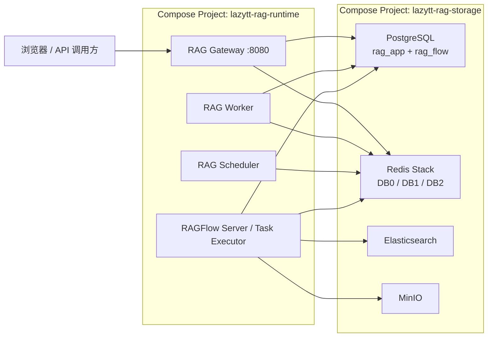
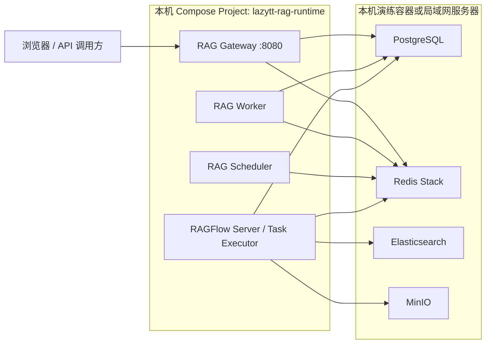

# LazyTT RAG 本地/外部存储切换操作手册

> 历史参考：本文保留改造前的流程与审计说明。2026-09-07 起，部署与 SQL 执行以[当前 ECS 操作入口](../deploy/ecs/README.md)为准；本文旧 `migrations/releases`、Alembic 或一体化安装命令不再执行。旧文件可在 Git 检查点 `335d418` 查阅。

## 1. 文档目的

本文说明如何让同一套 LazyTT RAG 运行时代码在以下两种存储拓扑之间切换：

- `local`：使用本仓库 `docker-compose.storage.yml` 启动的本地存储容器；
- `external`：连接本机模拟服务器或局域网服务器上已经运行的存储服务。

切换只修改 Git 忽略的私有配置 `deploy/local/.env.ragflow`，不修改业务代码，也不修改
RAGFlow 源码。`deploy/local/.env.full` 是启动脚本自动生成的运行环境，禁止手工维护。

本文覆盖 PostgreSQL、Redis Stack、Elasticsearch 和 MinIO 四类存储。适合：

1. 在本机先演练一次外部存储部署；
2. 验证 RAG 运行时可以不依赖本地存储 Compose；
3. 将连接地址改为局域网数据库服务器；
4. 在验收失败时安全回退到原本地存储。

> 当前流程只切换连接，不迁移旧业务数据。`local` 与 `external` 是两套独立数据。
> 切换到空外部存储后，看不到旧知识库和旧文档属于正常现象。

## 2. 最终架构

### 2.1 本地存储模式



本模式中，存储软件由本仓库 Docker Compose 启动，因此需要四个镜像配置。

### 2.2 外部存储模式



本模式中，远端服务器负责安装和运行存储软件。RAG 项目只读取地址、端口、账号和
密码，不读取 PostgreSQL、Redis Stack、Elasticsearch、MinIO 的镜像配置。

## 3. 两种模式的配置读取规则

| 配置 | `local` 模式 | `external` 模式 |
|---|---|---|
| `RAG_STORAGE_MODE` | `local` | `external` |
| `POSTGRES_IMAGE` | 使用；缺失时补固定默认值 | 忽略，不进入 `.env.full` |
| `REDIS_STACK_IMAGE` | 使用；缺失时补固定默认值 | 忽略，不进入 `.env.full` |
| `ELASTICSEARCH_IMAGE` | 使用；缺失时补固定默认值 | 忽略，不进入 `.env.full` |
| `MINIO_IMAGE` | 使用；缺失时补固定默认值 | 忽略，不进入 `.env.full` |
| 存储 Compose | 自动启动 | 不渲染、不启动 |
| 存储连接地址 | 本地 Docker 服务名 | 外部服务器地址 |
| `RAGFLOW_IMAGE` | 必须保留 | 必须保留 |

`RAGFLOW_IMAGE` 不属于存储镜像。无论存储在哪里，RAGFlow Server 和 Task Executor
仍由本项目运行，所以 `RAGFLOW_IMAGE=infiniflow/ragflow:v0.26.4` 必须保留。

即使 `deploy/local/.env.ragflow` 中仍留着四行存储镜像，只要
`RAG_STORAGE_MODE=external`，启动脚本也不会读取或启动这些镜像。为了降低误解，
外部模式建议删除这四行，但删除不是运行所必需的。

## 4. 操作前的安全检查

进入项目目录：

```bash
cd /Users/wx/Lazyai_Project/Lazyai_RAG_Project/lazytt-rag-system
```

确认私有配置存在：

```bash
test -f deploy/local/.env.ragflow && echo "private environment exists"
```

备份当前私有配置，并限制文件权限：

```bash
cp deploy/local/.env.ragflow deploy/local/.env.ragflow.before-storage-switch
chmod 600 deploy/local/.env.ragflow.before-storage-switch
```

确认当前模式：

```bash
awk -F= '$1 == "RAG_STORAGE_MODE" { print $2 }' deploy/local/.env.ragflow
```

停止当前运行时和本地存储：

```bash
./deploy/local/stop-full.sh
./deploy/local/stop-storage.sh
```

以上命令只停止容器，不删除网络或命名卷。禁止执行：

```text
docker compose down -v
```

`-v` 会删除存储卷，可能造成不可恢复的数据丢失。

## 5. 演练一：在本机模拟外部数据库服务器

### 5.1 使用场景

本演练会启动一个完全独立的 Compose Project：

```text
lazytt-rag-external-storage-lab
```

它只包含四个空存储服务，不包含 Gateway、Worker、Scheduler 或 RAGFlow。演练使用
独立端口和独立命名卷，不复用 `lazytt-rag-storage` 的数据。

### 5.2 准备演练配置

```bash
cp deploy/local/external-storage-lab/.env.example deploy/local/external-storage-lab/.env
chmod 600 deploy/local/external-storage-lab/.env
```

编辑文件：

```bash
nano deploy/local/external-storage-lab/.env
```

将所有 `change-me-*` 替换成不同的随机密码。不得把真实密码写入 Git、共享文档、
聊天记录或截图。

演练端口如下：

| 服务 | 宿主机端口 | 容器端口 |
|---|---:|---:|
| PostgreSQL | `15432` | `5432` |
| Redis Stack | `16379` | `6379` |
| Elasticsearch | `19200` | `9200` |
| MinIO API | `19000` | `9000` |
| MinIO Console | `19001` | `9001` |

### 5.3 启动空外部存储

```bash
docker compose \
  --env-file deploy/local/external-storage-lab/.env \
  -f deploy/local/external-storage-lab/docker-compose.yml \
  up -d --wait
```

查看状态：

```bash
docker compose \
  --env-file deploy/local/external-storage-lab/.env \
  -f deploy/local/external-storage-lab/docker-compose.yml \
  ps
```

预期四个服务均为 `healthy`。

### 5.4 PostgreSQL 必须由 DBA 手工安装

Compose 启动后只有演练 DBA 账号和 `postgres` 管理库，不会自动创建业务角色、业务库
或表。四个服务显示 `healthy` 后，DBA 必须按
[`database-deployment-package/DBA_MIGRATION_SIMULATION_RUNBOOK.md`](./database-deployment-package/DBA_MIGRATION_SIMULATION_RUNBOOK.md)
完成以下工作：

1. 审计 `migrations/releases/V1.0.0__fresh_install.sql` 的提交号和 SHA-256；
2. 手工创建唯一业务账号/对象所有者 `lazytt_rag`；
3. 以 `lazytt_rag` 为 Owner 手工创建 `rag_app` 与 `rag_flow`；
4. 安装当前应用和固定 RAGFlow 版本的全部表结构；
5. 验收两个目标 Schema 的所有权、CREATE 权限、表数量与 Revision。

在 DBA 完成上述步骤前，不要切换并启动 RAG Runtime。系统只会只读校验数据库结构，
不会替管理员执行迁移。

### 5.5 验证 Redis Stack

```bash
docker compose \
  --env-file deploy/local/external-storage-lab/.env \
  -f deploy/local/external-storage-lab/docker-compose.yml \
  exec redis-stack sh -lc \
  'redis-cli -a "$REDIS_STACK_PASSWORD" --no-auth-warning PING'
```

预期：

```text
PONG
```

验证 RediSearch 模块存在：

```bash
docker compose \
  --env-file deploy/local/external-storage-lab/.env \
  -f deploy/local/external-storage-lab/docker-compose.yml \
  exec redis-stack sh -lc \
  'redis-cli -a "$REDIS_STACK_PASSWORD" --no-auth-warning MODULE LIST'
```

Redis Stack 的逻辑数据库约定：

| Redis DB | 用途 |
|---:|---|
| `0` | 精确缓存、语义缓存及应用运行状态 |
| `1` | RAGFlow 队列和内部状态 |
| `2` | Celery Broker/Result Backend |

### 5.6 验证 Elasticsearch 和 MinIO

Elasticsearch：

```bash
elastic_password="$(
  awk -F= '$1=="ELASTIC_PASSWORD" {
    sub(/^[^=]*=/, "")
    print
  }' deploy/local/external-storage-lab/.env
)"

curl -fsS \
  -u "elastic:${elastic_password}" \
  http://127.0.0.1:19200/_cluster/health

unset elastic_password
```

MinIO：

```bash
curl -fsS http://127.0.0.1:19000/minio/health/live
```

`<REDACTED>` 表示从私有 `.env` 读取真实值。避免把密码直接写入共享 Shell 历史。

## 6. 将 RAG 运行时切到本机模拟外部存储

### 6.1 只修改私有源配置

打开：

```bash
nano deploy/local/.env.ragflow
```

将存储部分改为：

```dotenv
RAG_STORAGE_MODE=external

APP_DATABASE_DSN=postgresql+psycopg://lazytt_rag:<URL_ENCODED_PASSWORD>@host.docker.internal:15432/rag_app

REDIS_STACK_HOST=host.docker.internal
REDIS_STACK_PORT=16379
REDIS_STACK_PASSWORD=<REDACTED>

RAGFLOW_POSTGRES_HOST=host.docker.internal
RAGFLOW_POSTGRES_PORT=15432
RAGFLOW_POSTGRES_DATABASE=rag_flow
RAGFLOW_POSTGRES_USER=lazytt_rag
RAGFLOW_POSTGRES_PASSWORD=<REDACTED>

RAGFLOW_ES_SCHEME=http
RAGFLOW_ES_HOST=host.docker.internal
RAGFLOW_ES_PORT=19200
ELASTIC_PASSWORD=<REDACTED>

RAGFLOW_MINIO_HOST=host.docker.internal
RAGFLOW_MINIO_PORT=19000
MINIO_USER=lazytt_rag
MINIO_PASSWORD=<REDACTED>

RAGFLOW_API_KEY=
```

注意：

- `APP_DATABASE_DSN` 中的密码必须经过 URL 编码；
- 其他独立密码字段填写原始密码；
- Docker 容器访问宿主机不能填写 `127.0.0.1`；
- macOS/Windows Docker Desktop 使用 `host.docker.internal`；
- 空 `rag_flow` 必须把 `RAGFLOW_API_KEY` 留空，由启动脚本通过官方 API 创建新 Key；
- Chat、Embedding、Vision、Rerank、ASR 配置保持不变；
- 不要手工修改 `deploy/local/.env.full`。

四行存储镜像可以删除：

```text
POSTGRES_IMAGE=...
REDIS_STACK_IMAGE=...
ELASTICSEARCH_IMAGE=...
MINIO_IMAGE=...
```

不删除也不会被外部模式读取。`RAGFLOW_IMAGE` 必须保留。

### 6.2 启动运行时

```bash
./deploy/local/start-full.sh
```

关键预期日志：

```text
runtime and external storage static preflight passed
external storage mode selected; local storage containers were not started
```

启动脚本会依次完成：

1. 生成 `deploy/local/.env.full`；
2. 校验外部存储连接配置；
3. 跳过 `docker-compose.storage.yml`；
4. 使用业务账号只读校验 `rag_app`、`rag_flow` 的 Schema、Revision、对象所有权和
   CREATE 权限；
5. 缺表、版本不符、对象 Owner 不符或缺少 CREATE 权限时立即停止；
6. 启动 RAGFlow Server 和 Task Executor；
7. 使用 RAGFlow 官方 API 创建/复用管理员账号和 API Key；
8. 注册模型 Provider；
9. 以正常 DML 初始化 Profile 与 Redis 语义缓存索引；
10. 启动 Gateway、Worker 和 Scheduler。

启动过程不会执行 Alembic、`CREATE TABLE`、`ALTER TABLE` 或任何 DBA 安装 SQL。

### 6.3 确认本地存储未被读取

```bash
docker compose \
  --env-file deploy/local/.env.full \
  -f deploy/local/docker-compose.storage.yml \
  ps
```

外部模式不应该由 `start-full.sh` 新建或启动本地 storage 容器。已有的旧 storage 容器
可能仍显示在 Docker Desktop 中，但只要之前已执行 `stop-storage.sh`，它们应处于停止
状态，不参与本次运行。

确认自动生成环境中没有四个镜像字段：

```bash
rg '^(POSTGRES_IMAGE|REDIS_STACK_IMAGE|ELASTICSEARCH_IMAGE|MINIO_IMAGE)=' deploy/local/.env.full
```

预期没有输出。

## 7. 演练二：切到局域网外部服务器

### 7.1 外部服务器前置条件

假设服务器地址为 `192.168.31.2`。运维侧必须先完成：

- PostgreSQL 与当前项目兼容；
- 由 DBA 执行受审计 SQL，创建角色、`rag_app`、`rag_flow` 和完整固定版本 Schema；
- 单一业务账号 `lazytt_rag` 持有两个项目数据库及其 Schema/对象，并在目标 Schema
  保留 CREATE，但不具备超级用户、创建角色或创建其他数据库权限；
- Redis 必须是 Redis Stack，包含 RediSearch 模块；
- Elasticsearch 版本、认证和 HTTP 协议与项目配置兼容；
- MinIO API 可访问；
- 服务器防火墙只允许受信 RAG 主机访问对应端口；
- 四个存储均已配置持久化、备份和监控。

本项目当前固定验证基线：

| 存储 | 基线版本/镜像 |
|---|---|
| PostgreSQL | `18.4` |
| Redis Stack | `7.4.0-v8` |
| Elasticsearch | `8.11.3` |
| MinIO | `RELEASE.2026-03-25T00-00-00Z` |

外部服务器不需要使用 Docker，但软件协议和功能必须兼容。版本不同时应先在隔离环境
完成契约测试，不要直接切换生产连接。

### 7.2 从 RAG 主机验证网络

```bash
nc -vz 192.168.31.2 5432
nc -vz 192.168.31.2 6379
nc -vz 192.168.31.2 9200
nc -vz 192.168.31.2 9000
```

端口连通不代表账号、权限和协议正确，仍需逐项做服务级健康检查。

### 7.3 修改连接配置

`deploy/local/.env.ragflow` 示例：

```dotenv
RAG_STORAGE_MODE=external

APP_DATABASE_DSN=postgresql+psycopg://lazytt_rag:<URL_ENCODED_PASSWORD>@192.168.31.2:5432/rag_app

REDIS_STACK_HOST=192.168.31.2
REDIS_STACK_PORT=6379
REDIS_STACK_PASSWORD=<REDACTED>

RAGFLOW_POSTGRES_HOST=192.168.31.2
RAGFLOW_POSTGRES_PORT=5432
RAGFLOW_POSTGRES_DATABASE=rag_flow
RAGFLOW_POSTGRES_USER=lazytt_rag
RAGFLOW_POSTGRES_PASSWORD=<REDACTED>

RAGFLOW_ES_SCHEME=http
RAGFLOW_ES_HOST=192.168.31.2
RAGFLOW_ES_PORT=9200
ELASTIC_PASSWORD=<REDACTED>

RAGFLOW_MINIO_HOST=192.168.31.2
RAGFLOW_MINIO_PORT=9000
MINIO_USER=lazytt_rag
MINIO_PASSWORD=<REDACTED>

RAGFLOW_API_KEY=
```

如果服务器使用 TLS、反向代理或非默认端口，必须填写运维提供的真实协议与端口。
不要根据示例自行猜测。

### 7.4 启动

```bash
./deploy/local/start-full.sh
```

外部模式的启动、初始化和验收逻辑与本机演练完全相同。

## 8. 完整验收步骤

### 8.1 容器与服务健康

```bash
docker compose \
  --env-file deploy/local/.env.full \
  -f compose.local.yml \
  ps
```

确认以下服务正常：

- `ragflow-server`；
- `ragflow-task-executor`；
- `rag-gateway`；
- `rag-worker`；
- `rag-scheduler`。

检查 Gateway：

```bash
curl -fsS http://127.0.0.1:8080/health/live
curl -fsS http://127.0.0.1:8080/health/ready
```

浏览器入口：

- Gateway Swagger：<http://127.0.0.1:8080/docs>
- RAGFlow 管理界面：<http://127.0.0.1:8081>

### 8.2 身份隔离验收

当前开发联调模式使用两个请求头：

```http
X-Tenant-ID: acceptance-tenant-a
X-User-ID: acceptance-user-a
```

公开健康接口不要求这两个请求头。知识库、文档、检索和问答等业务接口必须携带。

### 8.3 创建知识库

在 Swagger 或 API 客户端中调用：

```http
POST /v1/knowledge-bases
```

至少填写：

```http
X-Tenant-ID: acceptance-tenant-a
X-User-ID: acceptance-user-a
Idempotency-Key: external-storage-kb-001
```

请求体中的 Profile 使用系统当前 `/v1/capabilities` 或开发控制台展示的有效值，
不要填写 `string` 占位符。

### 8.4 上传、解析和检索

1. 上传一个最小非业务 DOCX 或 PDF；
2. 启用自动解析；
3. 记录 `document_id` 和 `job_id`；
4. 查询 Job，等待 `SUCCEEDED`；
5. 查询文档，确认状态为 `READY`；
6. 确认 `chunk_count > 0`；
7. 确认结构化 metadata 已生成；
8. 执行 `/v1/retrieval/query`；
9. 确认返回真实 Chunk 和引用来源；
10. 执行普通问答和 SSE 流式问答。

### 8.5 Redis 缓存与队列

至少验证：

- 相同请求可命中精确缓存；
- 语义缓存可写入且维度正确；
- 不同 `X-Tenant-ID + X-User-ID` 不能复用对方缓存；
- Worker 能消费文档解析任务；
- Scheduler 启动后无 Redis 连接错误。

### 8.6 重启验证

```bash
./deploy/local/stop-full.sh
./deploy/local/start-full.sh
```

确认重启后：

- 知识库和文档仍存在；
- 已解析文档仍可检索；
- RAGFlow API Key 和模型配置仍有效；
- Redis 索引仍可用；
- 不会重新启动本地 storage Compose。

## 9. 回退到本地存储

### 9.1 停止外部模式运行时

```bash
./deploy/local/stop-full.sh
```

### 9.2 恢复原私有配置

```bash
cp deploy/local/.env.ragflow.before-storage-switch deploy/local/.env.ragflow
chmod 600 deploy/local/.env.ragflow
```

或手工恢复以下核心内容：

```dotenv
RAG_STORAGE_MODE=local
REDIS_STACK_HOST=redis-stack
REDIS_STACK_PORT=6379
RAGFLOW_POSTGRES_HOST=postgres
RAGFLOW_POSTGRES_PORT=5432
RAGFLOW_ES_SCHEME=http
RAGFLOW_ES_HOST=elasticsearch
RAGFLOW_ES_PORT=9200
RAGFLOW_MINIO_HOST=minio
RAGFLOW_MINIO_PORT=9000
```

本地 PostgreSQL 的 `APP_DATABASE_DSN` 会由环境生成脚本根据本地账号生成，不应保留
外部服务器地址。

### 9.3 启动本地模式

```bash
./deploy/local/start-full.sh
```

本地模式会先启动 `lazytt-rag-storage`，等待存储健康，再启动
`lazytt-rag-runtime`。原命名卷未被删除，因此原本地知识库和文档重新可见。

### 9.4 停止本机演练服务器

```bash
docker compose \
  --env-file deploy/local/external-storage-lab/.env \
  -f deploy/local/external-storage-lab/docker-compose.yml \
  stop
```

该命令保留演练数据。禁止为了省事使用 `down -v`。

## 10. 常见故障与处理

### 10.1 `external storage ... must be configured`

原因：外部模式缺少连接地址、端口、账号或密码。

处理：只修改 `deploy/local/.env.ragflow`，补齐错误消息点名的字段，再运行：

```bash
./deploy/local/start-full.sh
```

### 10.2 容器访问 `127.0.0.1` 失败

原因：容器里的 `127.0.0.1` 指向容器自身，不是 Mac 宿主机。

处理：

- 本机演练使用 `host.docker.internal`；
- 局域网服务器使用服务器真实 IP 或稳定 DNS 名称。

### 10.3 PostgreSQL 密码正确但 DSN 无法解析

原因：密码中含 `@`、`:`、`/`、`#`、`%` 等 URL 保留字符。

处理：只对 `APP_DATABASE_DSN` 中的密码做 URL 编码。单独密码字段仍填原值。

### 10.4 RAGFlow 登录成功但 API Key 无效

原因：切到新的空 `rag_flow` 后仍沿用旧数据库生成的 API Key。

处理：停止运行时，将私有配置中的 `RAGFLOW_API_KEY` 清空，再执行
`./deploy/local/start-full.sh`。脚本会使用官方 API 创建并验证新 Key。

### 10.5 Redis 能 `PING`，但语义缓存初始化失败

原因：外部服务是普通 Redis，没有 RediSearch 模块，或账号没有模块命令权限。

处理：使用 Redis Stack，并确认 `MODULE LIST` 包含搜索模块。当前系统不能把普通
Redis 当成语义缓存后端。

### 10.6 Elasticsearch 连接成功但 RAGFlow 不可用

检查：

- 版本是否兼容；
- `RAGFLOW_ES_SCHEME` 是否正确；
- 密码是否属于 `elastic` 账号或运维分配账号；
- 是否启用了 HTTPS；
- 容器是否信任自签证书；
- 外部集群是否允许创建索引和 Mapping。

### 10.7 MinIO 健康但上传失败

检查：

- API 端口与 Console 端口是否填反；
- 运行账号是否有 Bucket/Object 权限；
- 反向代理是否限制上传大小；
- 服务时间是否同步；
- MinIO 使用的是 API 地址而不是浏览器 Console 地址。

### 10.8 切换后看不到旧数据

原因：连接到了另一套空存储。这不是数据丢失，也不是缓存问题。

处理：

- 若只是验证切换，继续创建最小非业务 Fixture；
- 若要恢复旧数据，按第 9 节切回原本地存储；
- 若要保留并迁移旧数据，需要单独执行数据迁移方案，不属于本文范围。

## 11. 安全要求

- `deploy/local/.env.ragflow`、`deploy/local/.env.full` 和演练 `.env` 必须保持 Git 忽略；
- 文档、命令示例和截图统一使用 `<REDACTED>`；
- 不向聊天、日志或 Git 输出完整密码、API Key、JWT 或私钥；
- 外部 PostgreSQL、Redis、Elasticsearch、MinIO 仅允许受信主机访问；
- 生产环境应启用 TLS、最小权限账号、备份、监控和告警；
- Redis 合并实例在生产中应进一步使用 ACL，而不只依赖逻辑 DB；
- RAGFlow 管理界面继续只绑定 `127.0.0.1:8081`；
- Gateway 若绑定 `0.0.0.0:8080`，应由外层网关、防火墙或 Identity 系统限制访问。

## 12. 切换行为总结

### 12.1 可以做到

- 同一份代码切换本地或外部存储；
- 外部模式完全不启动本地存储 Compose；
- 外部模式不要求四个存储镜像字段；
- 只通过私有连接配置切到局域网服务器；
- 在不删除本地卷的情况下安全回退；
- 通过独立本机 Compose 演练空外部存储。

### 12.2 不会自动做到

- 不会在切换时复制旧业务数据；
- 不会热切换正在运行的数据库连接；
- 不会替外部服务器安装存储软件；
- 不会创建 PostgreSQL 角色、数据库、Schema 或表；
- 不会自动执行 Alembic 或 DBA 安装 SQL；
- 不会自动修改外部服务器防火墙、账号权限、TLS 或备份策略；
- 不会验证未经测试的数据库大版本兼容性。

因此，每次切换的标准顺序是：

```text
停止 runtime
  → 修改 deploy/local/.env.ragflow
  → 启动或确认目标存储
  → ./deploy/local/start-full.sh
  → 健康检查
  → 上传/解析/检索/问答 Smoke
  → 重启验证
```

## 13. 相关文档

- [本机外部存储迁移演练](./LOCAL_EXTERNAL_STORAGE_REHEARSAL.md)
- [DBA 主导的空数据库迁移模拟验收](./database-deployment-package/DBA_MIGRATION_SIMULATION_RUNBOOK.md)
- [外部存储部署手册](./EXTERNAL_STORAGE_DEPLOYMENT_RUNBOOK.md)
- [部署目录说明](../deploy/local/README.md)
- [用户手册](./USER_MANUAL.md)
